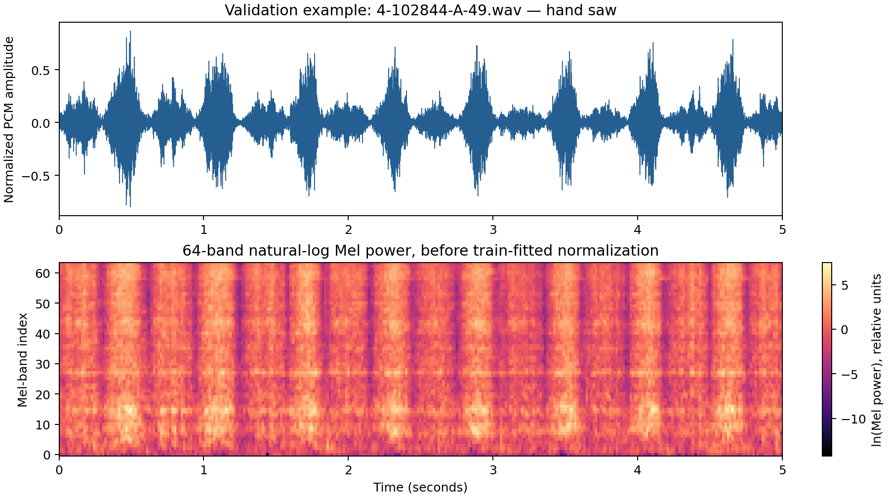

# ESC-50 研究：中文内容说明与使用指南

编写日期：2026年10月28日。本指南解释所提供项目的实际实现；本次 Colab 到底完成了哪些实验、测到了什么，请阅读[中文结果报告](../../reports/matrix_20261028/report_zh.md)。实验配置、软件测试、历史保存结果和本次新训练，是不同层次的证据。

## 1. 这项研究究竟在解决什么？

输入一段五秒录音，输出狗叫、雨声、敲门声、飞机等50个类别中的一个。模型对**整段录音给出一个类别**，并不标出声音发生的时间，也不分离重叠声音。遇到50类以外的声音，现有分类器也不能可靠地识别为“未知”。

研究围绕三个问题展开：改变模型结构是否有帮助；改变训练增强是否有帮助；改变声音表示和采样率是否有帮助。比较时需要控制其他条件，否则分数变化不能归因于某一个因素。

ESC-50 有2,000段录音，每类40段，官方分成五个 fold。本项目开发协议使用 folds 1–3 训练、fold 4 验证、fold 5 作为指定测试角色。metadata 显示，部分原始录音来源 ID 跨越了 fold；按代码的 source-strict 优先级排除冲突后，得到**1,200段训练、398段验证、400段测试角色录音**，其中两段验证录音被排除。同源 ID 意味着需要防止来源泄露，不等于已证明两个音频片段完全相同。

训练集用于更新模型参数，验证集用于选 checkpoint 和比较方案，测试集应回答预先明确的最终问题。**历史研究已经访问 fold 5，也轮换评价过其他 fold。** 当前实验矩阵不评价 fold 5；新的验证分数不能重新创造一个从未见过的独立确认集。本协议也不是标准的“四折训练、一折测试” benchmark，因此不能直接拿它与论文排行榜数字比较。

## 2. 为什么可以用 CNN 处理声音？

主模型与增强实验的输入通路是：

```text
五秒 WAV → 单声道、16 kHz → 80,000个采样点
         → STFT 功率谱 → 64个 Mel 频带 → 自然对数
         → 仅用训练录音拟合的归一化
         → [batch, 1, 64, 313]
```

波形描述振幅随时间变化。STFT 把波形切成相互重叠的短窗口，观察每个局部区间包含哪些频率。窗口长512点，即32 ms；相邻窗口间隔256点，即16 ms，使用中心填充。Mel filterbank 将相近频率组合成64个频带；取对数压缩功率数值范围。归一化统计量只从训练录音估计，不能拿验证或测试录音来拟合。

张量 `[batch, 1, 64, 313]` 依次表示批大小、一个输入通道、64个频带、313个时间帧。它是一张“时间×频率”的表示，CNN 因而可以寻找局部声学图案。CNN 内部的 channel 是学到的特征图，不是左右声道。

三个 convolution → BatchNorm → ReLU → max-pooling 阶段使用16、32、64个特征通道。主输入经过 encoder 后得到 `[batch, 64, 8, 39]`。

## 3. CNN、BiGRU 和 Attention 分别做什么？

| 矩阵中的模型名 | encoder 之后的实际计算 | 要回答的问题 |
| --- | --- | --- |
| `cnn_freq` | 时间平均，保留“通道×频率位置”，再线性分类 | 小 CNN 能做到什么水平？ |
| `crnn_freq` | 每个时刻展平为512维，送入 BiGRU，平均39个输出 | 利用前后文顺序有没有帮助？ |
| `crnn_freq_ta` | 同样的 BiGRU，以 temporal attention 替代时间平均 | 学习哪些时刻更重要有没有帮助？ |
| `crnn_freq_ca` | 在 BiGRU 之前加入 channel attention，之后时间平均 | 重新分配特征图权重有没有帮助？ |
| `crnn_freq_tca` | 同时使用 channel 和 temporal attention | 两种加权结合是否有帮助？ |

BiGRU 沿正向、反向读取**已经录好的整段声音**，每个方向 hidden size 为64，输出 `[batch, 39, 128]`。它适合离线片段分类；这里没有建立实时、因果的流式识别证据。

Temporal attention 为每个时刻输出一个分数，在时间轴上做 softmax，再计算加权平均：`Σ_t α_t h_t`。权重满足 `α_t ≥ 0`、`Σ_t α_t = 1`。初始化时分数相同，因此起点就是均值池化。例如三个时刻的权重为0.1、0.8、0.1，中间时刻贡献更大；三个权重相等就退化为普通平均。Attention 权重描述模型怎样组合特征，并不能直接证明它找到了真实声源或给出了可靠因果解释。

Channel attention 先对每个 encoder channel 的时间与频率位置求平均，经64 → 8 → 64的小 MLP，再乘上 **2×sigmoid** 门控。门控初始化为1，因此初始不改变特征；其范围是0–2，而非0–1。这是轻量的 SE-style 改编，并非对某篇 Attention 论文的逐项复现。更复杂的结构只是研究假设，是否更好必须看受控实验。

## 4. 为什么矩阵共有65项？

| 组别 | 项数 | 内容 |
| --- | ---: | --- |
| A：传统 baseline | 2 | Log-Mel 时间均值/标准差 + logistic regression；DCT 倒谱统计 + linear SVM |
| B：模型结构 | 15 | 上述五种模型 × seeds 101、202、303 |
| C：数据增强 | 9 | CNN 分别使用 SpecAugment、Gaussian noise、waveform Mixup × 三个 seed |
| D：特征与采样率 | 36 | 十二种特征/采样条件 × 三个 seed，使用独立的频率全局池化 `cnn` |
| E：鲁棒性 | 3 | 用 seed101 的干净 CNN、干净 GRU、加噪训练 CNN，分别做验证集扰动测试 |

Baseline 用于判断深度模型增加的复杂度是否值得。Logistic baseline 将64个 Mel 频带各自沿时间取均值和标准差，得到128维向量。SVM baseline 先对64维 Log-Mel 做正交 DCT-II，取前20个系数，再取时间均值和标准差，得到40维向量；这是项目自定义倒谱 baseline，不是 Piczak SVM 系统的复现。

主神经网络训练配方是60 epochs、batch size 32、AdamW 初始学习率0.001、weight decay 0.0001、cosine 衰减和梯度裁剪。**checkpoint 按最低验证 cross-entropy 选择，并非按最高验证 accuracy 选择。** 不同 seed 改变初始化和训练随机性；三个 seed 可以观察稳定性，但不代表三个独立数据集。

SpecAugment 在训练时遮挡归一化特征的部分时间和频带。Gaussian noise 以0.5概率对每条训练波形加噪，added-noise SNR 从10–30 dB采样。Mixup 以 Beta(0.4,0.4) 系数混合训练波形，损失使用两个标签 cross-entropy 的加权和。例如0.7份狗叫与0.3份雨声混合，训练目标也应保留0.7/0.3的软标签，而不是简单标成“狗”。选 checkpoint 时验证集仍保持干净。

E组另测干净声音、20/10/0 dB白噪声，以及−6/+6 dB增益变化。0 dB表示添加的噪声与原录音 RMS 功率相同；扰动按每段录音缩放且不做峰值裁剪。这能检验一种明确的人工扰动，不能代表对所有房间、麦克风、交通噪声或现实环境都鲁棒。

## 5. 十二种特征实验如何理解？

D组将四种表示与三种条件组合：

| 条件 | 采样率 | 分析频率上限 | FFT / hop |
| --- | ---: | ---: | ---: |
| SR16–F8 | 16 kHz | 8 kHz | 512 / 256点 |
| SR32–F8 | 32 kHz | 8 kHz | 1,024 / 512点 |
| SR32–F16 | 32 kHz | 16 kHz | 1,024 / 512点 |

每种条件仍为五秒、32 ms窗口、16 ms hop、313帧。四种表示是64维 Log-Mel、32维 Log-Mel、对64维 Log-Mel 取前40个 DCT-II 系数的 `mfcc40`，以及64个线性频率三角滤波器的对数功率。这里的 MFCC 约定不做 liftering，也不额外替换第0系数。

SR16–F8 与 SR32–F8 分析带宽都到8 kHz，因此后者没有增加8 kHz以上的信息。SR32–F8 与 SR32–F16 增加高频带，但在频带数量不变时也改变了滤波器间距。这些是有明确边界的具体对照，不能直接推出“采样率越高越好”。

D组用的是频率全局池化 `cnn`，因此32、40、64行输入都保持同样的可训练参数量。它与B组的 `cnn_freq` **不是同一结构**。研究特征作用应在D组内部比较；B组和D组的差异同时包含结构变化。D组 checkpoint 也需要各自的前端，不能直接交给旧的普通 `predict` 命令处理。

## 6. 结果里的 Accuracy 和 Macro-F1 是什么？

Accuracy 是“预测正确的录音数÷全部评价录音数”。例如398条验证录音中正确280条，accuracy 为70.35%；改变一条预测就会改变约0.251个百分点。

Macro-F1 先对50个类别各算 F1，再等权平均。某一类别的 precision 为 `TP/(TP+FP)`，recall 为 `TP/(TP+FN)`，F1 为 `2TP/(2TP+FP+FN)`；该实现对零分母类别记零。它能补充发现“总体分数看起来还行，但某些类别几乎不会识别”的问题。JSON中的指标通常是0–1小数，报告一般转换成百分数，两者不能混淆。

从70%升到72%是提高**2个百分点**，不是相对提高2%。应同时看三个 seed 的结果、均值和波动，干净/扰动表现，以及失败或中断记录。只挑最高分 seed 会夸大效果。即使不对验证集反向传播，反复用同一398条录音挑方案，也可能让整个开发过程对验证集过拟合。

## 7. 文件应该按什么顺序看？

| 文件或目录 | 负责什么 |
| --- | --- |
| `notebooks/templates/ESC50_Colab_Research_Console.ipynb` | 预览计划、pilot和选定任务执行控制台 |
| `configs/colab_study_matrix_v1.json` | 已登记任务清单；与用户提供的独立 JSON 一致 |
| `src/esc50_sound/audio.py`、`data.py` | 声音前端、数据获取、划分、归一化 |
| `models.py`、`training.py`、`augmentation.py` | 结构、训练和仅训练时使用的增强 |
| `baseline.py`、`cepstral.py` | 两种传统分类器 |
| `feature_ablation.py`、`scripts/feature_ablation.py` | 独立特征实验与对应命令入口 |
| `evaluation.py`、`inference.py` | 数据集评价与单条新录音预测 |
| `study.py` | 鲁棒性与受控诊断 |
| `results/matrix_20261028/` | 本次执行保存的证据，具体覆盖以结果报告为准 |
| `results/historical/final_study/`、旧notebook和模型包 | 历史证据，不自动等于本次重跑 |

Scheduler、registry、platform 是可选研究组织工具，不是让模型分数提高的算法证据。PANNs、AST、BEATs、CLAP和reinforcement learning 仍是尚未集成的未来项，没有相应可运行任务或分数。

## 8. 怎样运行、怎样恢复？

在项目根目录，主训练通路可直接运行：

```bash
python -m pip install -e '.[dev,baseline,report]'
python -m esc50_sound prepare --root data/ESC-50 --cache data/esc50_features.npz
python -m esc50_sound preflight --root data/ESC-50 --cache data/esc50_features.npz
python -m esc50_sound train --model crnn_freq_ta --seed 101 --epochs 60 \
  --scheduler cosine --device cuda --max-seconds 3600 \
  --output runs/new_ta_seed101
```

控制台的 `plan` 只预览；`pilot` 用独立目录做短运行；`selected` 执行选定的登记任务。两轮 pilot 只能验证通路，不能当作最终研究质量。按从上到下的顺序运行 cell，设置明确任务数量和时间上限，并保存每次输出目录。

对于**新版主训练**在完整 epoch 边界的中断，可以运行：

```bash
python -m esc50_sound resume-train --output runs/new_ta_seed101 --max-seconds 3600
```

`last.pt` 保存最近完整 epoch、optimizer和随机状态；`best.pt` 保存验证选中的推理模型。恢复使用 `last.pt`，要求代码、数据、环境兼容；旧推理 checkpoint 不能凭空变成可恢复训练的 checkpoint。特征实验通路不支持 epoch-resume，应保留中断目录，检查后以新运行标识开始。

Colab 的 `/content` 是临时存储。长任务期间就应下载已完成的日志、预测和权重；使用 Drive 时先验证文件写入及恢复行为。仅保存 notebook 不等于保存 runtime 中的全部文件。实际导出了什么，以本次结果报告为准。判断研究结论时，应依赖完整训练记录和重新核算的逐样本预测，而不是只看一个“completed”标签。

## 9. 原始资料与阅读边界

数据定义来自 [ESC-50 官方仓库](https://github.com/karolpiczak/ESC-50)，GRU 接口来自 [PyTorch 2.11 文档](https://docs.pytorch.org/docs/2.11/generated/torch.nn.GRU.html)。[Squeeze-and-Excitation](https://arxiv.org/abs/1709.01507) 提供通道重标定思想；[SpecAugment](https://arxiv.org/abs/1904.08779) 与 [mixup](https://arxiv.org/abs/1710.09412) 是增强方法的原始论文。本轮核验了这些页面的原始摘要/元信息；项目细节以实际源码为准。这里的通道门控、无 time-warp 的掩码与 waveform Mixup 均是具体改编，不声称完整复现原论文，也不以这些引用证明本项目的实验收益。




图中是同一条验证录音的波形与归一化之前的Log-Mel；纵轴为Mel频带索引，不是CNN通道。
