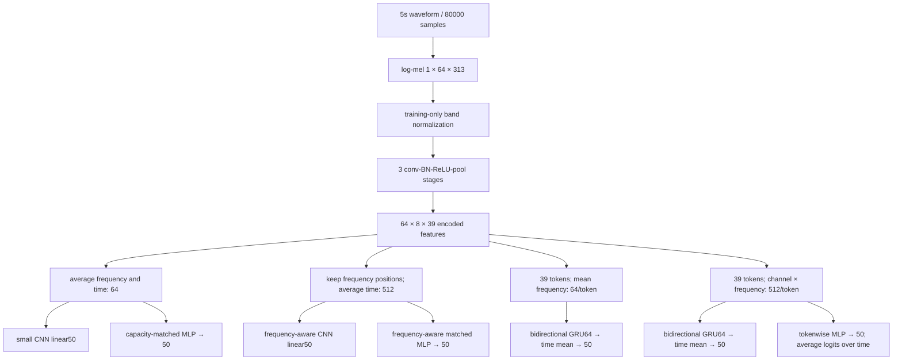

# Model, signal representation and experimental meaning

## Signal and coordinates

Known input is a finite mono audio waveform of nominal duration5seconds. The model sample rate is16,000 samples/second, so the waveform has80,000 samples after resampling and right padding (or the research loader's documented center crop). The user-facing classifier rejects longer-than-five-second audio rather than silently choosing a window. Waveform values represent digital amplitude; they are not calibrated sound pressure in pascals. Frequency is in hertz, time in seconds. Labels are one categorical target among50 ESC-50 classes, not a multilabel sound-event annotation.

For waveform x[n], define an STFT with Hann window length512, hop256 and centered reflection padding. Each frame spans32ms and adjacent frame centers are16ms apart. The one-sided Fourier transform has257 bins. Magnitude-squared gives power-like digital-amplitude units. A64×257 HTK triangular mel filterbank integrates these bins; the implementation takes natural logarithm after flooring values at1e-10. No physical SPL or decibel claim follows from this log transform.

With centered padding, the number of time frames is `1 + floor(80000 / 256) = 313`. Thus one clip becomes `[1,64,313]`: channel, mel frequency, time. Halving waveform amplitude divides squared magnitude by4, so active log-power bins decrease by `ln(4)`: `L(x/2)−L(x)=−ln(4)`. This identity and finite behavior for silence are verified. The log floor prevents numerical infinities; it does not give semantic meaning to silent input. The deployed classifier abstains on near-silent waveforms.

For each mel band, the mean and population standard deviation are fitted over **actual training clips and time**, after source exclusions. Statistics have shape `[1,1,64,1]`, then broadcast over batches and time. Held-out clips are transformed using these fixed statistics. The cache contains deterministic per-clip features; it does not contain fitted all-data normalization. Its sidecar binds frontend settings, cache bytes and metadata alignment. Checkpoints bind the fitted statistics, class ordering, model configuration and source-policy manifest.

## Shared encoder and different heads

Each encoder stage uses3×3 stride-one convolution, BatchNorm, ReLU and2×2 max pooling. Channel widths are16,32,64. Frequency sizes are64→32→16→8 and time sizes313→156→78→39. There are23,408 trainable encoder parameters. A nonrecurrent full-clip average can summarize evidence over all five seconds, but cannot preserve the sequence of encoded features. This is different from saying that its receptive field covers only a short duration.

With fixed BatchNorm statistics at evaluation, one final encoder token's local receptive field spans22 frontend frames: start with size1/jump1, then apply3×3 convolution and2×2 pooling three times to obtain sizes3,4,8,10,18,22 and final jump8. Including the STFT window, the audio span is approximately `(22−1)×16 + 32 = 368ms`. Global pooling combines all39 time tokens; GRU adds order-sensitive interactions among them. Boundaries and reflection padding require caution when interpreting this approximate interior span. During training, BatchNorm moments depend on batch/time/frequency values, so this local convolution/pooling support is not the complete training-time dependency graph.

| Model | Head input | Trainable parameters | Modeling consequence |
|---|---|---:|---|
| cnn | pooled64 | 26,658 | Removes direct frequency position and token order at the head |
| crnn | 39×64 | 79,778 | Recurrent temporal aggregation after frequency averaging |
| cnn_matched | pooled64, MLP hidden490 | 79,808 | Nonrecurrent head capacity within0.04% of crnn |
| cnn_freq | pooled512 | 49,058 | Keeps eight frequency positions; removes encoded token order |
| crnn_freq | 39×512 | 251,810 | Recurrent temporal aggregation while retaining frequency positions |
| cnn_freq_matched | pooled512, MLP hidden406 | 252,036 | Nonrecurrent head capacity within0.1% of crnn_freq |
| cnn_freq_token | 39×512, shared MLP hidden406, then mean logits | 252,036 | Nonlinear token processing without recurrent state or token-order sensitivity |

For a GRU direction with input i and hidden size h, PyTorch's three gates use `3hi + 3h² + 6h` parameters, counting separate input/recurrent biases. Bidirectionality doubles this. With h64 and i512, the recurrent block has221,952 parameters. Adding encoder23,408 and a128→50 head6,450 yields251,810, matching the measured count. Sanity check: preserving frequency increases recurrent input width from64 to512, so recurrent input weights and total parameters increase; it is not a free optimization.

The tokenwise MLP applies the same nonlinear head to each encoded token before averaging its logits. In general `mean(g(z_t))` differs from `g(mean(z_t))`, so it is a stronger nonrecurrent competitor than only enlarging a pooled head. The matched pooled and tokenwise variants share the same parameter layout and initial weights for a fixed seed, but dropout masks operate at different granularity during training; their difference is not a pure pooling-only causal intervention.

All heads return50 logits. Categorical cross-entropy is `−log softmax(logits)[target]`. A uniform50-way model has loss `ln(50)≈3.912` and expected accuracy2%. These are mathematical reference values, not a competitive learned baseline. A train-only standardized128-dimensional temporal-statistics logistic classifier is the cheap empirical anchor.

## Recurrent state and its assumptions

For one clip, the frequency-preserving encoder supplies39 ordered vectors `v_t ∈ R^512`. Each GRU direction has a64-dimensional state, initialized to zero for each clip. With learned matrices `A_* ∈ R^(64×512)`, `B_* ∈ R^(64×64)` and64-dimensional biases, the implemented update is

\[
r_t=\sigma(A_rv_t+a_r+B_rh_{t-1}+b_r),\quad
u_t=\sigma(A_uv_t+a_u+B_uh_{t-1}+b_u),
\]
\[
n_t=\tanh(A_nv_t+a_n+r_t\odot(B_nh_{t-1}+b_n)),\qquad
h_t=(1-u_t)\odot n_t+u_t\odot h_{t-1}.
\]

Here sigmoid gates lie in `[0,1]`, and multiplication is elementwise. As a limiting check, `u_t=1` retains the previous state; `u_t=0` replaces it with the candidate. These equations follow [PyTorch2.11's GRU convention](https://docs.pytorch.org/docs/2.11/generated/torch.nn.GRU.html), including reset multiplication after the recurrent affine map.

The reverse direction processes the tokens in reverse. Concatenating directions gives39×128 features; averaging time and applying dropout/linear projection yields50 logits. Bidirectionality assumes the complete clip is available, so this is offline classification, not causal streaming. Gating permits state retention; it does not guarantee that training learns a useful long-range dependency. That is an empirical question addressed by the controls.

## What the comparisons can establish

Within a representation regime, compare CRNN with both the small and parameter-comparable nonrecurrent heads under the same actual training clips, optimizer/data-exposure budget and validation-selection opportunities. Matched parameter counts do not match FLOPs, optimizer dynamics, regularization or latency; those are reported separately. Cross-regime comparisons also change representation and capacity and remain development evidence rather than a clean single-factor causal estimate.

During the order probe, a deterministic permutation is applied **after the encoder**, before the recurrent head. Nonrecurrent heads are invariant to this operation; the recurrent head can change. A drop establishes dependence on order under that intervention. Since shuffled encoded sequences are out of the training distribution, a drop alone does not prove that temporal order caused an improvement on natural audio. Capacity controls and unshuffled generalization results remain necessary.

Training readouts distinguish online optimization loss (changing weights, training-mode dropout/BatchNorm) from end-of-epoch evaluation-mode training and validation metrics. The checkpoint rule is fixed minimum validation cross-entropy, earliest tie. If a later epoch has higher accuracy but worse cross-entropy, it is not silently substituted as the selected checkpoint. All epoch results and actual exposure remain inspectable.

## Stress and efficiency measurements

Additive noise uses a deterministic zero-mean Gaussian vector normalized to unit RMS for each clip/condition. At requested SNR s dB, noise RMS is `signal_RMS / 10^(s/20)`, because SNR uses power ratio and power is squared amplitude. Tests verify the realized ratio. Stress conditions20,10,0dB and gains−6/+6dB use no peak clipping and one registered noise realization per clip/condition. This measures synthetic-corruption sensitivity on ESC-50; it cannot establish real-world acoustic robustness, multiple simultaneous source handling or microphone independence.

CPU batch-one latency separates cached-feature model inference from WAV read→resample→log-mel→normalization→logits. Warmup, repetitions, actual hardware, thread count and percentiles are recorded. Repeating one WAV warms the operating-system file cache; these figures exclude model loading and are not service latency. GPU training time cannot establish CPU inference efficiency, and CPU timing cannot establish CUDA performance.
