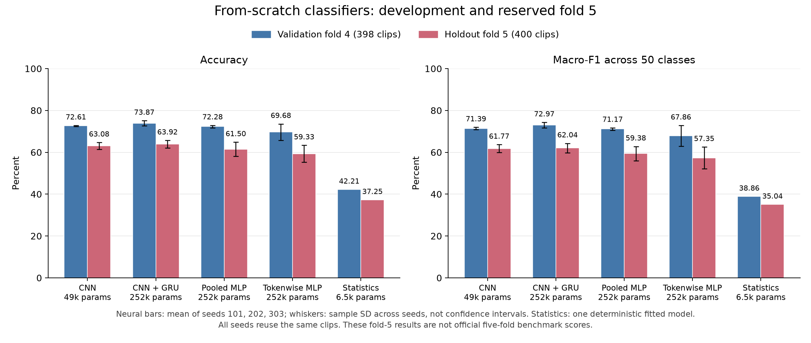
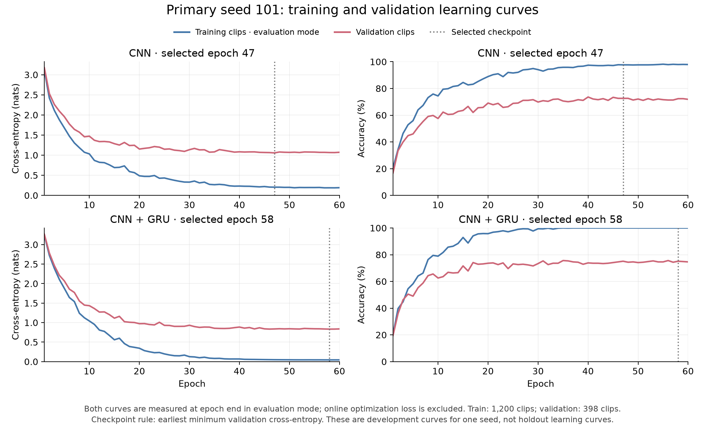
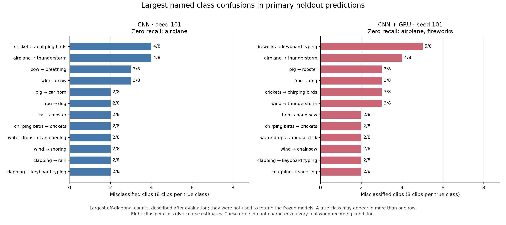
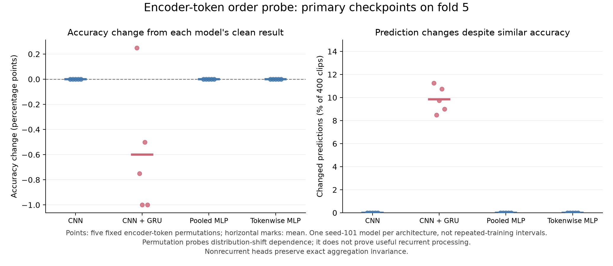
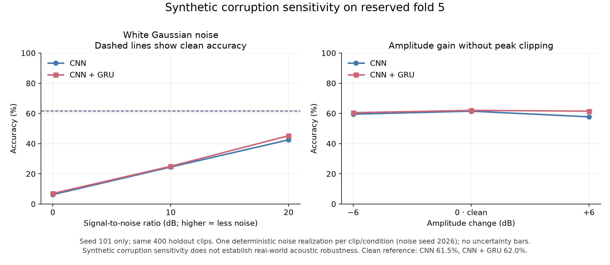
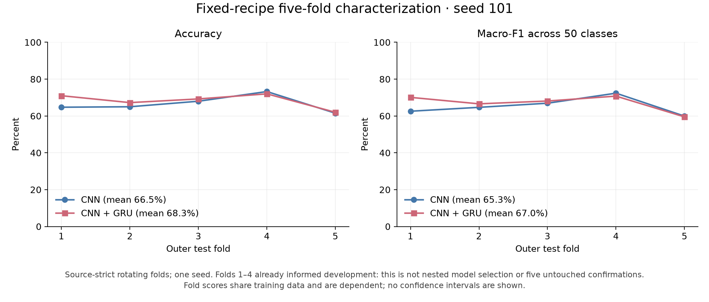

# ESC-50: does recurrent aggregation justify its cost?

Completed study, 28 October 2026. Agent-produced research and implementation, with separate internal verification. This is a from-scratch comparison on one public dataset; it makes no new-architecture, state-of-the-art, institutional-affiliation or learner-mastery claim.

## Findings and delivery decision

The small CNN is the frozen default. CNN+GRU improved mean development accuracy by **1.26 percentage points**, below the predeclared 3-point practical preference. On the reserved fold 5, their three-seed means were **63.08% and 63.92%**. The primary seed 101 checkpoints scored **61.50% and 62.00%**. These results establish a working classifier and modest recurrent gains within this setup; they do not establish recurrent superiority.

The model is efficient under the measured workload, but **noise robustness was not achieved**: the default CNN fell to 42.50% accuracy at 20 dB Gaussian-noise SNR and 6.25% at 0 dB. Its primary fold 5 airplane recall was 0/8. The deliverables are research prototypes with these limitations made explicit.

A fixed-recipe, one-seed rotation across five outer folds gave 66.50% CNN and 68.30% CNN+GRU mean accuracy. Folds 1–4 had already informed development, so this is descriptive characterization rather than five untouched confirmations or a fully nested estimate of the adaptive development process. No model selection was changed after test access.

## Question, hypotheses and scope

The question was whether a bidirectional GRU adds enough value to justify its extra parameters and computation when the frontend, encoder, actual training clips, maximum exposure and checkpoint rule are fixed. The competing explanation is that local time–frequency texture and nonlinear nonrecurrent heads already provide enough information. Extra capacity, optimization and selection variation can also explain an apparent gain.

The study compares a small pooled CNN, a parameter-comparable pooled MLP, a shared tokenwise MLP and a CNN+GRU. The tokenwise model applies its nonlinearity before averaging; it is a stronger nonrecurrent control than only enlarging an already pooled head. Equal parameter counts do not match FLOPs, dropout granularity or optimization. An RNN-only model was considered in the initial source audit but was not part of the final controlled study; the recurrence question here concerns aggregation on a shared convolutional encoder.

These are established families. [Qiao et al. 2019](https://arxiv.org/pdf/1908.05863) provides a directly relevant historical CNN/CRNN comparison; [Çakır et al. 2017](https://arxiv.org/pdf/1702.06286) motivates retaining frequency identity before recurrence, on a different detection task. [Salamon and Bello 2017](https://arxiv.org/pdf/1608.04363) studies augmentation on UrbanSound8K. Their reported scores are not interchangeable with this protocol. The [full-text audit](../../docs/methodology/literature_deep_read.md) records reading depth and unresolved source limitations; it is not an exhaustive 2026 novelty search or a reproduction of those papers.

## Data and evaluation boundary

ESC-50 is pinned to commit `33c8ce9eb2cf0b1c2f8bcf322eb349b6be34dbb6`: 2,000 five-second recordings, 50 categories and five official folds of 400 clips. No external pretrained weights or data were used. The official metadata and license are retained; the dataset is distributed overall under CC BY-NC 3.0. See [the official repository](https://github.com/karolpiczak/ESC-50).

Four source IDs cross official folds. IDs 131943/134049 cross folds 2/3; 209698/234879 cross 4/5. These establish source dependence risk, not proof of identical or overlapping waveform content. The strict protocol retains the entire test fold, removes test sources from validation and removes held-out sources from training. Development therefore used 1,200 training clips, 398 validation clips in fold 4, and 400 reserved fold 5 clips. Normalization was fitted on the actual training subset. Format and exact-byte-duplicate audits found no exact cross-fold WAV duplicate; perceptual near-duplicate auditing remains incomplete.

Deterministic features were cached for all clips before testing, but held-out statistics were not fitted and test predictions did not inform selection. The selected model, seed, checkpoint identities, probe settings, fold roles and resource limits were saved in [confirmation_v1.json](../../configs/confirmation_v1.json). Independent review found the first recorded holdout access 98.55 seconds after this freeze. The fixed confirmation seed was101, rather than the best observed test seed.

Primary metric is clip top-1 accuracy; macro-F1 averages all 50 class F1 values with undefined values set to zero. Every checkpoint is the earliest minimum validation cross-entropy. No later maximum-accuracy checkpoint was substituted. Each changed fold 5 decision changes accuracy by 0.25 pp. See the source audit (optional local evidence: `archive/research_start_and_source_audit.md`) and data audit (optional local evidence: `results/historical/data_audit.json`) and waveform audit (optional local evidence: `results/historical/waveform_audit.json`).

## Method and training

The frontend downmixes to mono, resamples to 16 kHz, uses a 512-sample Hann STFT with 256-sample hop, forms 64 HTK mel-power bands and takes the natural log with floor 1e-10. Train-only per-band normalization produces `[B,1,64,313]` features. Three conv/BatchNorm/ReLU/pooling stages produce `[B,64,8,39]`.

Frequency-preserving heads retain the channel×frequency dimensions. The CNN averages 39 time tokens into 512 features; the hybrid sends 39×512 tokens to a bidirectional GRU with hidden size 64 per direction, averages its 128-dimensional outputs and projects to 50 logits. The [method document](../../docs/methodology/method.md) gives equations, tensor shapes, receptive-field assumptions, GRU parameter arithmetic, augmentation and SNR checks.

All registered repeated models used AdamW (learning rate 0.001, weight decay0.0001), batch size 32, gradient clipping 5,60 epochs and cosine decay, with no augmentation. Every development run saw 72,000 training examples and 2,280 optimizer updates. Seeds 101/202/303 vary initialization and data order; they are three runs of the same task, not independent datasets. The statistical anchor concatenates 64 temporal means and 64 population standard deviations, standardizes using training data, and fits multinomial logistic regression. A declared L2 grid 0.001/0.01/0.1 selected 0.001 by validation cross-entropy; optimization was extended to convergence before final use.

An initial six-model screen at seed 17 motivated the frequency-preserving family. Its saved notebook and complete curves survive, but its model weights and row predictions were not recovered before the temporary runtime ended. Its 75.38% validation result is exploratory history, not a recoverable final checkpoint. The final 13 development runs and eight additional fold-training runs all have saved portable selected weights and complete records. The augmentation pilot reached 73.12% validation accuracy versus 75.13% for its unaugmented seed 101 counterpart, failing the predeclared 2 pp improvement gate; further augmentation repeats were therefore not run.

## Repeated results and selection

Values below are percentages. Neural ± values are **sample SD over three training seeds**, not confidence intervals. Each seed uses the same398 validation and 400 test clips. The deterministic statistical baseline is a single selected fitted model.

| Model | Parameters | Validation accuracy | Fold5 accuracy | Fold5 macro-F1 |
|---|---:|---:|---:|---:|
| CNN | 49,058 | 72.61 ± 0.25 | 63.08 ± 1.63 | 61.77 |
| CNN + GRU | 251,810 | 73.87 ± 1.26 | 63.92 ± 1.77 | 62.04 |
| Matched pooled MLP | 252,036 | 72.28 ± 0.63 | 61.50 ± 3.36 | 59.38 |
| Tokenwise MLP | 252,036 | 69.68 ± 3.90 | 59.33 ± 4.02 | 57.35 |
| Temporal statistics + logistic regression | 6,450 | 42.21 | 37.25 | 35.04 |



The larger nonrecurrent heads did not improve on the small CNN. The recurrent model's validation gain was 1.26 pp and its held-out mean gain 0.83 pp. The registered preference retained the best eligible nonrecurrent model unless recurrence improved mean validation accuracy by at least 3 pp without lowering mean macro-F1. All models met the prototype latency/size limits, so the default remained `cnn_freq`. This is an operational decision under a stated utility rule, not a universal conclusion that smaller gains have no value.

The validation-to-test drop is material: the selected CNN family's mean decreases from 72.61% to 63.08%. Learning curves show high training accuracy and substantially lower validation accuracy. Selection optimism and fold-specific recording differences are plausible contributors; these observations do not isolate their causes. We did not respond by tuning on fold 5.



All individual neural runs are retained:

| Model | Seed | Validation accuracy | Fold5 accuracy | Fold5 macro-F1 | Selected epoch |
|---|---:|---:|---:|---:|---:|
| CNN | 101 | 72.61 | 61.50 | 59.92 | 47 |
| CNN | 202 | 72.36 | 64.75 | 63.71 | 49 |
| CNN | 303 | 72.86 | 63.00 | 61.67 | 46 |
| CNN + GRU | 101 | 75.13 | 62.00 | 59.50 | 58 |
| CNN + GRU | 202 | 73.87 | 65.50 | 63.82 | 58 |
| CNN + GRU | 303 | 72.61 | 64.25 | 62.80 | 30 |
| Matched pooled MLP | 101 | 71.61 | 57.75 | 55.54 | 32 |
| Matched pooled MLP | 202 | 72.86 | 62.50 | 60.46 | 52 |
| Matched pooled MLP | 303 | 72.36 | 64.25 | 62.15 | 48 |
| Tokenwise MLP | 101 | 65.33 | 54.75 | 51.40 | 13 |
| Tokenwise MLP | 202 | 72.86 | 62.25 | 60.99 | 30 |
| Tokenwise MLP | 303 | 70.85 | 61.00 | 59.65 | 20 |

## Paired errors and uncertainty

At seed 101 the CNN and CRNN were both correct on 213 clips, CNN-only correct on 33, CRNN-only correct on 35, and both wrong on 119. Thus the recurrent primary checkpoint adds only two net correct decisions. A paired source-group bootstrap (310 groups, 2,000 resamples, seed 42, clip-weighted accuracy) gives a 95% percentile interval of **−3.90 to +4.89 pp for CRNN minus CNN**. This is fixed-model sample-composition uncertainty. It excludes retraining, fold and model-selection uncertainty; the three-seed SDs above describe a different source of variation. Neither the point difference nor this interval establishes superiority or equivalence.

The selected CNN correctly classified **0/8 airplane clips**. The primary CRNN had 0/8 recall for airplane and fireworks. Other named confusions are shown below. Eight examples per class support concrete failure inspection but give imprecise class-level estimates. No corrective tuning followed these observations. All 400 test clips were above the silence threshold, so abstention did not alter test coverage.

The largest primary-checkpoint class-count differences are listed below (ties sorted by category name). These are exploratory slices with eight examples per class, not independent evidence of a temporal mechanism.

| Category | CNN correct | CRNN correct | CRNN minus CNN |
|---|---:|---:|---:|
| footsteps | 2/8 | 5/8 | +3 |
| siren | 2/8 | 5/8 | +3 |
| clapping | 2/8 | 4/8 | +2 |
| coughing | 8/8 | 5/8 | -3 |
| train | 7/8 | 4/8 | -3 |
| door wood creaks | 3/8 | 1/8 | -2 |



## Temporal-order probe

Five deterministic permutations were applied after the encoder. All nonrecurrent controls retained identical predictions, as expected. CRNN predictions changed on 34–45 of 400 test clips, while accuracy ranged 61.00–62.25% around clean 62.00%; the mean change was −0.60 pp. This establishes order dependence of some predictions under an artificial intervention, but provides weak evidence that the ordering improved classification accuracy. Shuffled tokens are out of distribution; the probe cannot by itself establish a causal mechanism for a natural-audio improvement.



## Synthetic noise, gain and input behavior

Noise was Gaussian and scaled to each processed waveform's RMS at the registered 20/10/0 dB SNR, with seed 2026 and no peak clipping. Gain changes were −6/+6 dB. These are synthetic-corruption measurements, not proof of real-world microphone or background robustness.

| Condition | Primary CNN accuracy | Primary CRNN accuracy |
|---|---:|---:|
| Clean | 61.50 | 62.00 |
| 20 dB SNR | 42.50 | 45.25 |
| 10 dB SNR | 24.50 | 25.00 |
| 0 dB SNR | 6.25 | 7.00 |
| Gain −6 dB | 59.50 | 60.50 |
| Gain +6 dB | 57.75 | 61.50 |



Both models degrade severely under additive noise. The clean-validation augmentation pilot failing its gate does not show that augmentation cannot improve noise robustness; its held-out noise performance was not used for selection. The input interface rejects invalid/nonfinite or overlong recordings, pads shorter ones and abstains when waveform RMS < 1e-5. Softmax scores are uncalibrated, and arbitrary unknown sounds are not detected. Short inputs are accepted by preprocessing but accuracy was evaluated on five-second ESC-50 clips.

## Five-fold fixed-recipe characterization

After development and confirmation were frozen, the two original frequency-preserving architectures were trained with the same 60-epoch recipe at seed 101. Each outer fold uses the preceding fold cyclically for validation and the remaining three for training, with source repair. The existing fold 5 seed 101 models/results were reused. All test folds retain 400 clips.

| Outer test fold | Validation fold | Train / validation clips | CNN accuracy | CNN+GRU accuracy |
|---|---:|---:|---:|---:|
| 1 | 5 | 1198 / 400 | 64.75 | 71.00 |
| 2 | 1 | 1198 / 400 | 65.00 | 67.25 |
| 3 | 2 | 1200 / 398 | 68.00 | 69.25 |
| 4 | 3 | 1195 / 400 | 73.25 | 72.00 |
| 5 | 4 | 1200 / 398 | 61.50 | 62.00 |
| Mean across folds | — | — | **66.50** | **68.30** |
| Sample SD across folds (pp) | — | — | 4.42 | 3.96 |



The mean difference is 1.80 pp, with substantial fold variation. These are source-strict three-training-fold results, not directly comparable with published protocols that train on four folds, use patches, external pretraining or different selection procedures. Folds 1–4 already participated in adaptive development. Five folds share training data and are not five independent datasets. This rotation is descriptive fixed-recipe context; it does not repair the history into a fully nested evaluation or create five untouched confirmations.

## Efficiency and resource accounting

CPU measurement used an Apple M4, two threads, batch size 1, 10 warmup and 100 measured repetitions of the same validation WAV. File cache and model were warm. WAV→logits includes decoding, resampling, log-mel and normalization; it excludes model loading, CLI startup, softmax/JSON service handling and concurrency. The declared prototype limits were p95 ≤ 100 ms and a compact checkpoint ≤ 5 MiB.

| Model | Compact checkpoint bytes | Model-only p95 (ms) | WAV→logits p95 (ms) |
|---|---:|---:|---:|
| CNN | 286,113 | 1.33 | 3.64 |
| CNN + GRU | 1,098,142 | 1.91 | 4.36 |
| Matched pooled MLP | 1,098,587 | 1.40 | 3.39 |
| Tokenwise MLP | 1,098,587 | 1.19 | 3.40 |

All models meet those narrow limits. Parameter count is not a latency ratio. Fresh standalone CLI checks took about 1.0–1.3 seconds including process startup and model loading, so those should not be confused with the warmed figures. No CUDA-inference or production-service latency claim is made.

The 21 final 60-epoch training runs sum to 1,553.35 seconds of recorded per-run wall time, including their logged epoch evaluation/checkpoint work. This excludes preparation, earlier pilots, failed orchestration attempts, idle allocation, probes, verification and notebook execution. Historical CPU pilots/40-epoch runs and the first six-model screen remain recorded separately; the first screen's six full runs sum to about 459.53 seconds. These totals are not a complete account of all project time or GPU-active compute. No compute-unit purchase, paid API purchase or GPU-plan upgrade was made. Colab used a Tesla T4, PyTorch 2.11.0+cu130, NumPy 2.1.3, SciPy 1.16.3 and SoundFile 0.14.0; the complete environment is saved with the study.

## Verification and implementation quality

The implementation now lives in a small `src/esc50_sound` package with explicit audio, data, model, training, evaluation, inference, baseline and record responsibilities. There is one supported CLI and no experiment-framework dependency. Organizational references were the explicit model/train/evaluate structure in [PyTorch’s MNIST example](https://github.com/pytorch/examples/blob/main/mnist/main.py) and data/pipeline separation in [torchaudio’s wav2letter example](https://github.com/pytorch/audio/tree/main/examples/pipeline_wav2letter). Root launchers preserve old commands; frozen historical code is archived. Independent internal checks found package/frozen-source logits bit-for-bit equal for all four repeated architectures on the same input. Both primary models reproduced every saved validation prediction from 398 original WAVs, and a separate reviewer reproduced all 400 primary test predictions for each model through the packaged frontend/model.

The current suite passes 153 tests. Saved prediction/selection/checkpoint audits pass for all 13 development runs and 20 neural held-out evaluations. The statistical baseline's 400 labels/predictions were independently recalculated. A separate reviewer checked the freeze chronology, primary paired errors, actual WAV inference and absence of test abstention. This is internal independent execution, not external human replication or evidence of learner mastery. Cached-feature bytes depend on the numerical runtime; the frozen environment supports replay, while the raw-WAV delivery checks establish portability across the tested Colab/local versions. Exact resume from the compact deployment checkpoints is not implemented.

The final self-contained Colab notebook was executed end to end on a T4 with a two-epoch integration override, including both training loops, the statistical baseline, real WAV prediction and ZIP export. All 20 code cells completed without errors; their code matches the default 60-epoch template. Those two-epoch demonstration scores are excluded from the research tables. The two primary portable bundles also ran from an unrelated working directory using their own source and empty project PYTHONPATH.

## Deliverables and reproduction

- [Default CNN model card](../../docs/model_cards/cnn_freq.md) and [recurrent comparison card](../../docs/model_cards/crnn_freq.md).
- Portable model directories (optional local evidence: `releases/README.md`), each with weights, source, class ordering, frontend, requirements, model card and file manifest.
- [Final Colab notebook](https://colab.research.google.com/drive/1o_QBlLmJ0Puvlbrc546bXkOqMEvg1wNy?authuser=1), local template (optional local evidence: `notebooks/archive/ESC50_Research_and_Inference.ipynb`) and executed integration record (optional local evidence: `notebooks/archive/ESC50_Research_and_Inference_output.ipynb`).
- [Final study files](../../results/historical/final_study), development audit (optional local evidence: `results/historical/development_audit/report.md`), final evaluation audit (optional local evidence: `results/historical/final_evaluation_audit/report.md`), [paired comparison](../evidence/baseline_20261028/comparison.json), and independent verification (optional local evidence: `results/historical/independent_verification.json`).
- [Figure source](../../scripts/make_figures.py) and [numeric figure inputs](../figures/baseline_20261028/figure_data.json).

From the project directory:

```sh
python -m pip install -e '.[dev,report]'
python -m esc50_sound prepare
python -m esc50_sound train --model cnn_freq --seed 101 --epochs 60 --scheduler cosine --device cuda --output runs/new_cnn
python -m esc50_sound predict --checkpoint runs/new_cnn/best.pt --audio YOUR_SHORT_CLIP.wav
python -m pytest -q
python scripts/make_figures.py --svg --include-cv
```

Use a new output directory for each run and the saved configuration/environment for exact experimental scope. The notebook requires no opaque source encoding or Drive mount. The full study scripts and frozen source preserve the actual executed recipe; the modern package keeps the model mathematics equivalent while making the implementation easier to navigate. The [completion matrix](../../docs/engineering/completion_plan.md) links requirements to proof.

## Limits and research conclusion

This study answers the declared recurrence question within a small from-scratch, single-dataset regime. It supports retaining the simpler CNN under the registered preference and reporting the recurrent model's modest gains alongside its cost. It does not establish universal model ranking, novelty, calibrated probabilities, unknown-sound recognition, short-clip accuracy, robustness on real backgrounds, or production readiness. Near-duplicate auditing is incomplete, three seeds give limited training-variation evidence, and the broader fold estimate has a disclosed development history.

The useful outcome is a reproducible classifier comparison with a negative robustness result, a clear default choice and a portable implementation. Improving it responsibly would require new development/confirmation boundaries rather than reusing these test outcomes for another tuning cycle.
