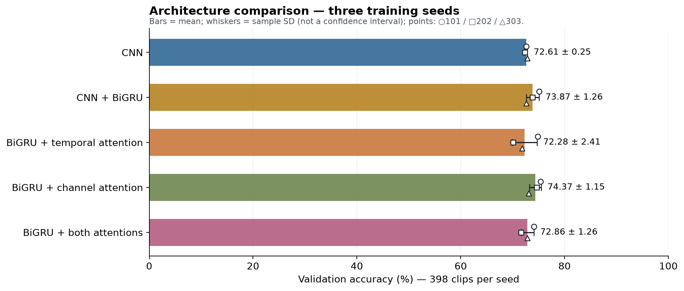
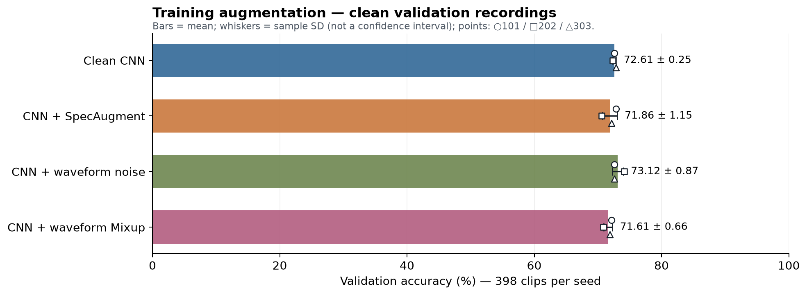
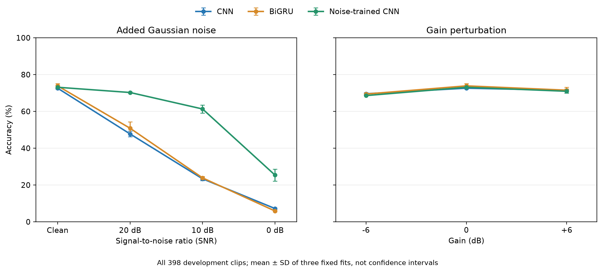
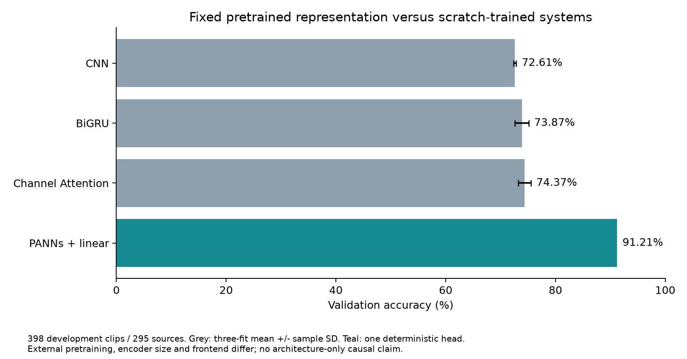
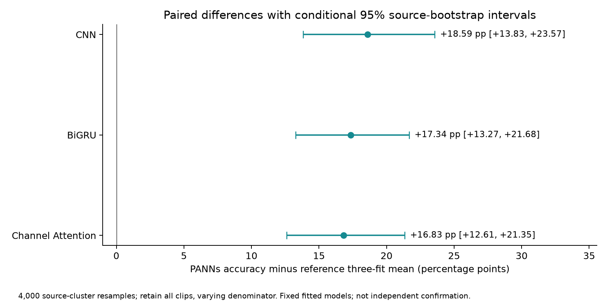
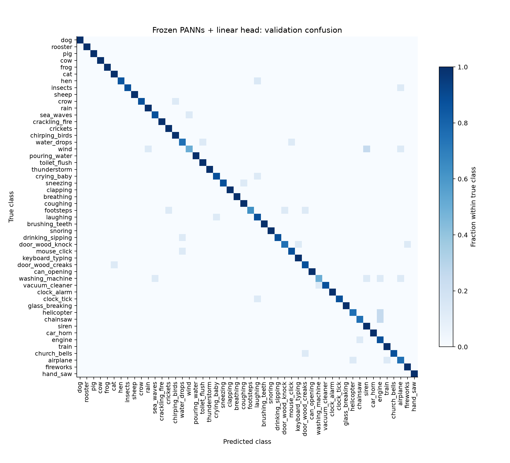
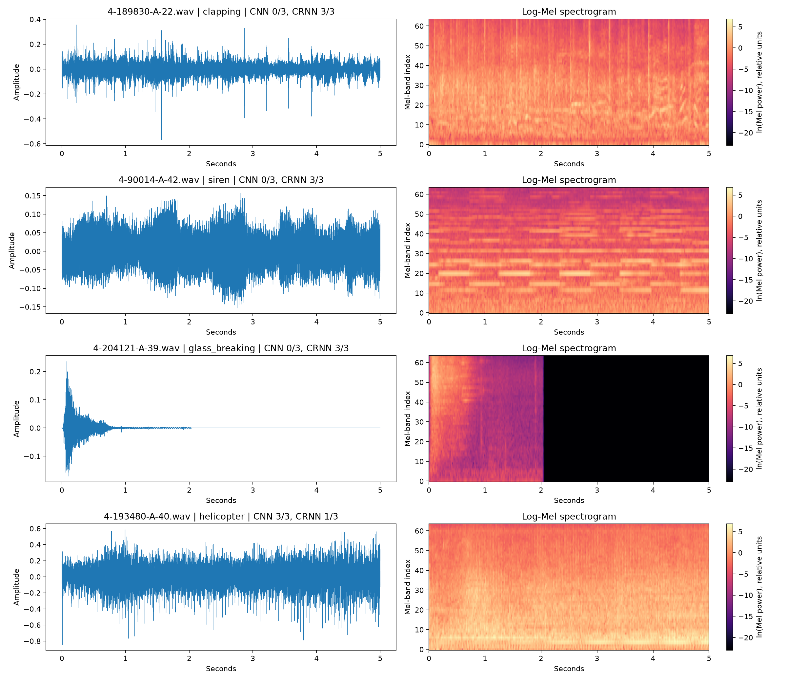

> Historical checkpoint snapshot: the later completed [transfer follow-up](../../notebooks/ESC50_Transfer_Followup.ipynb) adds matched PANNs noise evaluation and six matched-head fits. Statements below about planned experiments describe the checkpoint stage.

# Improving Environmental Sound Classification on ESC-50: Model Improvement Checkpoint

**COMP9444 — Deep Learning | Research Checkpoint | 5 November 2026**

## Abstract

This report investigates improvements to environmental sound classification using the ESC-50 dataset. We evaluate three complementary directions: architectural modifications involving recurrent layers and attention mechanisms, training-time data augmentation for robustness, and transfer learning using a pretrained audio representation.

Our research baseline is a lightweight convolutional neural network (CNN), achieving 72.61% mean validation accuracy. Adding bidirectional recurrent processing increases accuracy to 73.87%, while channel attention achieves 74.37%. Gaussian noise augmentation substantially improves performance under matched noisy conditions, although it does not establish general robustness to environmental noise.

The strongest result comes from a pretrained PANNs Cnn14_16k encoder with a frozen feature extractor and a linear classifier. This system achieves **91.21% accuracy and 91.10% macro-F1**, improving accuracy by 16.83 percentage points over the channel-attention model on the same development validation split.

These findings demonstrate strong development-set performance from a frozen pretrained system, without isolating the contribution of pretraining. Limitations include dataset exposure, pretrained model provenance, and generalisation beyond the evaluated recordings.

## Checkpoint Requirements and Evidence

| Course requirement | Completed evidence |
| --- | --- |
| Analyse baseline and improvement areas | Section 1: compact CNN, noise sensitivity, temporal pooling and data scarcity |
| Implement improvements | Section 2: BiGRU, three attention variants and three augmentation configurations |
| Experiment with a different approach | Section 3: executed frozen PANNs plus fixed linear classifier |
| Evaluate with appropriate metrics | Section 4: Accuracy, Macro-F1, all-class confusion and paired source intervals |
| Compare and discuss findings | Section 5: positive/negative results, extra-data/capacity differences and limitations |

The checkpoint synthesises completed experiments; report production did not retrain these models. The original matrix contained 65 tasks, including 60 neural fits. PANNs adds one fixed linear-head fit; later diagnostics reuse existing weights.

## Data Scope and Experimental Setting

ESC-50 contains 2,000 five-second environmental audio recordings distributed across 50 classes, with 40 recordings per class. The dataset includes human activities, animals, natural environments, domestic sounds, and other common acoustic events.

The primary research experiments use a source-strict partition:

- **Training:** 1,200 recordings from folds 1–3.
- **Development validation:** 398 recordings from fold 4, representing 295 distinct `src_file` groups.
- **Held-out-designated fold:** Fold 5 is excluded from the present comparisons.

The split implementation uses metadata `src_file` identifiers to exclude fold-5 sources from validation and training, and validation sources from training. The evaluated training and validation subsets are separated by these identifiers. This is metadata-based source isolation; it is not a comprehensive perceptual near-duplicate or pretraining-overlap audit.

However, all official folds have been exposed during the broader research history. Consequently, fold 4 must be treated as a repeatedly used development validation set, not a previously unseen final test set. Reported results are therefore development-validation findings.

The study maintains a common evaluation partition for the internally compared models, while documenting preprocessing differences introduced by the pretrained system.

## 1. Baseline Performance and Improvement Opportunities

### 1.1 Research Baseline Architecture

The primary research baseline is a compact frequency-aware CNN designed to classify log-Mel spectrograms.

Audio is resampled to 16 kHz and transformed using a 512-point FFT, hop length of 256 samples, and 64 Mel-frequency bands. Natural-log spectrogram features produce an input of [1, 64, 313] per five-second recording. Normalisation statistics are estimated using training data only.

The network contains three convolutional stages, with 16, 32, and 64 output channels. Each stage uses a 3 × 3 convolution, batch normalisation, ReLU activation, and 2 × 2 pooling.

The resulting feature representation has dimensions [64, 8, 39]. The model averages across the time dimension while retaining frequency structure, then maps the resulting 512-dimensional representation to 50 class logits.

The convolutional encoder already learns local temporal patterns; this is not a comparison between a temporal model and a model with no temporal information. This architecture has **49,058 trainable parameters**, making it a relatively inexpensive reference model.

Training uses 60 epochs, batch size 32, AdamW with an initial learning rate of 0.001, weight decay of 0.0001, and cosine learning-rate scheduling. Checkpoints are selected using minimum validation cross-entropy. Three fixed training seeds, 101, 202, and 303, are used.

The baseline achieves 72.61% mean accuracy and 71.39% macro-F1.

### 1.2 Limitations Motivating Improvement

The baseline presents three opportunities for improvement.

First, temporal averaging can discard information about the ordering of acoustic events. Sounds such as footsteps, clapping, and mechanical actions may contain temporal patterns that are not fully described by pooled convolutional features.

Second, standard training does not explicitly encourage tolerance to additive interference. A classifier trained primarily on clean audio may rely on spectral details that become unreliable when noise is introduced.

Third, the small training partition limits the variety of acoustic examples available for learning representations from scratch. A larger pretrained encoder may provide useful general acoustic features that would otherwise be difficult to acquire from 1,200 labelled recordings.

These motivate recurrent modelling, augmentation, and pretrained transfer learning, respectively. They are hypotheses for improvement rather than assumed explanations of the baseline's errors.

### 1.3 Distinction From the Team Repository Baseline

The original team repository also contains a CNN implementation, but it is not identical to the research baseline.

That implementation has approximately 1,368,386 parameters, employs a different convolutional and dense architecture, and uses 22.05 kHz audio, 128 Mel bands, a 2048-point FFT, hop length 512, and clip-relative `power_to_db` preprocessing. Its original validation configuration also contains 400 recordings rather than the research partition's 398.

No verified evaluation score or trained weights for that original implementation are available in the supplied evidence.

Therefore, **72.61% must not be attributed to the original team CNN**. All quantitative improvement claims in this report refer to the independently implemented research baseline under the stated evaluation protocol. The original implementation should be preserved separately when incorporating this study into the team repository.

## Related Work and Selection of Ideas

The shared literature collection was assessed by methodological relevance rather than by ranking published accuracies. Zhang et al. motivates temporal/channel reweighting; its publisher abstract was verified, while unavailable full ablation tables are not treated as evidence for a particular improvement size. Salamon and Bello studied augmentation primarily on UrbanSound8K. SpecAugment originated in speech recognition, so the masking-only adaptation below is a hypothesis to evaluate on ESC-50 rather than an assumed improvement.

Kong et al. explicitly distinguishes scratch training, frozen feature extraction and fine-tuning (Sections V and VI-D). Our experiment follows the frozen strategy with the official later 16 kHz checkpoint and a fixed logistic classifier; it is not a replication of the paper's 32 kHz five-fold transfer recipe. AST, BEATs, CLAP and masked audio models supply broader context, but their pretraining and benchmark protocols differ. The [26-entry literature decision map](literature_review.md) documents primary links, reading depth and which ideas were actually implemented.

## 2. Implemented Improvements

### 2.1 Bidirectional Recurrent Modelling

The first architectural improvement introduces a bidirectional gated recurrent unit (BiGRU) after the CNN encoder.

Instead of immediately averaging convolutional features across time, the model interprets the 39 temporal positions as a sequence of 512-dimensional feature vectors.

A bidirectional GRU with hidden size 64 processes this sequence in both temporal directions. Its 128-dimensional bidirectional outputs are aggregated for classification.

The resulting model contains 251,810 parameters.

This approach preserves the CNN's local feature extraction while providing an explicit mechanism for modelling relationships between temporal positions.

The mean validation accuracy increases from 72.61% to 73.87%, an improvement of 1.26 percentage points.

Although positive, the improvement is modest relative to the increase in model size. It does not establish that recurrent modelling consistently outperforms temporal pooling on unseen audio sources.

### 2.2 Temporal and Channel Attention

We additionally implement three lightweight attention configurations, each evaluated using three training seeds.

**Temporal Attention** uses learned scalar scores and softmax normalisation to weight temporal representations before classification. Its objective is to give different temporal positions different contributions to the final prediction.

**Channel Attention** employs a squeeze-and-excitation-style mechanism. A small multilayer perceptron generates sigmoid-based gates that reweight 64 feature channels, allowing the model to emphasise different learned acoustic features.

**Combined Temporal and Channel Attention** applies both mechanisms within the research architecture.

The results are mixed. Channel attention achieves 74.37% mean accuracy, compared with 73.87% for BiGRU. Temporal attention reaches 72.28%, while the combined model reaches 72.86%.

Channel attention's improvement over BiGRU is only 0.50 percentage points. Its source-group bootstrap interval spans zero, indicating that the observed improvement is not sufficiently precise to establish a reliable advantage under the fixed-fit evaluation.

The other attention variants do not improve mean accuracy over BiGRU.

These are lightweight independent implementations motivated by attention-based audio classification literature, including Zhang et al. (2019), rather than exact reproductions of published architectures.

The findings show that adding attention is not automatically beneficial, especially when the available labelled dataset is relatively small.

### 2.3 Data Augmentation and Noise Robustness

We evaluate three augmentation strategies.

**Gaussian noise augmentation** injects waveform-level Gaussian noise before log-Mel feature extraction, with augmentation probability 0.5 and a uniformly sampled signal-to-noise ratio between 10 and 30 dB.

**SpecAugment** applies frequency and temporal masking, with masks covering up to eight frequency bands and 24 frames. This implementation does not reproduce the original method's time-warping component.

**Waveform Mixup** combines pairs of audio recordings using coefficients sampled from a Beta distribution with parameter 0.4, together with correspondingly weighted classification losses. This is not an exact implementation of the between-class audio method proposed by Tokozume and colleagues.

The SpecAugment and Mixup configurations achieve mean clean-validation accuracies of 71.86% and 71.61%, respectively. Neither exceeds the research CNN baseline.

The noise-augmented CNN achieves 73.12% clean accuracy and 71.99% macro-F1, while providing a substantial advantage under matched Gaussian interference.

At 10 dB SNR, the standard CNN achieves 23.37% accuracy, compared with 61.31% for the noise-trained CNN.

The paired advantage is 37.94 percentage points, with a conditional source-bootstrap 95% interval of [32.08, 43.88]. After accounting for their clean-accuracy difference, the noise-trained model experiences 37.44 percentage points less degradation, with an interval of [31.31, 43.74].

Nevertheless, at 0 dB SNR, the noise-trained model achieves only 25.38%. The benefit is substantial but limited. Training and evaluation use the same general Gaussian noise family, and no comparable evidence establishes robustness to real-world background recordings. Gain perturbations of ±6 dB also provide no clear augmentation advantage.

### 2.4 Complete robustness panel

| Condition | CNN accuracy (%) | BiGRU accuracy (%) | Noise-CNN accuracy (%) |
| --- | --- | --- | --- |
| clean | 72.61 | 73.87 | 73.12 |
| snr_20 | 47.74 | 50.84 | 70.27 |
| snr_10 | 23.37 | 23.87 | 61.31 |
| snr_0 | 7.20 | 5.86 | 25.38 |
| gain_-6 | 69.60 | 69.43 | 68.59 |
| gain_6 | 71.44 | 71.52 | 70.94 |

These are means of three fixed fits on the same clips under fixed perturbation realisations. They are not PANNs results. The matched-Gaussian benefit does not establish field robustness.

## 3. Alternative Pretrained Approach

### 3.1 Motivation and Architecture

The strongest alternative investigates whether pretrained acoustic representations can outperform models trained entirely on ESC-50.

We use the official AudioSet-pretrained **PANNs Cnn14_16k** model described by Kong et al. The loaded frozen author model contains 81,033,231 parameters, including its original AudioSet classifier and produces a 2048-dimensional embedding.

Its internal audio preprocessing uses a 16 kHz sampling rate, 512-point FFT, hop length 160, 64 Mel bands, and a frequency range of 50–8000 Hz.

Unlike the original research CNN, PANNs uses its own pretrained frontend. The comparison consequently changes representation capacity, pretraining data, architecture, and frontend simultaneously.

### 3.2 Frozen Encoder and Linear Classification

All pretrained encoder parameters remain frozen. The encoder operates in evaluation mode without fine-tuning or augmentation.

A single feature extraction pass produces embeddings for the training and validation recordings.

Training-only standardisation is then applied using `StandardScaler`. The final classifier is an L2-regularised multinomial logistic regression model using C = 1, L-BFGS optimisation, a maximum of 3,000 iterations, and tolerance 1e-6.

The linear head contains 102,450 trainable parameters and converges after 137 iterations.

Only one deterministic linear classifier is fitted. No regularisation search or repeated artificial training seeds are performed.

This design isolates the practical effectiveness of the available pretrained representation under a fixed downstream classification procedure. It does not isolate the causal effect of pretraining from architectural differences.

### 3.3 Observed Performance

The system correctly classifies 363 of 398 validation recordings, achieving:

- **Accuracy:** 91.21%.
- **Macro-F1:** 91.10%.
- **Classification errors:** 35 recordings.

The observed accuracy improvement is 16.83 percentage points over channel attention and 18.59 percentage points over the research CNN.

The main Colab T4 program records 38.05 seconds, including model loading, feature extraction, and classifier fitting. Feature extraction takes 30.38 seconds and linear fitting takes 4.41 seconds.

These measurements exclude installation, checkpoint downloading, previous compatibility work, and the external cost of pretraining. They are not per-recording deployment latency measurements.

The result demonstrates an effective transfer-learning pipeline, but it cannot establish that the model's high accuracy results exclusively from pretraining. Furthermore, potential overlap between AudioSet pretraining material and ESC-50 recordings has not been comprehensively excluded.

## 4. Evaluation Protocol and Results

### 4.1 Metrics and Comparison Procedure

The primary metric is classification accuracy, calculated as the proportion of correctly classified recordings.

Macro-F1 is used as a complementary metric, giving equal weight to the 50 classes through their individual F1 scores. This helps expose uneven performance even when overall accuracy appears strong.

Confusion matrices, classification reports, and recording-level predictions are also retained for error analysis.

For neural architectures trained from scratch, reported means and standard deviations are calculated across three fixed training runs. These standard deviations describe variation across those runs; they are not confidence intervals for independent audio samples.

Selected model comparisons use 4,000 source-group bootstrap resamples. All recordings belonging to a sampled source are resampled together, and accuracy is calculated using the actual number of recordings represented.

The resulting intervals are conditional on the existing model fits, evaluation sample, and development decisions. They do not include uncertainty from future retraining, different pretraining data, or repeated model selection.

### 4.2 Summary of Main Results

| System | Accuracy (%), mean +/- SD | Macro-F1 (%), mean +/- SD | Task-trained parameters | Fits |
| --- | --- | --- | --- | --- |
| CNN baseline (frequency-preserving) | 72.61 +/- 0.25 | 71.39 +/- 0.58 | 49,058 | 3 |
| CNN + BiGRU | 73.87 +/- 1.26 | 72.97 +/- 1.36 | 251,810 | 3 |
| CRNN + channel attention | 74.37 +/- 1.15 | 73.48 +/- 1.00 | 252,906 | 3 |
| CRNN + temporal attention | 72.28 +/- 2.41 | 71.52 +/- 2.41 | 251,939 | 3 |
| CRNN + temporal/channel attention | 72.86 +/- 1.26 | 71.69 +/- 1.35 | 253,035 | 3 |
| CNN + mixup | 71.61 +/- 0.66 | 70.65 +/- 0.44 | 49,058 | 3 |
| CNN + noise | 73.12 +/- 0.87 | 71.99 +/- 1.23 | 49,058 | 3 |
| CNN + specaugment | 71.86 +/- 1.15 | 70.75 +/- 1.38 | 49,058 | 3 |
| Frozen PANNs + linear head | 91.21 | 91.10 | 102,450 (+81,033,231 frozen loaded) | 1 |

Scratch-trained results summarize the same three fixed seeds. The PANNs result is one deterministic head fit; no seed SD is estimated. The loaded PANNs model retains its original AudioSet classifier even though its 527-label outputs are not used for ESC-50 decisions. All nine systems use the same 398 development-validation clips.

### 4.3 Paired Performance Differences

The pretrained system's accuracy improvement over the strongest scratch-trained model, channel attention, is 16.83 percentage points, with a conditional 95% source-bootstrap interval of [12.61, 21.35].

The corresponding improvement is 17.34 percentage points over BiGRU, with interval [13.27, 21.68], and 18.59 percentage points over CNN, with interval [13.83, 23.57].

These intervals support a substantial performance difference on the fixed development validation set. They do not establish equivalent improvements under a new data collection.

The small channel-attention improvement over BiGRU has a corresponding interval of [-1.22, 2.17] percentage points, which includes zero.

### 4.4 Error Analysis

Across the previously evaluated model families, 41 recordings were incorrectly classified by CNN, BiGRU, Channel Attention and noise-trained CNN across all three fits in each family. The PANNs system corrects 26 of these recordings, leaving 15 incorrect.

The PANNs system correctly classified 26 of the 41 examples selected for consistent failure among earlier models; this does not establish the cause of those improvements.

Nevertheless, PANNs still makes 35 errors overall.

Among the more difficult classes, `wind` and `washing_machine` each have four incorrect predictions out of eight validation recordings, while `footsteps` has five correct predictions out of eight (three errors).

Although 28 classes have all seven or eight available validation recordings classified correctly, these small class-level sample sizes do not justify claims of perfect class generalisation.

No listening-based annotation audit has established whether the remaining errors reflect label ambiguity, acoustic similarity, recording quality, or model limitations. The observed error patterns should therefore be interpreted descriptively rather than causally.

## 5. Comparison, Findings and Next Steps

### 5.1 What Improved and What Did Not

The experiments reveal three distinct findings.

First, architectural complexity alone provides limited improvement. BiGRU and channel attention moderately outperform the compact CNN, but temporal attention and combined attention do not. Channel attention's mean advantage is also small relative to the uncertainty observed in the existing validation sample.

Second, augmentation benefits depend on the evaluation condition. Gaussian noise training substantially improves resistance to matched synthetic interference, while SpecAugment and Mixup do not improve clean accuracy in the evaluated configurations. The robustness finding must not be extended automatically to unrelated noise types.

Third, pretrained representations deliver the largest observed system-level improvement. The frozen PANNs encoder and simple linear classifier outperform all scratch-trained architectures on the shared development validation partition, without requiring encoder fine-tuning.

This suggests that, for a small labelled audio dataset, reusing a large pretrained acoustic representation may be more productive than repeatedly adding architectural modules to a small model trained from scratch.

However, the present results do not identify how much of the improvement comes from pretraining, model capacity, the frontend, or other differences.

### 5.2 Limitations

Several limitations constrain interpretation.

The validation split has been reused throughout development, and all official folds have previously been exposed. The study therefore lacks a genuinely untouched final evaluation set.

The PANNs encoder was trained externally on AudioSet. Potential recording overlap or cross-platform duplication between AudioSet and ESC-50 has not been fully audited. Accordingly, the validation result cannot establish uncontaminated generalisation.

The PANNs system also uses a substantially larger encoder and a different frontend. Its advantage is a system-level result rather than a controlled demonstration of an isolated algorithmic improvement.

Finally, noise robustness has been measured for the earlier CNN models but not for PANNs. The pretrained system's strong clean accuracy cannot be taken as evidence of superior noisy-audio performance.

### 5.3 Future Research

A narrowly scoped follow-up would evaluate the existing frozen PANNs classifier on clean and 10 dB Gaussian-perturbed recordings, using identical perturbation waveforms for paired comparisons against the previously evaluated noise-trained CNN.

This would distinguish accuracy under a specified noisy condition from accuracy degradation relative to clean audio. The two measurements can favour different models and should not be treated as interchangeable.

A separate, higher-value validation objective would be evaluation on genuinely independent recording sources, subject to data availability and compatible class definitions.

Partial encoder fine-tuning and more complex pretrained architectures, including AST, BEATs, M2D, and CLAP-based representations, remain possible future research directions. None has been implemented or evaluated in this checkpoint, and no performance improvement is assumed.

The existing experimental evidence is sufficient for the present checkpoint without additional training. Future work should address a specific unresolved research question rather than repeat architecture searches solely to obtain a higher development-validation score.

### 5.4 Reproducibility

The study retains model configurations, training histories, selected checkpoints, prediction records, and evaluation summaries for the completed experiments.

The pretrained study additionally retains its extracted embeddings, fitted linear classifier, per-recording predictions, probabilities, and evaluation outputs.

For repository integration, the original team baseline should remain intact, while the independently conducted research and its results should be documented separately. This preserves the distinction between the original implementation and the experimentally evaluated systems.

### 5.5 Conclusion

This checkpoint demonstrates the implementation and evaluation of multiple approaches to improving environmental sound classification.

Recurrent modelling and channel attention produce modest gains over a lightweight CNN, while matched Gaussian noise augmentation substantially improves robustness to the evaluated synthetic interference. Other attention and augmentation variants do not consistently improve clean performance.

The strongest result is achieved by a frozen AudioSet-pretrained PANNs encoder with a deterministic linear classification head, reaching **91.21% accuracy and 91.10% macro-F1** on the source-strict development validation set.

The central finding is not that a particular attention module or training trick universally improves sound classification. Rather, pretrained acoustic representations provide a strong practical alternative to learning all features from a small labelled dataset.

This conclusion is supported within the evaluated development setting, while independent-source validation and pretrained-data overlap remain unresolved.

## Evidence and references

All comparative tables, the full 22-figure atlas, class-level results, the 65-task ledger and the complete literature matrix are displayed in [the executable results notebook](../../notebooks/ESC50_Results.ipynb). Original source data remain in the adjacent evidence folders. The notebook separates previously completed scratch-model experiments from its new PANNs extraction and head fit.

