# Environmental Sound Classification on ESC-50: Architecture, Robustness and Representation — Final Research Report, 5 November 2026

## Abstract

This study investigates environmental sound classification on ESC-50 through three research questions: the contribution of temporal modeling and attention mechanisms (RQ1), robustness to acoustic perturbations (RQ2), and the influence of audio feature representation and sampling configuration (RQ3).

The research comprises 65 experimental tasks, including 60 neural-network training runs, together with additional inference-only investigations using existing checkpoints. A source-strict development split was used to reduce source overlap between training and validation.

Across three training seeds, the baseline CNN achieved 72.61% validation accuracy, while the CNN-BiGRU model achieved 73.87%. Channel Attention produced the highest observed architecture-group mean accuracy of 74.37%, although its advantage over BiGRU was only 0.50 percentage points (pp), with a source-bootstrap confidence interval spanning zero.

Noise-augmented CNN training produced substantially stronger robustness under matched Gaussian noise. At 10 dB signal-to-noise ratio (SNR), accuracy increased from 23.37% for the baseline CNN to 61.31% for the noise-trained CNN.

Feature experiments showed consistent advantages for 32-band over 64-band Log-Mel representations within a separate frequency-pooled CNN architecture. Temporal interventions further demonstrated that BiGRU predictions were sensitive to encoder-token ordering, whereas CNN predictions were invariant under the tested permutations.

These findings support architecture-specific conclusions about temporal aggregation, noise robustness, and feature configuration. However, repeated development-set exposure, limited training seeds, and the absence of independent confirmation restrict broader generalization claims.

## 1. Research Questions

This study addresses three questions.

**RQ1 — Architecture and Temporal Modeling:** Does recurrent temporal aggregation improve environmental sound classification, and do attention mechanisms provide additional benefits? What does sensitivity to encoder-token ordering reveal about the models?

**RQ2 — Acoustic Robustness:** How do baseline, recurrent, and noise-trained architectures respond to additive Gaussian noise and amplitude variation? Does noise-augmented training reduce degradation under matched perturbations?

**RQ3 — Audio Representation:** How do sampling rate, frequency coverage, and feature dimensionality affect classification performance under a controlled architecture and training budget?

The objective is to identify supported empirical relationships rather than assume that greater architectural complexity necessarily improves recognition accuracy.

## 2. Data and Methods

### 2.1 Dataset and Validation Protocol

ESC-50 contains 2,000 five-second environmental audio recordings distributed across 50 classes. The original recordings are provided at 44.1 kHz.

The primary experiments used the following source-strict development split:

| Partition | Configuration |
|---|---|
| Training | Folds 1–3; 1,200 recordings |
| Validation | Fold 4; 398 recordings from 295 `src_file` groups |
| Designated test | Fold 5; 400 recordings |
| Validation selection | Minimum validation cross-entropy |
| Training repetitions | Seeds 101, 202, and 303 |

Source identity was considered when constructing the development validation set to reduce source-level leakage.

However, all official folds had been exposed during the broader project history. Consequently, the designated fifth fold cannot be described as an untouched blind test set, and the reported results are development-validation findings.

### 2.2 Audio Processing

The principal audio preprocessing pipeline was:

WAV → Resampling → Log-Mel Spectrogram → Normalization

The main configuration used:

- Sampling rate: 16 kHz
- FFT size: 512
- Hop length: 256
- Mel bands: 64
- Logarithm: Natural logarithm
- Feature tensor shape: [1, 64, 313]

Normalization statistics were estimated using training data only and subsequently applied to validation inputs.

### 2.3 Experimental Design

The original experimental matrix contained 65 tasks:

| Experiment group | Tasks |
|---|---:|
| Classical baselines | 2 |
| Architecture comparisons | 15 |
| Augmentation experiments | 9 |
| Feature and sampling experiments | 36 |
| Original robustness stress tasks | 3 |
| **Total** | **65** |

The 60 neural-network training runs used 60 epochs, batch size 32, AdamW, initial learning rate 0.001, weight decay 0.0001, and cosine learning-rate scheduling.

For each run, the checkpoint with the lowest validation cross-entropy was selected.

Additional RQ1 and RQ2 investigations reused existing checkpoints for inference without retraining.

Reported architecture results are means across three fixed training seeds, accompanied by sample standard deviations. Paired confidence intervals were estimated using 4,000 source-level bootstrap resamples over the fixed fitted models. These intervals do not characterize the population of possible training seeds. Each source resample retains every constituent clip and uses its actual, varying clip denominator; the same source draws are shared across paired models and fixed seeds. The paired-analysis RNG seed is 20261104; the temporal-intervention RNG seed is 20261105.

## 3. Results

### 3.0 Classical Baselines

| Method | Accuracy | Macro-F1 |
| --- | --- | --- |
| Log-Mel statistics + logistic regression | 42.21% | 38.86% |
| DCT cepstral statistics + linear SVM | 40.20% | 37.50% |

The feature families and selection procedures differ; the score difference is not a classifier-only comparison.

### 3.1 RQ1 — Architecture, Attention, and Temporal Modeling

#### Architecture Comparison

| Model | Parameters | Accuracy, mean ± SD | Macro-F1, mean ± SD |
| --- | --- | --- | --- |
| CNN | 49,058 | 72.61 ± 0.25% | 71.39 ± 0.58% |
| CNN-BiGRU | 251,810 | 73.87 ± 1.26% | 72.97 ± 1.36% |
| Temporal Attention (TA) | 251,939 | 72.28 ± 2.41% | 71.52 ± 2.41% |
| Channel Attention (CA) | 252,906 | 74.37 ± 1.15% | 73.48 ± 1.00% |
| Temporal + Channel Attention | 253,035 | 72.86 ± 1.26% | 71.69 ± 1.35% |

BiGRU improved mean accuracy over CNN by 1.256 pp, but the paired 95% source-bootstrap interval was [-1.806, 4.167] pp.

Attention comparisons against BiGRU produced:

| Comparison | Difference (pp) | 95% source-bootstrap CI (pp) |
|---|---:|---|
| CA − BiGRU | +0.503 | [-1.217, 2.167] |
| TA − BiGRU | -1.591 | [-4.473, 1.250] |
| TA+CA − BiGRU | -1.005 | [-3.782, 1.737] |

Channel Attention achieved the highest observed mean, but its paired improvement was small: approximately one, three, and two additional correct predictions across the respective seeds.

Neither temporal attention nor combined attention improved mean accuracy over the BiGRU reference.

These findings do not establish a reliable general advantage for attention-based architectural complexity.

#### Encoder-Token Order Interventions

A separate inference-only investigation examined whether trained models depended on temporal-token ordering.

The intervention directly rearranged the 39 temporal tokens in the encoder output, preserving the embedding associated with each token. It did not reverse the original WAV waveform.

Five conditions were evaluated: identity, reverse, roll by 19 positions, and two fixed shuffles using seeds 17 and 29.

Across six existing checkpoints, this produced 30 prediction sets and 11,940 predictions.

| Intervention | BiGRU accuracy | Change from identity (pp) | 95% CI (pp) |
|---|---:|---:|---|
| Identity | 73.87% | Reference | — |
| Reverse | 68.84% | -5.03 | [-7.54, -2.60] |
| Roll 19 | — | -1.42 | [-2.94, 0.09] |
| Shuffle 17 | — | -1.09 | [-2.64, 0.42] |
| Shuffle 29 | — | -0.08 | [-1.47, 1.32] |

The CNN exhibited zero prediction changes across all tested token permutations.

This invariance is consistent with its temporal aggregation structure; it does not imply that the CNN ignores temporal information.

Each encoder token already incorporates approximately 368 milliseconds of local temporal context.

BiGRU sensitivity to reversal therefore demonstrates dependence on the arrangement of learned local representations, not necessarily the recognition of long-range acoustic event direction.

The shuffle conditions also changed numerous individual predictions despite relatively small net accuracy differences, indicating that newly introduced errors and corrected errors partially offset one another.

Possible explanations include event directionality, onset and offset structure, silence positioning, boundary effects, and nonlinear recurrent-state aggregation. The current interventions cannot uniquely distinguish these mechanisms.

### 3.2 RQ2 — Robustness to Acoustic Perturbations

Noise robustness was evaluated using existing CNN, BiGRU, and noise-trained CNN checkpoints.

After completing the missing inference evaluations, the investigation contained three models, three training seeds, and six conditions, totaling 54 prediction sets.

Gaussian noise was added at specified SNR levels, with the same fixed noise realization shared across models and training seeds for each recording-condition pair.

Post-perturbation RMS-SNR was measured, clipping was avoided, and checkpoint-specific training normalization was retained.

#### Accuracy Under Gaussian Noise

| Evaluation condition | CNN | BiGRU | Noise-trained CNN |
|---|---:|---:|---:|
| Clean | 72.61% | 73.87% | 73.12% |
| Gaussian, 20 dB | 47.74% | 50.84% | **70.27%** |
| Gaussian, 10 dB | 23.37% | 23.87% | **61.31%** |
| Gaussian, 0 dB | 7.20% | 5.86% | **25.38%** |

The noise-trained CNN maintained substantially higher accuracy under the evaluated Gaussian perturbations.

Its paired advantages over the baseline CNN were:

| Condition | Accuracy advantage (pp) | 95% CI (pp) |
|---|---:|---|
| 20 dB | +22.53 | [17.35, 27.64] |
| 10 dB | +37.94 | [32.08, 43.88] |
| 0 dB | +18.17 | [14.55, 21.87] |

At 10 dB, after accounting for the clean-condition accuracy advantage, noise training reduced the accuracy loss by 37.44 pp [31.31, 43.74].

By contrast, the ±6 dB amplitude-control conditions provided no clear robustness advantage.

In the augmentation comparison, the clean-validation accuracies were:

| Augmentation | Accuracy, mean ± SD |
|---|---:|
| Noise augmentation | 73.12 ± 0.87% |
| SpecAugment | 71.86 ± 0.79% |
| Mixup | 71.61 ± 0.66% |

The principal RQ2 result is that matched Gaussian-noise augmentation substantially reduced sensitivity to additive Gaussian noise without a large observed reduction in clean accuracy.

However, the result does not demonstrate robustness to real-world environmental noise, non-Gaussian interference, or unseen noise-generation processes.

The reported SNR describes the added perturbation, not the total environmental noise already present in an original recording.

### 3.3 RQ3 — Feature Representation and Sampling Configuration

RQ3 used a separate frequency-pooled CNN with 26,658 parameters.

Twelve feature-and-sampling configurations were evaluated across three training seeds, yielding 36 training runs. Four representations were crossed with three sampling/bandwidth settings: Log-Mel 64, Log-Mel 32, 40-coefficient DCT cepstral features, and Log-Linear 64. FFT windows and hops were held at 32 ms and 16 ms across sampling rates.

Selected Log-Mel comparisons were:

| Sampling rate | Maximum frequency | Mel64 accuracy | Mel32 accuracy | Difference (pp) |
|---|---|---:|---:|---:|
| 16 kHz | 8 kHz | 51.59% | **55.61%** | +4.02 |
| 32 kHz | 8 kHz | 51.26% | **55.70%** | +4.44 |
| 32 kHz | 16 kHz | 51.09% | **57.12%** | +6.03 |

The 32-band representation consistently outperformed the corresponding 64-band representation in these comparisons.

This suggests that lower spectral dimensionality may offer a useful inductive bias within the tested architecture, potentially reducing the burden of learning from sparse training data.

Nevertheless, this explanation remains hypothetical. The experiment does not isolate all possible mechanisms behind the observed differences.

Thirty of the 36 runs selected their best checkpoints during epochs 51–60. However, the 32-band validation-loss advantage appeared earlier in training.

Late checkpoint selection alone does not establish that training had failed to converge.

The feature findings apply to the separate pooled-CNN architecture and should not be generalized directly to the principal CNN-BiGRU models.

## 4. Error Analysis

Persistent errors were investigated across the existing fitted models.

The CNN produced 83 recordings that were incorrectly classified by all three seeds, while the BiGRU produced 64 such recordings.

Across four model families, 41 recordings from 31 source groups were consistently misclassified.

These shared failures suggest that certain validation examples remain difficult across the tested modeling choices.

Four examples were additionally selected based on existing CNN/BiGRU disagreements: clapping, siren, glass breaking, and helicopter.

Their BiGRU correctness counts changed under encoder-token reversal as follows. Each count concerns three fitted models on the same single recording, not three independent recordings:

| Example | Identity | Reverse |
|---|---:|---:|
| Clapping | 3/3 | 2/3 |
| Siren | 3/3 | 3/3 |
| Glass breaking | 3/3 | 1/3 |
| Helicopter | 1/3 | 3/3 |

The selected glass-breaking example contained substantial early energy followed by an extended lower-energy region.

This observation raises possible explanations involving silence positioning, event boundaries, and recurrent-state dynamics.

However, these four examples were deliberately selected from model disagreements and are not representative category-level samples.

No listening-based verification or independent label audit was completed. Prediction CSV files alone cannot establish incorrect ground-truth labels or a specific acoustic failure mechanism.

## 5. Discussion

### 5.1 Architectural Complexity and Temporal Information

The modest BiGRU advantage, small Channel Attention gain, and negative mean results for Temporal Attention and combined attention provide no evidence that simply increasing attention complexity guarantees better classification.

The recurrent model is sensitive to the ordering of encoder representations, whereas the pooled CNN is invariant under the tested permutations.

Importantly, sensitivity to temporal-token arrangement is not equivalent to a demonstrated benefit from long-range temporal reasoning.

The encoder already captures local temporal patterns, and recurrent nonlinear aggregation may be affected by token position, silence distribution, and boundary structure.

These competing explanations remain unresolved.

### 5.2 Robustness and Representation

RQ2 provides the strongest observed performance contrast: noise training substantially improved classification under matched Gaussian disturbances.

This is meaningful within the tested perturbation family but should not be interpreted as verified cross-distribution robustness.

RQ3 shows that higher-dimensional spectral representations do not necessarily provide better accuracy in a data-limited setting.

Together, the findings show that performance varied across the tested representations, architectures, and training or perturbation conditions. The experiments do not identify all causal interactions among these factors.

### 5.3 Decision on Further Attention Training

All nine attention-specific training runs were completed, representing three variants across three seeds. They form part of the 15 architecture-training runs, not an additional unfinished experiment.

Therefore, the current investigation does not require further attention training or another large training matrix to reach its stated conclusions.

If the objective changes from completing this research to maximizing recognition accuracy, AudioSet-pretrained transfer learning using architectures such as PANNs or AST would be a reasonable separate research direction.

Such a study would introduce additional questions concerning pretraining data, dataset overlap, feature preprocessing, model capacity, and evaluation comparability.

No pretrained weights were downloaded or evaluated in this project, and compatibility, licensing, and data overlap have not been fully verified.

Consequently, no performance improvement is claimed or guaranteed. A pretrained-model comparison would also not isolate attention as the sole explanatory factor.

## 6. Limitations

Several limitations constrain the interpretation of the findings.

**Development-data exposure.** All official folds had historical exposure during the project. The reported results are not independently confirmed test-set estimates.

**Limited model repetitions.** Neural comparisons rely on three fixed training seeds. Source-bootstrap confidence intervals quantify variation over sampled source groups conditional on those fitted models, not variation over independent training runs.

**Exploratory multiplicity.** Numerous architectures and configurations were evaluated using development data. The reported intervals are not adjusted for this broader exploratory selection process.

**Noise generalization.** Gaussian training and evaluation used the same broad perturbation family. Each recording-condition pair had a single fixed noise realization. The intervals do not cover uncertainty from newly generated noise or retrained models.

**Temporal-mechanism identification.** Encoder-token permutations preserve local embeddings and are not equivalent to waveform reversal. Directionality, silence, boundary structure, and recurrent aggregation remain competing explanations.

**Architecture-dependent feature findings.** RQ3 employed a separate pooled CNN, preventing direct generalization of its Mel-band results to the primary architecture.

**Source grouping and near duplicates.** Source-strict grouping addresses known recording IDs; it does not rule out perceptual near-duplicates with different IDs. A complete perceptual near-duplicate audit was not performed.

**Incomplete independent confirmation.** No new blind-test evaluation, real-environment noise validation, pretrained-transfer experiment, or listening-based error-label verification was conducted.

## 7. Conclusion

This study completed a systematic comparison of environmental sound classification architectures, augmentation strategies, and audio representations on ESC-50.

Three main conclusions emerge.

First, recurrent temporal aggregation modestly improved mean validation accuracy, but the available uncertainty estimates do not establish a reliable general advantage. Channel Attention achieved the highest observed architecture-group mean, while additional temporal attention did not consistently improve performance. Encoder-token interventions demonstrated order sensitivity in BiGRU without uniquely identifying its underlying acoustic mechanism.

Second, noise-trained CNNs substantially outperformed standard CNNs under matched Gaussian perturbations, especially at 10 dB SNR. This supports the effectiveness of targeted noise augmentation within the evaluated distribution, not universal environmental robustness.

Third, in three tested configurations, Log-Mel32 achieved higher mean validation accuracy than Log-Mel64 within the pooled-CNN architecture; the underlying mechanism remains unidentified.

The existing evidence is sufficient to complete the current research without further attention training or a new model-training campaign.

Future pretrained-transfer investigations may pursue higher recognition accuracy, but they represent a distinct objective requiring separate controls and independent evaluation.

Performance varied across the tested representations, architectures, and perturbation conditions; their underlying causal interactions remain unresolved.

## Appendix A. Development-study and follow-up figure atlas

These figures retain their original evaluation scopes. In particular, the original robustness chart uses seed101 only; the completed three-seed result is shown separately. SD across fits is not a dataset confidence interval.

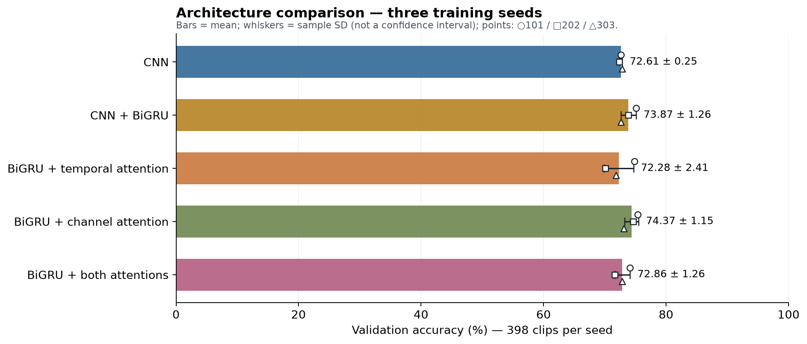

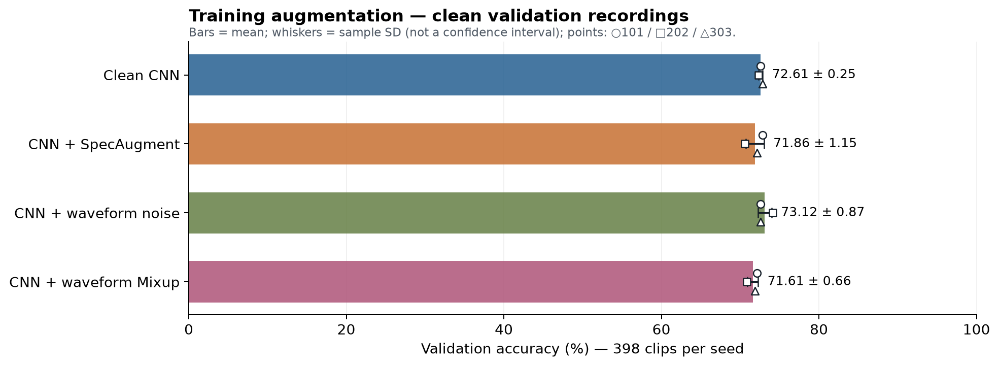

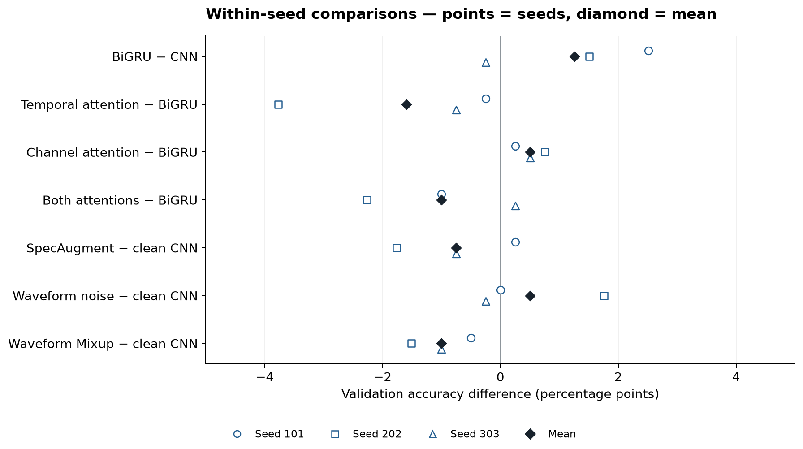

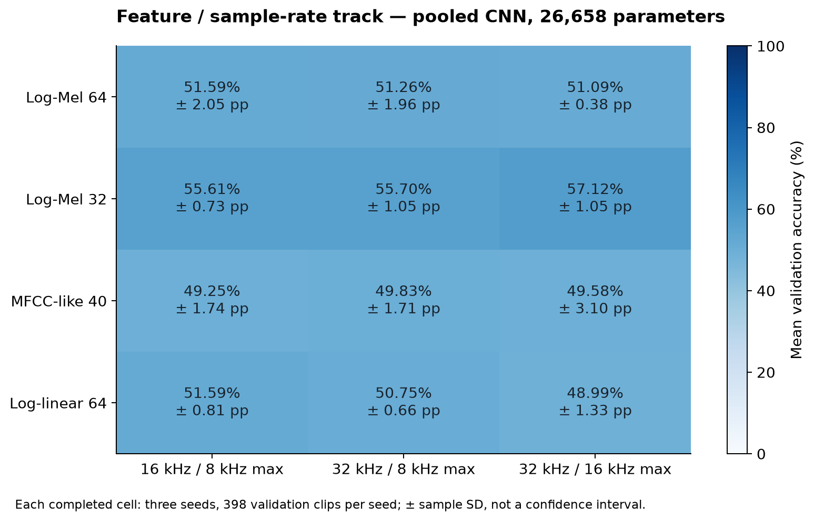

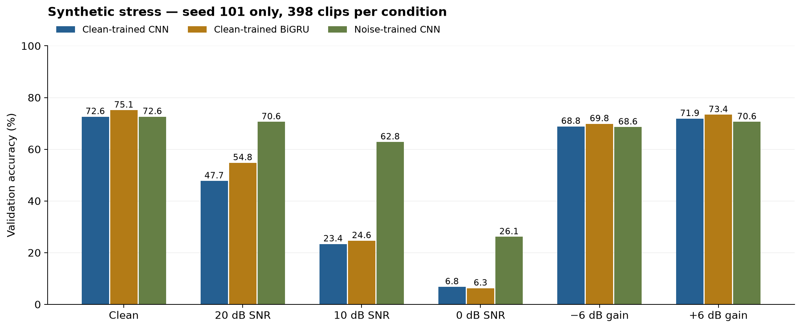

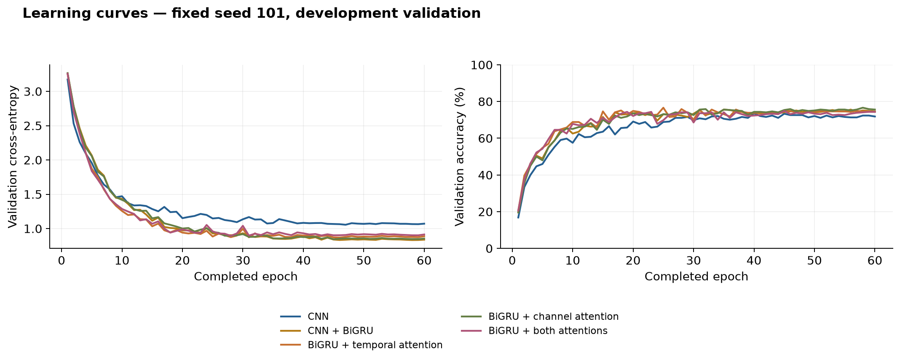

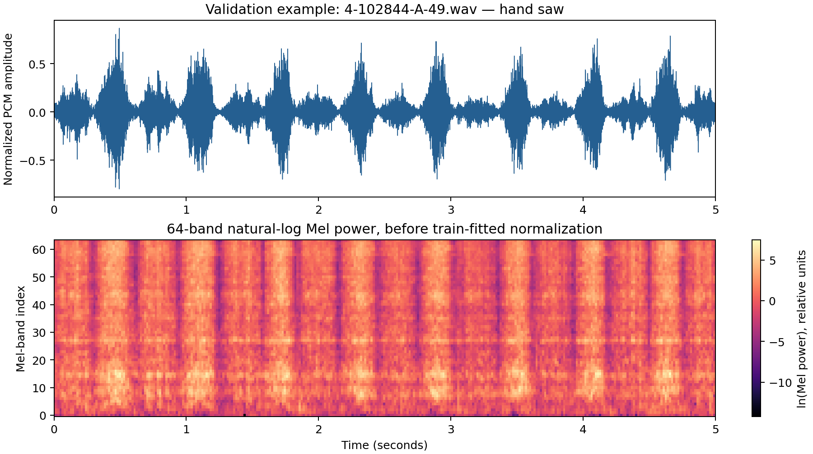

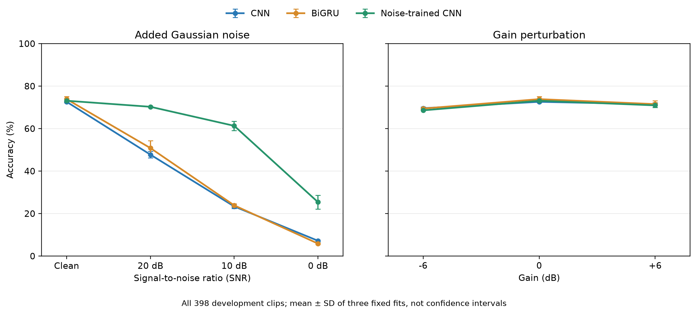

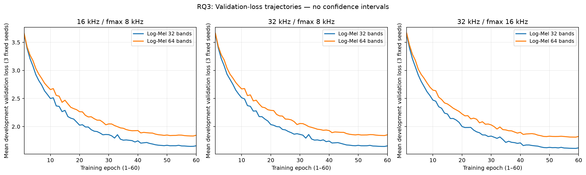

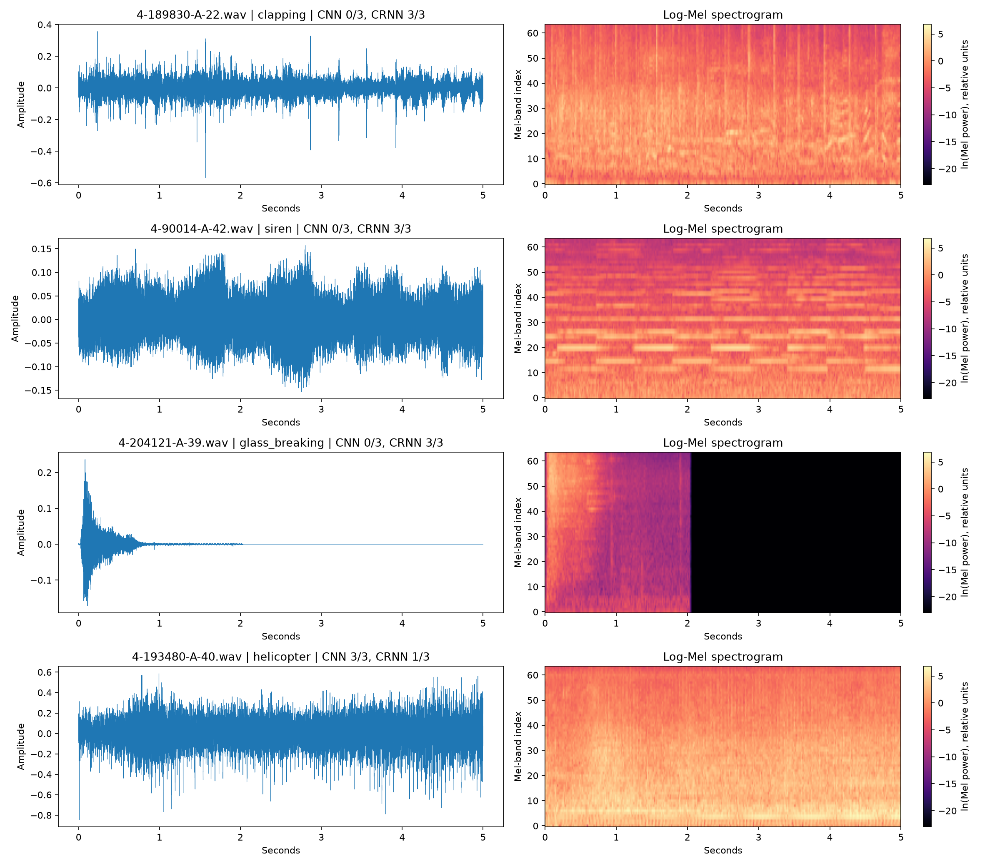

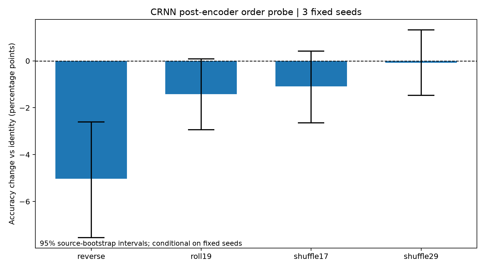

## Appendix B. Historical baseline figures: separate evaluation scope

The following eight figures belong to the earlier CNN/CRNN study, including historical fold-5 evaluation and fixed-recipe fold rotation. They are retained for completeness and provenance, not presented as new independent confirmation or merged into the current development averages.

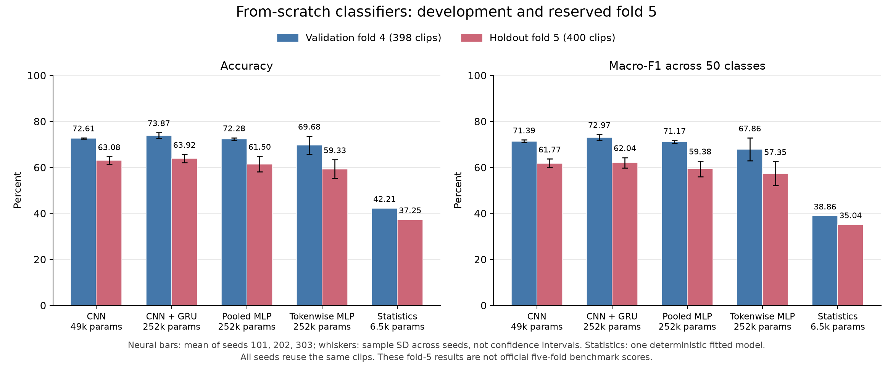

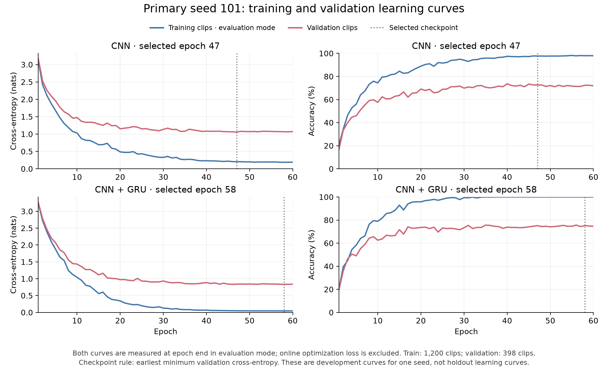

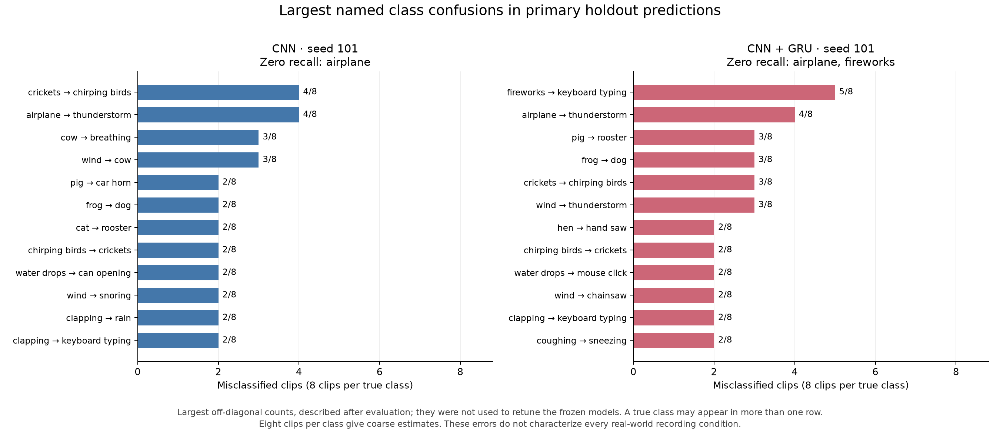

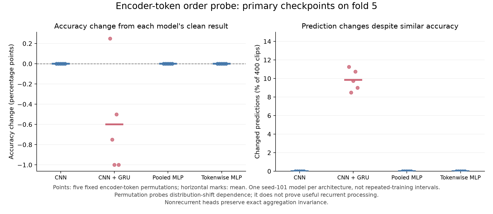

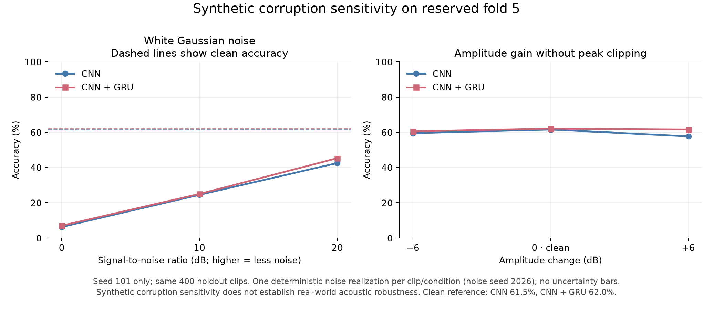

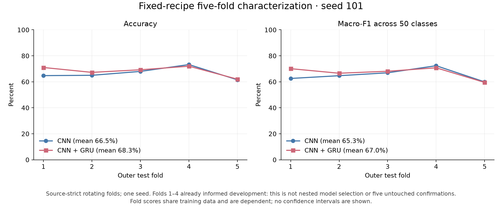

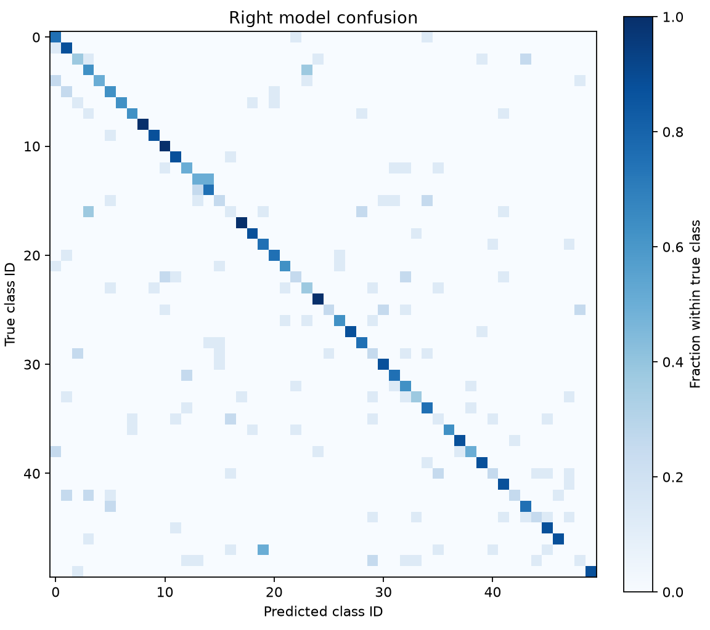

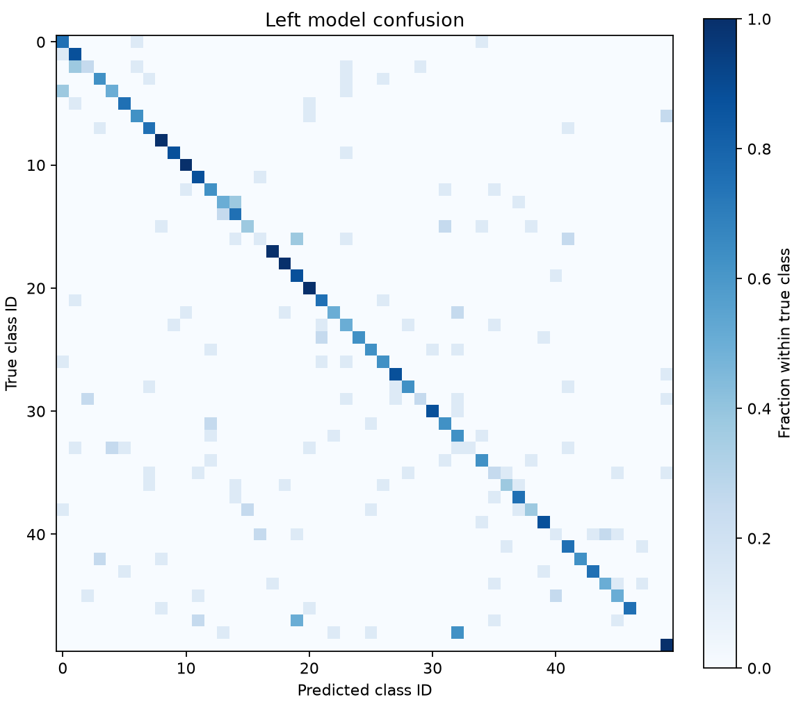

## Appendix C. Original fitted-task ledger

The original matrix has 62 fitted tasks (60 neural fits and two classical fits) plus three original stress tasks. The following are the original development-validation records; follow-up inference adds no fitted models.

| Task ID | Accuracy (%) | Macro-F1 (%) | Selected epoch |
| --- | --- | --- | --- |
| A_logistic | 42.21 | 38.86 | not applicable |
| A_cepstral_svm | 40.20 | 37.50 | not applicable |
| B_cnn_freq_s101 | 72.61 | 71.94 | 47 |
| B_cnn_freq_s202 | 72.36 | 70.79 | 49 |
| B_cnn_freq_s303 | 72.86 | 71.45 | 46 |
| B_crnn_freq_s101 | 75.13 | 74.21 | 58 |
| B_crnn_freq_s202 | 73.87 | 73.18 | 58 |
| B_crnn_freq_s303 | 72.61 | 71.52 | 30 |
| B_crnn_freq_ta_s101 | 74.87 | 74.02 | 46 |
| B_crnn_freq_ta_s202 | 70.10 | 69.22 | 58 |
| B_crnn_freq_ta_s303 | 71.86 | 71.31 | 40 |
| B_crnn_freq_ca_s101 | 75.38 | 74.38 | 45 |
| B_crnn_freq_ca_s202 | 74.62 | 73.64 | 58 |
| B_crnn_freq_ca_s303 | 73.12 | 72.41 | 57 |
| B_crnn_freq_tca_s101 | 74.12 | 72.86 | 28 |
| B_crnn_freq_tca_s202 | 71.61 | 70.21 | 58 |
| B_crnn_freq_tca_s303 | 72.86 | 72.02 | 40 |
| C_specaugment_s101 | 72.86 | 71.96 | 45 |
| C_specaugment_s202 | 70.60 | 69.25 | 58 |
| C_specaugment_s303 | 72.11 | 71.04 | 38 |
| C_noise_s101 | 72.61 | 71.28 | 57 |
| C_noise_s202 | 74.12 | 73.41 | 41 |
| C_noise_s303 | 72.61 | 71.29 | 52 |
| C_mixup_s101 | 72.11 | 71.16 | 58 |
| C_mixup_s202 | 70.85 | 70.40 | 56 |
| C_mixup_s303 | 71.86 | 70.41 | 57 |
| D_sr16_fmax8_logmel64_s101 | 49.25 | 46.02 | 59 |
| D_sr16_fmax8_logmel64_s202 | 52.51 | 49.08 | 49 |
| D_sr16_fmax8_logmel64_s303 | 53.02 | 50.27 | 57 |
| D_sr16_fmax8_logmel32_s101 | 54.77 | 52.42 | 58 |
| D_sr16_fmax8_logmel32_s202 | 56.03 | 53.28 | 58 |
| D_sr16_fmax8_logmel32_s303 | 56.03 | 53.21 | 57 |
| D_sr16_fmax8_mfcc40_s101 | 48.24 | 45.71 | 58 |
| D_sr16_fmax8_mfcc40_s202 | 51.26 | 49.05 | 56 |
| D_sr16_fmax8_mfcc40_s303 | 48.24 | 46.48 | 59 |
| D_sr16_fmax8_loglinear64_s101 | 51.01 | 47.65 | 58 |
| D_sr16_fmax8_loglinear64_s202 | 51.26 | 48.22 | 49 |
| D_sr16_fmax8_loglinear64_s303 | 52.51 | 49.87 | 57 |
| D_sr32_fmax8_logmel64_s101 | 48.99 | 45.78 | 59 |
| D_sr32_fmax8_logmel64_s202 | 52.26 | 49.10 | 49 |
| D_sr32_fmax8_logmel64_s303 | 52.51 | 49.83 | 57 |
| D_sr32_fmax8_logmel32_s101 | 56.53 | 54.17 | 58 |
| D_sr32_fmax8_logmel32_s202 | 54.52 | 51.54 | 58 |
| D_sr32_fmax8_logmel32_s303 | 56.03 | 53.31 | 59 |
| D_sr32_fmax8_mfcc40_s101 | 48.49 | 46.16 | 58 |
| D_sr32_fmax8_mfcc40_s202 | 51.76 | 49.53 | 56 |
| D_sr32_fmax8_mfcc40_s303 | 49.25 | 47.18 | 59 |
| D_sr32_fmax8_loglinear64_s101 | 50.25 | 46.63 | 58 |
| D_sr32_fmax8_loglinear64_s202 | 50.50 | 46.72 | 49 |
| D_sr32_fmax8_loglinear64_s303 | 51.51 | 49.39 | 57 |
| D_sr32_fmax16_logmel64_s101 | 50.75 | 47.91 | 58 |
| D_sr32_fmax16_logmel64_s202 | 51.51 | 48.84 | 49 |
| D_sr32_fmax16_logmel64_s303 | 51.01 | 48.23 | 57 |
| D_sr32_fmax16_logmel32_s101 | 56.78 | 54.24 | 58 |
| D_sr32_fmax16_logmel32_s202 | 56.28 | 53.28 | 56 |
| D_sr32_fmax16_logmel32_s303 | 58.29 | 56.26 | 57 |
| D_sr32_fmax16_mfcc40_s101 | 46.98 | 44.76 | 54 |
| D_sr32_fmax16_mfcc40_s202 | 53.02 | 50.50 | 56 |
| D_sr32_fmax16_mfcc40_s303 | 48.74 | 46.62 | 59 |
| D_sr32_fmax16_loglinear64_s101 | 47.99 | 45.38 | 58 |
| D_sr32_fmax16_loglinear64_s202 | 48.49 | 44.81 | 49 |
| D_sr32_fmax16_loglinear64_s303 | 50.50 | 48.07 | 57 |

## Appendix D. Completed three-seed robustness ledger

All rows use the same 398 validation recordings. Training seeds identify fixed fits, not independent audio datasets.

| Model | Seed | Condition | Accuracy (%) | Correct | Clips |
| --- | --- | --- | --- | --- | --- |
| cnn | 101 | clean | 72.61 | 289 | 398 |
| cnn | 101 | snr_20 | 47.74 | 190 | 398 |
| cnn | 101 | snr_10 | 23.37 | 93 | 398 |
| cnn | 101 | snr_0 | 6.78 | 27 | 398 |
| cnn | 101 | gain_-6 | 68.84 | 274 | 398 |
| cnn | 101 | gain_6 | 71.86 | 286 | 398 |
| cnn | 202 | clean | 72.36 | 288 | 398 |
| cnn | 202 | snr_20 | 49.25 | 196 | 398 |
| cnn | 202 | snr_10 | 24.37 | 97 | 398 |
| cnn | 202 | snr_0 | 7.54 | 30 | 398 |
| cnn | 202 | gain_-6 | 69.85 | 278 | 398 |
| cnn | 202 | gain_6 | 70.60 | 281 | 398 |
| cnn | 303 | clean | 72.86 | 290 | 398 |
| cnn | 303 | snr_20 | 46.23 | 184 | 398 |
| cnn | 303 | snr_10 | 22.36 | 89 | 398 |
| cnn | 303 | snr_0 | 7.29 | 29 | 398 |
| cnn | 303 | gain_-6 | 70.10 | 279 | 398 |
| cnn | 303 | gain_6 | 71.86 | 286 | 398 |
| crnn | 101 | clean | 75.13 | 299 | 398 |
| crnn | 101 | snr_20 | 54.77 | 218 | 398 |
| crnn | 101 | snr_10 | 24.62 | 98 | 398 |
| crnn | 101 | snr_0 | 6.28 | 25 | 398 |
| crnn | 101 | gain_-6 | 69.85 | 278 | 398 |
| crnn | 101 | gain_6 | 73.37 | 292 | 398 |
| crnn | 202 | clean | 73.87 | 294 | 398 |
| crnn | 202 | snr_20 | 48.24 | 192 | 398 |
| crnn | 202 | snr_10 | 23.12 | 92 | 398 |
| crnn | 202 | snr_0 | 5.53 | 22 | 398 |
| crnn | 202 | gain_-6 | 69.35 | 276 | 398 |
| crnn | 202 | gain_6 | 70.60 | 281 | 398 |
| crnn | 303 | clean | 72.61 | 289 | 398 |
| crnn | 303 | snr_20 | 49.50 | 197 | 398 |
| crnn | 303 | snr_10 | 23.87 | 95 | 398 |
| crnn | 303 | snr_0 | 5.78 | 23 | 398 |
| crnn | 303 | gain_-6 | 69.10 | 275 | 398 |
| crnn | 303 | gain_6 | 70.60 | 281 | 398 |
| noise_cnn | 101 | clean | 72.61 | 289 | 398 |
| noise_cnn | 101 | snr_20 | 70.60 | 281 | 398 |
| noise_cnn | 101 | snr_10 | 62.81 | 250 | 398 |
| noise_cnn | 101 | snr_0 | 26.13 | 104 | 398 |
| noise_cnn | 101 | gain_-6 | 68.59 | 273 | 398 |
| noise_cnn | 101 | gain_6 | 70.60 | 281 | 398 |
| noise_cnn | 202 | clean | 74.12 | 295 | 398 |
| noise_cnn | 202 | snr_20 | 70.10 | 279 | 398 |
| noise_cnn | 202 | snr_10 | 58.79 | 234 | 398 |
| noise_cnn | 202 | snr_0 | 21.86 | 87 | 398 |
| noise_cnn | 202 | gain_-6 | 68.59 | 273 | 398 |
| noise_cnn | 202 | gain_6 | 70.10 | 279 | 398 |
| noise_cnn | 303 | clean | 72.61 | 289 | 398 |
| noise_cnn | 303 | snr_20 | 70.10 | 279 | 398 |
| noise_cnn | 303 | snr_10 | 62.31 | 248 | 398 |
| noise_cnn | 303 | snr_0 | 28.14 | 112 | 398 |
| noise_cnn | 303 | gain_-6 | 68.59 | 273 | 398 |
| noise_cnn | 303 | gain_6 | 72.11 | 287 | 398 |

## Appendix E. Temporal-intervention ledger

Changed predictions are relative to each checkpoint's own identity predictions. The intervention reorders encoded tokens, not waveform samples. The first float32 absolute-tolerance failure and corrected numerical interpretation are retained in the project records.

| Model | Seed | Condition | Accuracy (%) | Changed predictions | Clips |
| --- | --- | --- | --- | --- | --- |
| cnn_freq | 101 | identity | 72.61 | 0 | 398 |
| cnn_freq | 101 | reverse | 72.61 | 0 | 398 |
| cnn_freq | 101 | roll19 | 72.61 | 0 | 398 |
| cnn_freq | 101 | shuffle17 | 72.61 | 0 | 398 |
| cnn_freq | 101 | shuffle29 | 72.61 | 0 | 398 |
| cnn_freq | 202 | identity | 72.36 | 0 | 398 |
| cnn_freq | 202 | reverse | 72.36 | 0 | 398 |
| cnn_freq | 202 | roll19 | 72.36 | 0 | 398 |
| cnn_freq | 202 | shuffle17 | 72.36 | 0 | 398 |
| cnn_freq | 202 | shuffle29 | 72.36 | 0 | 398 |
| cnn_freq | 303 | identity | 72.86 | 0 | 398 |
| cnn_freq | 303 | reverse | 72.86 | 0 | 398 |
| cnn_freq | 303 | roll19 | 72.86 | 0 | 398 |
| cnn_freq | 303 | shuffle17 | 72.86 | 0 | 398 |
| cnn_freq | 303 | shuffle29 | 72.86 | 0 | 398 |
| crnn_freq | 101 | identity | 75.13 | 0 | 398 |
| crnn_freq | 101 | reverse | 69.10 | 71 | 398 |
| crnn_freq | 101 | roll19 | 73.37 | 39 | 398 |
| crnn_freq | 101 | shuffle17 | 72.86 | 39 | 398 |
| crnn_freq | 101 | shuffle29 | 74.12 | 37 | 398 |
| crnn_freq | 202 | identity | 73.87 | 0 | 398 |
| crnn_freq | 202 | reverse | 68.84 | 78 | 398 |
| crnn_freq | 202 | roll19 | 73.62 | 38 | 398 |
| crnn_freq | 202 | shuffle17 | 73.62 | 39 | 398 |
| crnn_freq | 202 | shuffle29 | 74.62 | 41 | 398 |
| crnn_freq | 303 | identity | 72.61 | 0 | 398 |
| crnn_freq | 303 | reverse | 68.59 | 57 | 398 |
| crnn_freq | 303 | roll19 | 70.35 | 35 | 398 |
| crnn_freq | 303 | shuffle17 | 71.86 | 39 | 398 |
| crnn_freq | 303 | shuffle29 | 72.61 | 34 | 398 |

## Appendix F. Sources, analysis and completion status

- [Official ESC-50 dataset and credits](https://github.com/karolpiczak/ESC-50). Dataset license and recording metadata remain in the project.
- [Original matrix summary tables](../evidence/matrix_20261028/analysis/).
- [Completed prediction and robustness analysis](../followup_20261104/report_en.md).
- [Temporal-order probe and numerical implementation record](../temporal_20261105/README.md).
- [New attention paired effects](attention_paired_effects.json).
- [Model-decision meeting and manuscript review](../../docs/research_meetings/2026-11-05_model_decision.md).
- [Initial attention methods, with completed-training update](../../docs/methodology/attention_phase1.md).
- [PANNs author repository](https://github.com/qiuqiangkong/audioset_tagging_cnn) and [AST author repository](https://github.com/YuanGongND/ast) document external-pretraining routes. No such models were downloaded, trained or evaluated here; published benchmark protocols and extra data differ from this study.

This report closes the current executed research scope. It preserves the original study and all available figure originals. Further model-performance optimization is a separately proposed phase, not an unperformed requirement hidden inside this completion claim. The report and computational analyses are agent-produced; role-based ChatGPT discussion is not independent human peer review. No new training, test-fold inference, file-hash verification or test-suite expansion was performed to produce this final document.
