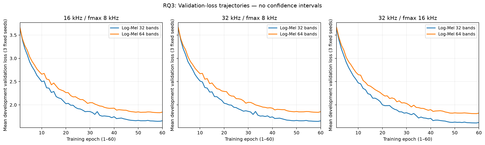

# RQ3 — Offline Feature Convergence

Observed late-best runs: **30/36** (previous review reported 30/36; actual histories are authoritative).

Checkpoint: earliest minimum validation loss. Changes: epoch 60 minus epoch 50.

| Case | Late/3 | Best epoch mean±SD | Selected accuracy % mean±SD | Loss Δ | Accuracy Δ (pp) |
|---|---:|---:|---:|---:|---:|
| sr16_fmax8_logmel64 | 2 | 55.0±5.3 | 51.59±2.05 | -0.0039 | -0.08 |
| sr16_fmax8_logmel32 | 3 | 57.7±0.6 | 55.61±0.73 | -0.0090 | -0.34 |
| sr16_fmax8_mfcc40 | 3 | 57.7±1.5 | 49.25±1.74 | -0.0010 | +0.42 |
| sr16_fmax8_loglinear64 | 2 | 54.7±4.9 | 51.59±0.81 | -0.0089 | +0.59 |
| sr32_fmax8_logmel64 | 2 | 55.0±5.3 | 51.26±1.96 | -0.0044 | -0.08 |
| sr32_fmax8_logmel32 | 3 | 58.3±0.6 | 55.70±1.05 | -0.0095 | +1.01 |
| sr32_fmax8_mfcc40 | 3 | 57.7±1.5 | 49.83±1.71 | -0.0003 | +0.00 |
| sr32_fmax8_loglinear64 | 2 | 54.7±4.9 | 50.75±0.66 | -0.0079 | +1.01 |
| sr32_fmax16_logmel64 | 2 | 54.7±4.9 | 51.09±0.38 | -0.0043 | -0.08 |
| sr32_fmax16_logmel32 | 3 | 57.0±1.0 | 57.12±1.05 | -0.0087 | +0.25 |
| sr32_fmax16_mfcc40 | 3 | 56.3±2.5 | 49.58±3.10 | -0.0019 | -0.92 |
| sr32_fmax16_loglinear64 | 2 | 54.7±4.9 | 48.99±1.33 | -0.0045 | +0.08 |

## Paired selected-accuracy difference: Log-Mel 32 − 64 (pp)

| Sampling config | Seed 101 | Seed 202 | Seed 303 | Mean±SD |
|---|---:|---:|---:|---:|
| 16 kHz / fmax 8 kHz | +5.53 | +3.52 | +3.02 | +4.02±1.33 |
| 32 kHz / fmax 8 kHz | +7.54 | +2.26 | +3.52 | +4.44±2.76 |
| 32 kHz / fmax 16 kHz | +6.03 | +4.77 | +7.29 | +6.03±1.26 |

## Interpretation
Late-best checkpoint selection does not prove non-convergence. These are fixed 60-epoch budget comparisons, not asymptotic results.
The 26,658-parameter pooled CNN differs from the main 49,058-parameter CNN; architectural effects cannot be ignored.
All validation results are development-fold observations. Three fixed-seed sample SDs are descriptive, not confidence intervals. No new training or test-fold evaluation was performed.

Log-Mel 32 loss separates from Log-Mel 64 before the final ten epochs; this does not establish asymptotic convergence or superiority under the main architecture.
