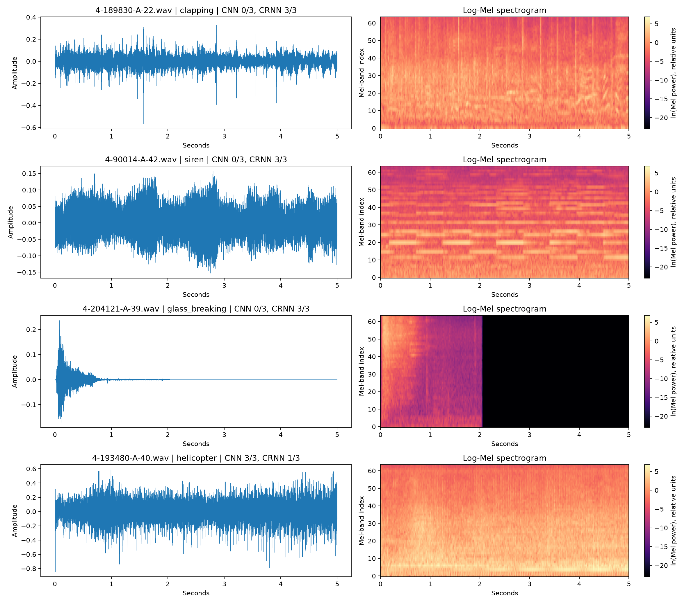

# RQ1: Real-audio error-case inspection

| Category | Filename | CNN /3 | CRNN /3 | Difference | Local WAV |
|---|---|---:|---:|---:|---|
| clapping | 4-189830-A-22.wav | 0 | 3 | +3 | `/Users/richardhuang/Desktop/ComputerVision/ai-research-engineering/projects/esc50-sound-classification/data/ESC-50/audio/4-189830-A-22.wav` |
| siren | 4-90014-A-42.wav | 0 | 3 | +3 | `/Users/richardhuang/Desktop/ComputerVision/ai-research-engineering/projects/esc50-sound-classification/data/ESC-50/audio/4-90014-A-42.wav` |
| glass_breaking | 4-204121-A-39.wav | 0 | 3 | +3 | `/Users/richardhuang/Desktop/ComputerVision/ai-research-engineering/projects/esc50-sound-classification/data/ESC-50/audio/4-204121-A-39.wav` |
| helicopter | 4-193480-A-40.wav | 3 | 1 | -2 | `/Users/richardhuang/Desktop/ComputerVision/ai-research-engineering/projects/esc50-sound-classification/data/ESC-50/audio/4-193480-A-40.wav` |

Selection uses observed CRNN-minus-CNN correct counts: maximum for clapping, siren and glass_breaking; minimum for helicopter; filename breaks ties.

These four exploratory selected samples are not representative class-level proof. No human listening, label-error finding, or causal time-region interpretation is claimed.

## Prediction details for the selected clips

| True class | CNN predictions (101 / 202 / 303) | CRNN predictions (101 / 202 / 303) |
| --- | --- | --- |
| clapping | door_wood_creaks / door_wood_creaks / door_wood_creaks | clapping / clapping / clapping |
| siren | cat / cat / cat | siren / siren / siren |
| glass_breaking | can_opening / can_opening / can_opening | glass_breaking / glass_breaking / glass_breaking |
| helicopter | helicopter / helicopter / helicopter | wind / helicopter / train |

The glass-breaking example has a short high-energy onset and a long trailing low-energy/zero region in the plotted waveform. The siren example shows sustained harmonic bands. These are visual observations of selected inputs, not evidence that the recurrent model used those regions. Silence duration and recording artifacts are competing explanations to retain when interpreting temporal structure.
