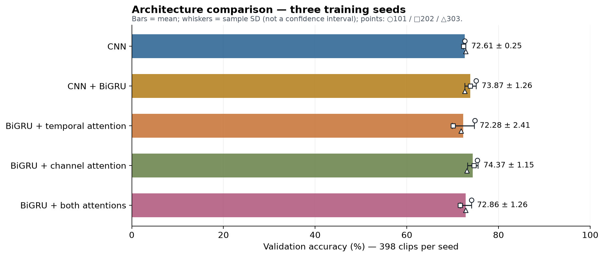
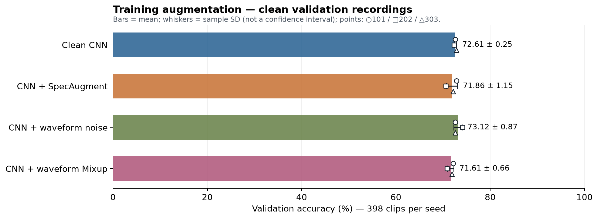
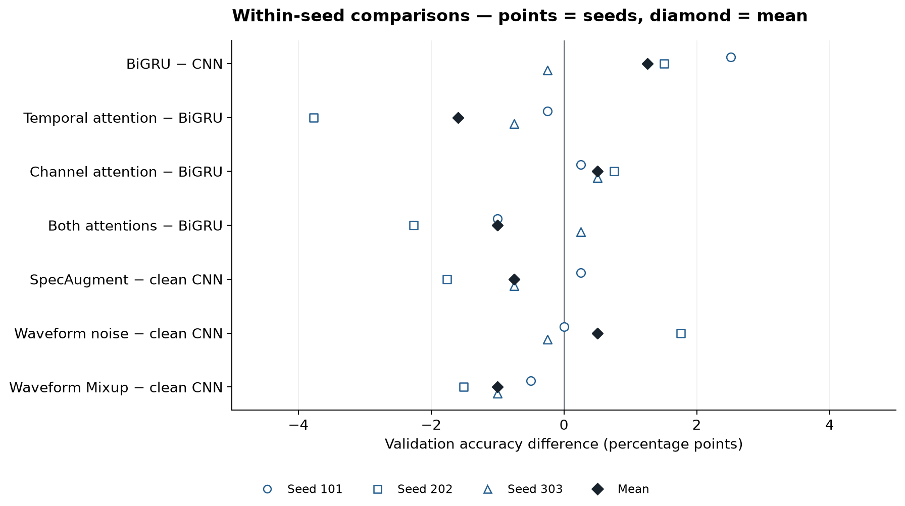
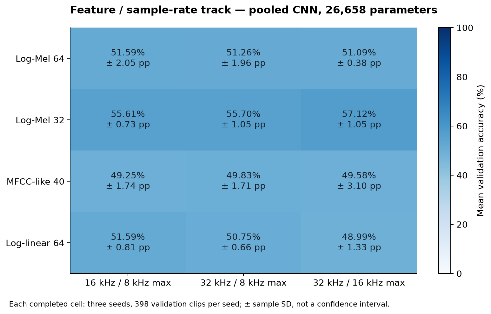
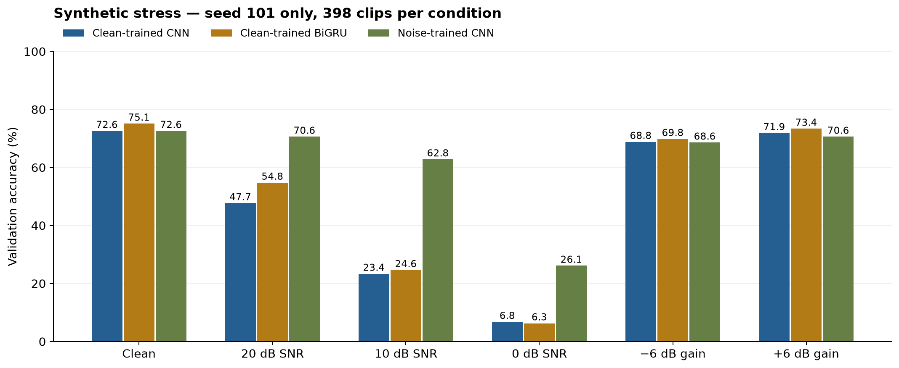
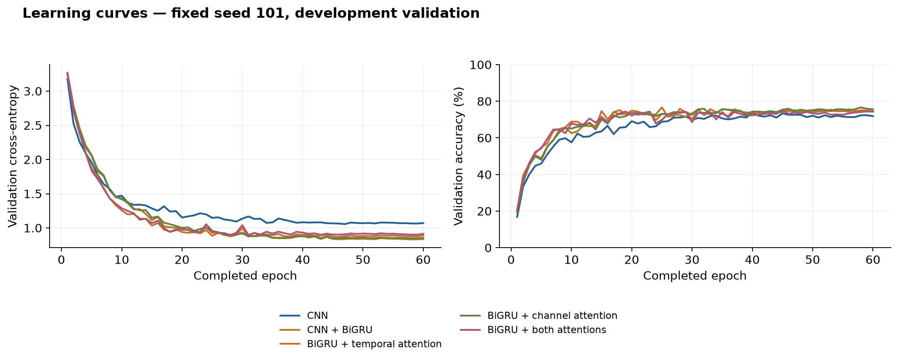

# ESC-50 full review and Colab execution report

Finalized: 29 October 2026; main experiments ran on 28 October. This report covers the supplied Downloads project and standalone Study Matrix. **65/65 tasks were executed, downloaded and audited**, including 60 neural runs completing 60 epochs each. This is development-validation research; historical test exposure prevents a claim of fresh independent confirmation.

The architecture group with the highest validation mean is **BiGRU + Channel Attention: 74.37%**, +0.50 percentage points relative to the original BiGRU. The highest feature-track mean is `sr32_fmax16_logmel32` at 57.12%; that track uses a different pooled CNN and is not a single-variable replacement for the main architecture. At 0 dB Gaussian-noise SNR, noise-trained versus clean-trained CNN changes accuracy by **+19.35 points**. All conditions are reported below.

[English content guide](../../docs/guides/guide_en.md) · [中文报告](report_zh.md)

## 1. Review findings and repairs

| Severity | Demonstrated issue | Verified repair |
| --- | --- | --- |
| P1 | Stale directories could impersonate completed tasks | Check task/config/cache/source/checkpoint identity, full history and prediction metrics |
| P1 | ID-only matrix checks ignored semantic changes | Consume matrix with schema, split, budget and semantic validation |
| P1 | Silent subprocesses could evade timeout | Poll output/process and terminate its group at command/session deadline |
| P1 | Feature aggregation admitted incomplete/fabricated records | Validate full exposure, selected epoch, weights, membership/labels and metrics; publish completion last |
| P1 | Live Colab kernel did not discover editable installation | Add verified source directory to live kernel; pilot rerun succeeded |
| P2 | Results view omitted stress.json | Add explicit three-model × six-condition result table |
| P1 | CI omitted baseline dependencies required by its tests | Install dev, baseline and report extras in CI and current guide |

The repaired project passed 274 tests locally and 274 in Colab; the final notebook contains no error outputs. Initial issues were a missing local scikit-learn dependency, omitted historical test fixtures in our first cloud upload, and a live-kernel import error after CNN pilot training. Logs are retained; failed execution was not counted as success. CI configuration was repaired, but no GitHub Actions run is claimed.

## 2. Executed scope and data protocol

| Group | Tasks | Executed content |
| --- | --- | --- |
| A | 2 | Log-Mel statistics + logistic; cepstral statistics + LinearSVC |
| B | 15 | CNN, BiGRU, TA, CA, TCA × three seeds |
| C | 9 | SpecAugment, waveform noise, waveform Mixup × three seeds |
| D | 36 | 12 feature/sampling cases × three seeds |
| E | 3 | Six validation stress conditions for each of three seed101 checkpoints |

Three two-epoch pilots and one real-data resume probe are stored separately and excluded from the 60 main runs and their means. PANNs/AST/BEATs/CLAP/RL are not implemented; no execution or score is invented. No new fold 5 evaluation or confirmation CV was performed. Software tests check old fixtures, which is distinct from evaluating new models on test audio.

The pinned ESC-50 data contains 2,000 five-second clips in 50 classes. Original WAVs were downloaded and a v2 cache prepared; all 2,000 cached identities/labels align with original metadata. Train folds 1–3, validation fold 4 and designated test role fold 5 become **1200 / 398 / 400** after source-strict exclusions. Validation classes 6 and 37 have seven clips each; all others have eight. Normalization is fitted only on training clips. Exact cross-fold duplicate checks passed; perceptual near-duplicate auditing is incomplete.

Main input: 16 kHz mono → 512-sample Hann STFT, hop 256 → 64 HTK Mel-power bands → natural log → train-only band normalization, shape `[B,1,64,313]`. The encoder outputs `[B,64,8,39]`; GRU input is `[B,39,512]`, with 64 hidden units per direction and 128 output features. TA learns softmax time weights; CA uses 64 → 8 → 64 gates with 2 × sigmoid and identity initialization.

Neural runs use 60 epochs, batch size 32, AdamW (learning rate 0.001, weight decay 0.0001), cosine scheduling and gradient clipping at 5. Main training records 1,200 examples and 38 updates per epoch, or 2,280 updates in total. Every run receives the same 60-epoch budget; selected weights may come from an earlier epoch with the earliest minimum validation cross-entropy. Logistic also selects by validation cross-entropy; SVM selects accuracy, then macro-F1 and smaller C. Accuracy and equally weighted 50-class macro-F1 are recalculated from per-clip predictions.

## 3. Classical baselines and architecture results

| Baseline | Accuracy | Macro-F1 | Selected parameter |
| --- | --- | --- | --- |
| logistic | 42.21% | 38.86% | 0.001 |
| cepstral_svm | 40.20% | 37.50% | 1.0 |

Logistic uses 128 temporal Log-Mel means/standard deviations; SVM uses 40 statistics from 20 DCT coefficients. Features, classifier and selection rule differ, so the score difference cannot be attributed to classifier choice alone. Candidate convergence was checked.

| Model | Accuracy: 101 / 202 / 303 | Accuracy mean ± SD (%) | Macro-F1 mean ± SD (%) | Parameters |
| --- | --- | --- | --- | --- |
| CNN | 72.61%, 72.36%, 72.86% | 72.61 ± 0.25 | 71.39 ± 0.58 | 49058 |
| CNN + BiGRU | 75.13%, 73.87%, 72.61% | 73.87 ± 1.26 | 72.97 ± 1.36 | 251810 |
| BiGRU + Temporal Attention | 74.87%, 70.10%, 71.86% | 72.28 ± 2.41 | 71.52 ± 2.41 | 251939 |
| BiGRU + Channel Attention | 75.38%, 74.62%, 73.12% | 74.37 ± 1.15 | 73.48 ± 1.00 | 252906 |
| BiGRU + Temporal + Channel Attention | 74.12%, 71.61%, 72.86% | 72.86 ± 1.26 | 71.69 ± 1.35 | 253035 |



Three-seed development validation; SD is not a confidence interval. [Data / 数据](../evidence/matrix_20261028/analysis/groups.csv) · [Plot code / 绘图代码](../../scripts/plot_colab_matrix.py)

All six new CNN/GRU runs match the historical development selected epochs, every validation prediction and weight tensors exactly. This is regression evidence from actual reruns, not reused old scores relabeled as new experiments.

## 4. Augmentation and paired changes

| Training condition | Accuracy mean ± SD (%) | Macro-F1 mean ± SD (%) |
| --- | --- | --- |
| Clean CNN | 72.61 ± 0.25 | 71.39 ± 0.58 |
| specaugment | 71.86 ± 1.15 | 70.75 ± 1.38 |
| noise | 73.12 ± 0.87 | 71.99 ± 1.23 |
| mixup | 71.61 ± 0.66 | 70.65 ± 0.44 |



Augmentation affects training only; validation recordings stay clean. [Data / 数据](../evidence/matrix_20261028/analysis/groups.csv) · [Plot code / 绘图代码](../../scripts/plot_colab_matrix.py)

SpecAugment masks normalized time/frequency regions; noise adds Gaussian corruption with probability 0.5 at 10–30 dB; Mixup combines waveforms and both label losses with Beta(0.4, 0.4). Augmented and clean training losses are different objectives and are not directly ranked against one another.

| Paired contrast | Per-seed accuracy delta (pp) | Mean ± SD (pp) | Mean macro-F1 delta (pp) |
| --- | --- | --- | --- |
| attention_ca_vs_gru | +0.25, +0.75, +0.50 | +0.50 ± 0.25 | +0.51 |
| attention_interaction | -1.01, +0.75, +0.50 | +0.08 ± 0.95 | -0.33 |
| attention_ta_vs_gru | -0.25, -3.77, -0.75 | -1.59 ± 1.90 | -1.45 |
| attention_tca_vs_gru | -1.01, -2.26, +0.25 | -1.01 ± 1.26 | -1.28 |
| gru_vs_cnn | +2.51, +1.51, -0.25 | +1.26 ± 1.40 | +1.58 |
| mixup_vs_clean_cnn | -0.50, -1.51, -1.01 | -1.01 ± 0.50 | -0.74 |
| noise_vs_clean_cnn | +0.00, +1.76, -0.25 | +0.50 ± 1.10 | +0.60 |
| specaugment_vs_clean_cnn | +0.25, -1.76, -0.75 | -0.75 ± 1.01 | -0.64 |



Within-seed deltas; these are not significance tests. [Data / 数据](../evidence/matrix_20261028/analysis/paired_contrasts.csv) · [Plot code / 绘图代码](../../scripts/plot_colab_matrix.py)

Attention interaction is TCA − TA − CA + original GRU, describing deviation from additive module effects rather than proving an unconfounded causal mechanism. Three seeds reuse the same 398 validation clips; they are not independent datasets, and seed SD is not a dataset-sampling confidence interval.

## 5. Twelve feature and sampling-rate conditions

| Case | Accuracy mean ± SD (%) | Macro-F1 mean ± SD (%) |
| --- | --- | --- |
| sr16_fmax8_loglinear64 | 51.59 ± 0.81 | 48.58 ± 1.15 |
| sr16_fmax8_logmel32 | 55.61 ± 0.73 | 52.97 ± 0.48 |
| sr16_fmax8_logmel64 | 51.59 ± 2.05 | 48.46 ± 2.20 |
| sr16_fmax8_mfcc40 | 49.25 ± 1.74 | 47.08 ± 1.75 |
| sr32_fmax16_loglinear64 | 48.99 ± 1.33 | 46.09 ± 1.74 |
| sr32_fmax16_logmel32 | 57.12 ± 1.05 | 54.59 ± 1.52 |
| sr32_fmax16_logmel64 | 51.09 ± 0.38 | 48.33 ± 0.48 |
| sr32_fmax16_mfcc40 | 49.58 ± 3.10 | 47.29 ± 2.93 |
| sr32_fmax8_loglinear64 | 50.75 ± 0.66 | 47.58 ± 1.57 |
| sr32_fmax8_logmel32 | 55.70 ± 1.05 | 53.00 ± 1.34 |
| sr32_fmax8_logmel64 | 51.26 ± 1.96 | 48.23 ± 2.16 |
| sr32_fmax8_mfcc40 | 49.83 ± 1.71 | 47.63 ± 1.73 |



Track D uses the 26,658-parameter pooled CNN; interpret separately from the main architecture track. [Data / 数据](../evidence/matrix_20261028/analysis/groups.csv) · [Plot code / 绘图代码](../../scripts/plot_colab_matrix.py)

Representations are Log-Mel 64, Log-Mel 32, the first 40 orthonormal DCT-II coefficients of 64-band Log-Mel, and Log-linear 64. Conditions are 16k/F8, 32k/F8 and 32k/F16, with 32 ms windows, 16 ms hops and 313 frames. The 16k/F8 → 32k/F8 comparison matches usable bandwidth; 32k/F8 → 32k/F16 adds high frequencies and changes filter spacing. MFCC changes row count and coordinate meaning. Equal parameter count does not imply equal computation or a pure single-variable causal experiment. All 17 × 3 within-track paired contrasts are retained in CSV; missing scores were never imputed as zero.

## 6. Noise and gain sensitivity

| Condition | Clean-trained CNN | Clean-trained BiGRU | Noise-trained CNN |
| --- | --- | --- | --- |
| clean | 72.61% | 75.13% | 72.61% |
| snr_20 | 47.74% | 54.77% | 70.60% |
| snr_10 | 23.37% | 24.62% | 62.81% |
| snr_0 | 6.78% | 6.28% | 26.13% |
| gain_-6 | 68.84% | 69.85% | 68.59% |
| gain_6 | 71.86% | 73.37% | 70.60% |



398 clips per cell; one selected seed101 checkpoint per model. [Data / 数据](../evidence/matrix_20261028/analysis/stress.csv) · [Plot code / 绘图代码](../../scripts/plot_colab_matrix.py)

These are deterministic, per-clip RMS-scaled Gaussian-noise and gain interventions, with identical realizations across models and no peak clipping. 0 dB equates added-noise and original-recording RMS power; the original ambient SNR is unknown. Improvements on these conditions do not establish robustness to field noise, rooms, devices or unknown classes. Track E covers three checkpoints, not three-seed robustness.

## 7. Integrity, replay and efficiency evidence

An independent script recalculates 50-class confusion matrices, accuracy and macro-F1 from CSVs, checking all 65 tasks, full epoch budgets, selected epochs and configurations. Colab then re-executes the project frontends and models from original validation WAVs: **62 fitted models × 398 clips = 24,676 predictions all reproduce**. This is actual forward replay rather than reading saved scores. A real-data probe pauses after one epoch and resumes for epoch 2, matching uninterrupted pilot weights bit-for-bit. Resume evidence applies to the same runtime/code/data, not arbitrary versions or devices.

| Model | CPU WAV→logits p95(ms) | T4 WAV→logits p95(ms) | Checkpoint(KiB) |
| --- | --- | --- | --- |
| CNN | 25.787 | 16.045 | 281.1 |
| CNN + BiGRU | 24.477 | 17.860 | 1075.4 |
| BiGRU + Temporal Attention | 32.398 | 16.501 | 1076.5 |
| BiGRU + Channel Attention | 25.846 | 17.290 | 1080.9 |
| BiGRU + Temporal + Channel Attention | 35.366 | 17.276 | 1081.9 |

Measured on Colab `Intel(R) Xeon(R) CPU @ 2.00GHz` / `Tesla T4` with 2 CPU threads, batch size 1, float32, 10 warmups, 100 repetitions and one fixed validation WAV. CUDA is synchronized. WAV-to-logits includes decoding, frontend and transfer, excluding model loading, process startup and service queues. Torch peak allocated memory is not total driver memory. Recorded training-loop wall times for 60 runs sum to 72.75 minutes, including in-loop validation/checkpoint writes but excluding initialization, cache/WAV loading and verification, acquisition/preparation, pilots/probes, idle and export; this is not total session time. Paid spend was 0, with no upgrade or resource purchase.



Fixed-seed101 validation curves; checkpoints use minimum cross-entropy. [Data / 数据](../figures/matrix_20261028/learning_curve_data.csv) · [Plot code / 绘图代码](../../scripts/plot_colab_matrix.py)

### Per-class error slices: fixed seed101

| Model | Zero-recall classes | Three lowest-recall classes:correct/support |
| --- | --- | --- |
| CNN | 0 | sheep 2/8; wind 3/8; clapping 3/8 |
| CNN + BiGRU | 0 | helicopter 1/8; door_wood_creaks 2/8; sheep 3/8 |
| BiGRU + Temporal Attention | 0 | door_wood_creaks 1/8; helicopter 1/8; wind 3/8 |
| BiGRU + Channel Attention | 0 | helicopter 1/8; drinking_sipping 2/8; door_wood_creaks 2/8 |
| BiGRU + Temporal + Channel Attention | 0 | drinking_sipping 1/8; helicopter 1/8; wind 2/8 |

Each class has only 7 or 8 validation clips, so one error substantially changes per-class recall. These slices are exploratory diagnostics. Every run retains its full confusion matrix and per-clip predictions; an aggregate score must not conceal class-specific failures.

## 8. Limits and next decision

This round establishes architecture, augmentation, representation and synthetic-stress behavior within the declared development protocol, not SOTA, algorithmic novelty or production readiness. Attention is not guaranteed to help; assess all seeds and small effects instead of the highest single score. Equal epoch budgets do not match parameters, FLOPs and latency simultaneously. The bidirectional GRU is an offline model, not evidence of causal streaming recognition. Attention weights are not reliable causal explanations.

**Do not subtract the old roughly 62% test result from the new 70%+ validation results and call the gap improvement.** They measure different recordings and purposes. Historical fold 5 three-seed means are 63.08% for CNN and 63.92% for GRU, referenced only as old evidence; this round does not reconfirm them. All ESC-50 folds have prior exposure, so further selection remains exploratory. Confirmation requires a new source-isolated evaluation boundary and defined real-noise needs; renaming an old fold cannot restore blindness.

The old CNN bundle remains the historical default. All new models are delivered as research checkpoints, retaining negative findings and failure logs. CV exam learning records were untouched; agent-produced work is not presented as user mastery, external human replication or institutional certification.

## 9. Evidence and reproduction

[Per-run results](../evidence/matrix_20261028/analysis/runs.csv) · [Three-seed aggregates](../evidence/matrix_20261028/analysis/groups.csv) · [75 paired deltas](../evidence/matrix_20261028/analysis/paired_contrasts.csv) · [Stress results](../evidence/matrix_20261028/analysis/stress.csv) · [Complete audit](../evidence/matrix_20261028/analysis/audit.json) · [WAV replay](../evidence/matrix_20261028/runtime_verification/waveform_replay.json) · [Resume check](../evidence/matrix_20261028/runtime_verification/resume_probe.json) · [Timing definition](../evidence/matrix_20261028/runtime_verification/warm_latency.json)

Environment: torch=2.11.0+cu130, numpy=2.1.3, scipy=1.16.3, soundfile=0.14.0, sklearn=1.6.1.

```bash
python -m pip install -e '.[dev,baseline,report]'
python -m esc50_sound prepare
python -m pytest -q
python scripts/analyze_colab_matrix.py --require-complete
python scripts/plot_colab_matrix.py
```

The full matrix uses `notebooks/templates/ESC50_Matrix_Full_20261028.ipynb`; it trains all tasks, so read its budget settings first. The safe preview remains plan mode in `ESC50_Colab_Research_Console.ipynb`. Feature runs cannot resume by epoch; main training requires matching environment and last.pt. Colab disk is temporary; this round exported/downloaded every task. A saved notebook is not a copy of all weights or audio.

Data and license: [official ESC-50](https://github.com/karolpiczak/ESC-50), pinned commit `33c8ce9eb2cf0b1c2f8bcf322eb349b6be34dbb6`. Overall dataset license is CC BY-NC 3.0; retain credits. This project grants no commercial rights. See [Colab resource information](https://research.google.com/colaboratory/faq.html). Primary method references and reading depth appear in the [literature reading notes](../../docs/methodology/literature_deep_read.md); actual saved runs and per-clip outputs directly support this round's results.


## Saved Colab reader and final review coverage

[Open the bilingual results in Colab](https://colab.research.google.com/drive/1A3gtdOMYvkezTTnwXzB1ux9wz-vjU_Nf?authuser=1). Downloaded readback matches every source cell, stream output and all four plot images; six code cells contain no errors. The reader displays the saved audited study without retraining.

[Review coverage and remaining limits](review_coverage.md) · [Measurement environment](../evidence/matrix_20261028/runtime_verification/measurement_environment.json)
