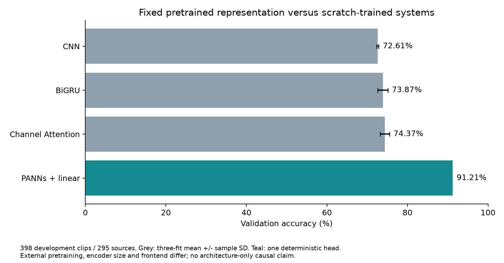
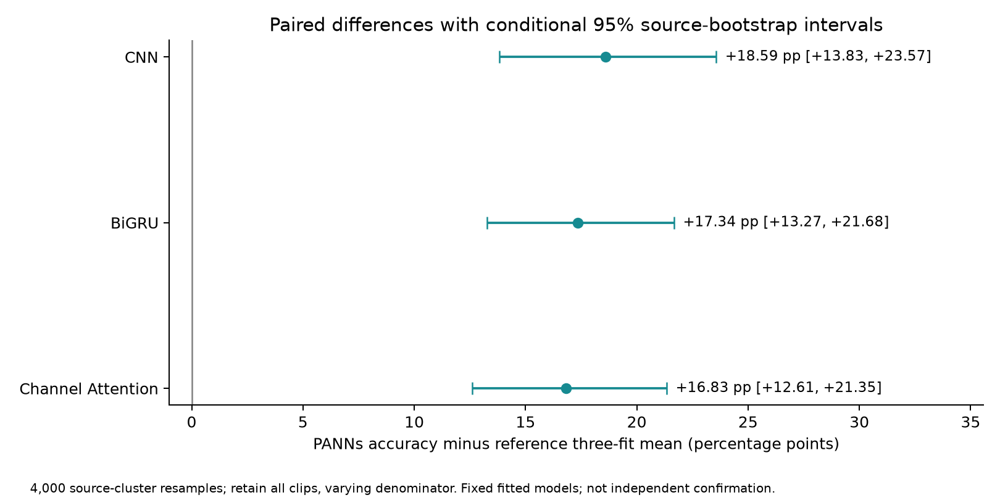
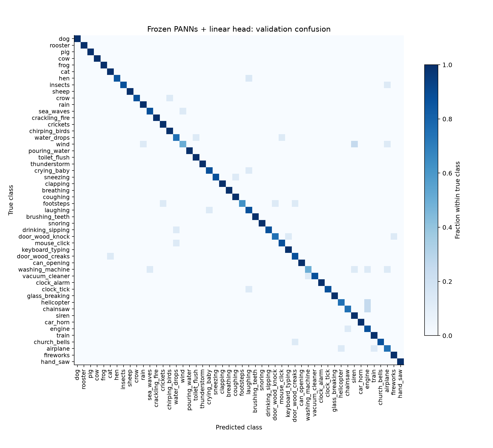

# Frozen PANNs transfer study - 5 November 2026

Executed on Colab Tesla T4: **91.21% accuracy, 91.10% macro-F1, 363/398 validation clips correct**. One frozen encoder and one fixed linear-head fit; no fine-tuning or hyperparameter search.

- [English PDF](../pdf/ESC50_PANNs_Transfer_Report_EN.pdf): 11 pages, all three new figures and all 50 class results.
- [English report](report_en.md) · [Chinese explanation and report](report_zh.md).
- [Fixed execution protocol](protocol.json) · [Run summary](run_summary.json) · [Actual run log](run.log).
- [Paired gains and source intervals](paired_differences.csv) · [Per-fit repairs and new errors](paired_errors.csv).
- [New predictions](validation_predictions.csv) · [Reference predictions](reference_predictions.csv) · [Class comparison](per_class_comparison.csv) · [Clip comparison](prediction_comparison.csv).
- [Exported linear head and model card](../../models/panns_linear/MODEL_CARD.md).

The primary gain over the existing three-fit Channel Attention mean is **+16.83 percentage points**, conditional 95% source-bootstrap interval **[+12.61, +21.35] pp**. The fixed +3 pp practical screen is met. The experiment stopped after the prescribed single fit; the Colab runtime has been released.

The model uses external AudioSet pretraining and a much larger encoder with a different frontend. All official ESC-50 folds have historical exposure, and pretraining overlap has not been comprehensively excluded. The comparison does not isolate an attention or pretraining effect. PANNs noise robustness was not evaluated.

## Reproduction

The offline analysis works from the shared metadata and compact evidence above; it does not need the old matrix checkpoints or raw audio:

```sh
python scripts/analyze_panns_transfer.py
```

The actual extraction/fit runner is [run_panns_linear_probe.py](../../scripts/run_panns_linear_probe.py). It requires the official source revision, official checkpoint and WAVs described in the protocol. Training and validation embeddings, the executed source copy and the joblib head are local under `results/runs/panns_20261105/`; large generated caches remain ignored. The shared NumPy head is approximately 525 KB. Its replay on all 398 saved validation embeddings produced zero prediction changes.

## Next-step meeting

The [five-role results meeting](../../docs/research_meetings/2026-11-05_panns_results.md) recommends one new frozen-model clean/10 dB Gaussian comparison against the three existing noise-trained CNNs, with shared perturbation inputs. This is a proposed next phase; no PANNs noise results exist yet. Fine-tuning and new attention experiments remain deferred.

## Research roles

The existing [model implementation Chat](https://chatgpt.com/c/6aebaf56-5938-83ec-8d37-c642aedf5f14) drafted the extraction/fit script. The [statistical-design Chat](https://chatgpt.com/c/6aebac6b-55b8-83ec-a1b6-9abdd7f6cb9e) reviewed the protocol before execution and the interpretation afterward. Local integration, actual Colab execution, prediction analysis and exported-head replay supplied the evidence. These role reviews are not independent experimental replication.






