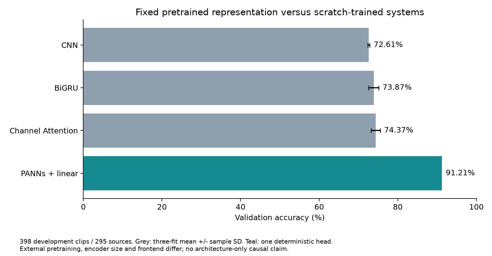
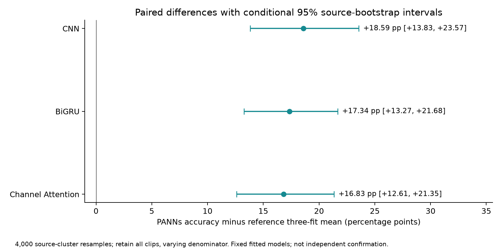
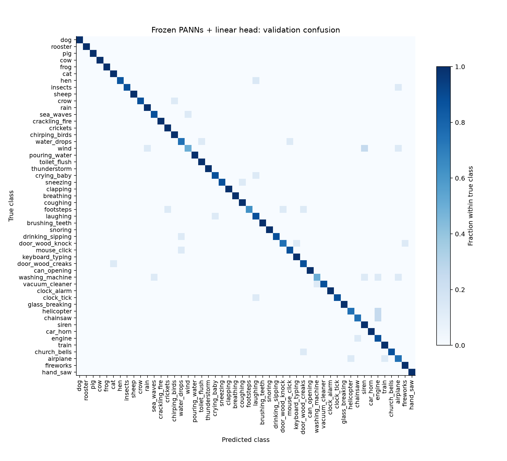

# ESC-50 Frozen PANNs Transfer Study - 5 November 2026

## 1. Main finding and decision

A frozen AudioSet-pretrained PANNs Cnn14_16k representation with one fixed logistic-regression head classified **363 of 398 validation clips correctly: 91.21% accuracy and 91.10% macro-F1**. No encoder fine-tuning or hyperparameter search was performed.

The primary paired difference against the mean accuracy of the three existing Channel Attention fits was **+16.83 percentage points (pp)**, with a conditional 95% source-bootstrap interval of **[+12.61, +21.35] pp**. This exceeds the execution-time-frozen +3 pp practical screening threshold. That threshold is a project decision rule, not a statistical theorem.

The result supports retaining frozen pretrained audio features plus a linear head as the stronger clean-validation candidate in this project. It does not independently confirm generalization, isolate the effect of pretraining from model capacity or frontend changes, or establish noise robustness. The existing scratch-trained CNN and CRNN remain useful controlled baselines.

## 2. Question, protocol and evaluation scope

The question was fixed before any new feature extraction or head-fitting result: does this externally pretrained system outperform the existing Channel Attention reference on the same development recordings?

The [execution-time-frozen protocol](protocol.json) specifies one embedding extraction, one deterministic head fit, C=1 without search, the reference fits, source resampling and the stopping rule. This is not external preregistration. The broader project has previously exposed every official ESC-50 fold, including the current development-validation fold.

| Partition | Role | Clips |
| --- | --- | --- |
| Official folds 1-3 | Train-only scaler and linear-head fit; exclude sources appearing in validation or test roles | 1,200 |
| Official fold 4 | Development validation; exclude sources appearing in fold 5 | 398 from 295 sources |
| Official fold 5 | Metadata used only to exclude source overlap; no waveform decoding or model scoring in this phase | 400 designated clips |

The dataset revision remains 33c8ce9eb2cf0b1c2f8bcf322eb349b6be34dbb6. All compared validation predictions are aligned by filename and target. Source grouping addresses known recording IDs; perceptual duplicates and AudioSet/ESC-50 pretraining overlap have not been comprehensively excluded.

## 3. Frozen encoder and linear classifier

The [PANNs author repository](https://github.com/qiuqiangkong/audioset_tagging_cnn) provides the Cnn14_16k implementation and its [official checkpoint](https://zenodo.org/records/3987831). The source revision used here was d2f4b8c18eab44737fcc0de1248ae21eb43f6aa4; the checkpoint identifier is Cnn14_16k_mAP=0.438.pth. Its filename's mAP refers to AudioSet, not this ESC-50 accuracy.

| Component | Fixed implementation |
| --- | --- |
| Waveform | Mono, scipy resample_poly to 16 kHz; exactly five seconds; no peak normalization |
| Encoder frontend | Author model's internal Log-Mel: FFT/window 512, hop 160, 64 bands, 50-8,000 Hz |
| Representation | 2,048-dimensional embedding after fc1 ReLU; eval mode disables dropout and augmentation |
| Encoder state | Strict state-dictionary loading; all parameters frozen; inference_mode |
| Scaling | StandardScaler fitted only on the 1,200 training embeddings |
| Head | Multiclass logistic regression; C=1, L2 penalty, lbfgs, max_iter=3,000, tol=1e-6 |
| Repetition | One fixed head fit; no nominal seed repetitions, tuning, augmentation or encoder fine-tuning |

For one clip, let e be its 2,048-dimensional frozen embedding. Training-set means and scales produce z=(e-mu_train)/sigma_train. The head computes 50 logits Wz+b, then predicts the largest logit. W has shape [50, 2048], and b has shape [50]. Thus the head has 102,450 fitted coefficients and biases. Standardization remains an affine transformation of the embedding.

Only W and b are optimized by the regularized multinomial logistic objective. The encoder is nonlinear but frozen; this is a linear probe of its representation. The loaded author model contains 81,033,231 parameters, with zero trainable encoder parameters. Its external pretraining computation is excluded from this phase's timing. The much larger encoder means that a simple head does not imply a small end-to-end model.

## 4. Clean-validation comparison

| System | Accuracy (%), mean +/- sample SD where repeated | Scope |
| --- | --- | --- |
| CNN, scratch-trained | 72.61 +/- 0.25 | Three existing fixed fits |
| CNN + BiGRU, scratch-trained | 73.87 +/- 1.26 | Three existing fixed fits |
| CRNN + Channel Attention, scratch-trained | 74.37 +/- 1.15 | Three existing fixed fits |
| Frozen PANNs + linear head | 91.21 | One fixed encoder and one head fit |

The grey reference systems each summarize three existing fits, not three independent audio datasets. PANNs reports one fit; a three-seed SD is neither estimated nor fabricated. References are individual-fit means, not an ensemble classifier.

## 5. Paired uncertainty and changes in errors

The primary estimand is the new system's clip accuracy minus the arithmetic mean of the three fixed Channel Attention accuracies. For each clip, the new correctness indicator is compared with the mean of its three reference correctness indicators. The analysis resamples 295 src_file groups with replacement 4,000 times using RNG seed 20261105. Every sampled source retains all constituent clips; each resample divides by its actual clip count. The same draws are shared across systems. The resampled denominator ranged from 360 to 450 clips.

| Reference three-fit mean | PANNs difference (pp) | Conditional 95% source interval (pp) |
| --- | --- | --- |
| CNN | +18.59 | [+13.83, +23.57] |
| BiGRU | +17.34 | [+13.27, +21.68] |
| Channel Attention | +16.83 | [+12.61, +21.35] |

These intervals condition on the fixed pretrained encoder, fitted head, reference fits and development dataset. They do not include future training randomness, pretraining uncertainty, historical model-selection bias or independent-dataset uncertainty. They are not simultaneous confidence intervals; CNN and BiGRU comparisons are secondary.

For each Channel Attention fit, the table distinguishes repaired reference errors from correct reference predictions that PANNs loses:

| CA seed | Errors repaired | New errors | Net additional correct |
| --- | --- | --- | --- |
| 101 | 78 | 15 | 63 |
| 202 | 77 | 11 | 66 |
| 303 | 86 | 14 | 72 |

PANNs improves on each reference fit, while also introducing some new errors. Of the 41 clips previously misclassified by CNN, BiGRU, Channel Attention and noise-trained CNN in all three fits, PANNs correctly classifies 26 and still misses 15. This is a descriptive analysis of a previously selected error set, not an independent benchmark.

## 6. Remaining failures

There are 35 remaining validation errors. Wind and washing_machine each have 4/8 correct predictions; footsteps has 5/8. Twenty-eight classes have every available validation clip classified correctly. Each class contains only seven or eight clips, so neither perfect nor low class scores establish class-wide generalization. No new listening study or label audit was performed.

The complete 50-class table is retained in Appendix A and the row-normalized confusion matrix shows all categories.

## 7. Execution, compatibility repair and delivery verification

Execution used Google Colab Tesla T4 through the official Colab CLI and its SSH transport. Python 3.13.16, PyTorch 2.11.0+cu130, NumPy 2.4.6, scipy 1.16.3, scikit-learn 1.6.1, torchlibrosa 0.1.0 and librosa 0.11.0 were recorded in the [run summary](run_summary.json).

| Measured stage | Wall time |
| --- | --- |
| Decode, resample and extract training embeddings | 23.38 s |
| Decode, resample and extract validation embeddings | 7.00 s |
| Fit the single linear head | 4.41 s |
| Main program, including model loading and saving outputs | 38.05 s |

These times exclude package installation, data and checkpoint downloads, prior compatibility repair, external pretraining and report production. They are not comparable to scratch-training-loop times as total model-development costs. L-BFGS converged after 137 iterations with no recorded convergence warning.

The first attempt stopped before extraction because the legacy official checkpoint contains NumPy metadata that newer PyTorch weights-only loading does not allow by default. The repair used a targeted NumPy data-type allowlist while retaining weights_only=True and strict model loading; the [failed attempt](checkpoint_loading_attempt1.log) is retained. This compatibility repair changed no model, head hyperparameter or score-selection rule.

Saved normalization and linear coefficients were replayed on all 398 original validation embeddings using the portable NumPy head: **zero prediction changes, 363 correct**. This verifies the exported head on saved features; it is not a second encoder extraction or independent replication. Predictions and probability vectors were downloaded before the Colab T4 session was terminated. No resource upgrade or purchase was made.

## 8. Interpretation and stopping decision

This fixed pretrained system is a substantially better clean-validation candidate under the present protocol. The observed gain is much larger than the earlier +0.50 pp Channel Attention difference, making pretrained representations a more productive practical direction than another attention-module search in this project.

However, the comparison changes external training data, encoder size, learned representation and frontend together. It cannot identify which change causes the gain. Unknown pretraining overlap and repeated development exposure also prevent a claim of fresh independent generalization. PANNs was not evaluated on the Gaussian-noise or gain conditions in this phase; the previous noise-trained CNN findings do not transfer automatically to it.

The fixed experiment is complete and stops here, with no fine-tuning, alternate checkpoint, regularization sweep or additional seed fits. Any future robustness or independent-data study needs its own stated evaluation scope. The previous 65-task study and its conclusions remain a separate record.

## 9. Evidence and reproduction

[Protocol](protocol.json), [paired summary](comparison_summary.json), [per-fit paired errors](paired_errors.csv), [all fixed reference predictions](reference_predictions.csv), [per-class comparison](per_class_comparison.csv), [clip predictions](validation_predictions.csv), [probabilities](validation_probabilities.csv), [run log](run.log), and [portable-head replay](portable_head_replay.json) are retained. Code: [single extraction and fit](../../scripts/run_panns_linear_probe.py) and [offline comparison and plotting](../../scripts/analyze_panns_transfer.py). The [model card](../../models/panns_linear/MODEL_CARD.md) describes the small exported head and its required external encoder.

Two existing Chrome ChatGPT roles supplied an implementation draft and protocol/result review. Local integration, actual Colab execution and recorded predictions supplied the experimental evidence. Role agreement is not external human review or independent replication.

## Appendix A. All 50 validation classes

PANNs counts concern one fit. CA accuracy is the mean of three fixed fits on the same class clips. It is not based on three times as many independent recordings.

| Class | Clips | PANNs correct | PANNs accuracy (%) | CA mean accuracy (%) |
| --- | --- | --- | --- | --- |
| dog | 8 | 8 | 100.0 | 87.5 |
| rooster | 8 | 8 | 100.0 | 91.7 |
| pig | 8 | 8 | 100.0 | 58.3 |
| cow | 8 | 8 | 100.0 | 87.5 |
| frog | 8 | 8 | 100.0 | 83.3 |
| cat | 8 | 8 | 100.0 | 62.5 |
| hen | 7 | 6 | 85.7 | 61.9 |
| insects | 8 | 7 | 87.5 | 62.5 |
| sheep | 8 | 8 | 100.0 | 29.2 |
| crow | 8 | 7 | 87.5 | 87.5 |
| rain | 8 | 8 | 100.0 | 83.3 |
| sea_waves | 8 | 7 | 87.5 | 87.5 |
| crackling_fire | 8 | 8 | 100.0 | 95.8 |
| crickets | 8 | 8 | 100.0 | 66.7 |
| chirping_birds | 8 | 8 | 100.0 | 95.8 |
| water_drops | 8 | 6 | 75.0 | 62.5 |
| wind | 8 | 4 | 50.0 | 25.0 |
| pouring_water | 8 | 8 | 100.0 | 91.7 |
| toilet_flush | 8 | 8 | 100.0 | 87.5 |
| thunderstorm | 8 | 8 | 100.0 | 91.7 |
| crying_baby | 8 | 7 | 87.5 | 87.5 |
| sneezing | 8 | 7 | 87.5 | 91.7 |
| clapping | 8 | 8 | 100.0 | 66.7 |
| breathing | 8 | 8 | 100.0 | 83.3 |
| coughing | 8 | 8 | 100.0 | 91.7 |
| footsteps | 8 | 5 | 62.5 | 66.7 |
| laughing | 8 | 7 | 87.5 | 50.0 |
| brushing_teeth | 8 | 8 | 100.0 | 79.2 |
| snoring | 8 | 8 | 100.0 | 87.5 |
| drinking_sipping | 8 | 7 | 87.5 | 33.3 |
| door_wood_knock | 8 | 6 | 75.0 | 83.3 |
| mouse_click | 8 | 7 | 87.5 | 87.5 |
| keyboard_typing | 8 | 8 | 100.0 | 79.2 |
| door_wood_creaks | 8 | 7 | 87.5 | 33.3 |
| can_opening | 8 | 8 | 100.0 | 100.0 |
| washing_machine | 8 | 4 | 50.0 | 45.8 |
| vacuum_cleaner | 8 | 7 | 87.5 | 87.5 |
| clock_alarm | 7 | 7 | 100.0 | 100.0 |
| clock_tick | 8 | 7 | 87.5 | 58.3 |
| glass_breaking | 8 | 8 | 100.0 | 79.2 |
| helicopter | 8 | 6 | 75.0 | 20.8 |
| chainsaw | 8 | 6 | 75.0 | 87.5 |
| siren | 8 | 8 | 100.0 | 50.0 |
| car_horn | 8 | 8 | 100.0 | 70.8 |
| engine | 8 | 7 | 87.5 | 62.5 |
| train | 8 | 8 | 100.0 | 95.8 |
| church_bells | 8 | 7 | 87.5 | 79.2 |
| airplane | 8 | 6 | 75.0 | 62.5 |
| fireworks | 8 | 8 | 100.0 | 100.0 |
| hand_saw | 8 | 8 | 100.0 | 100.0 |
