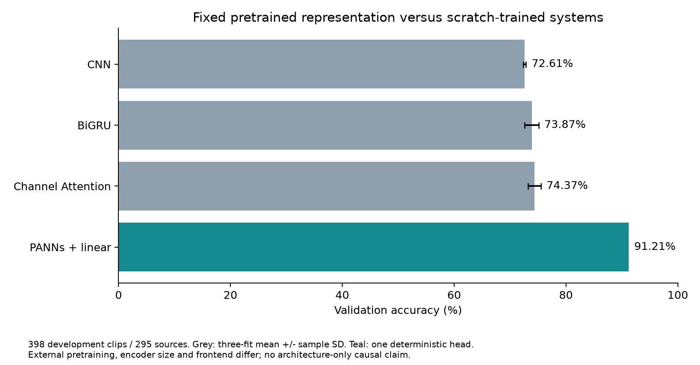
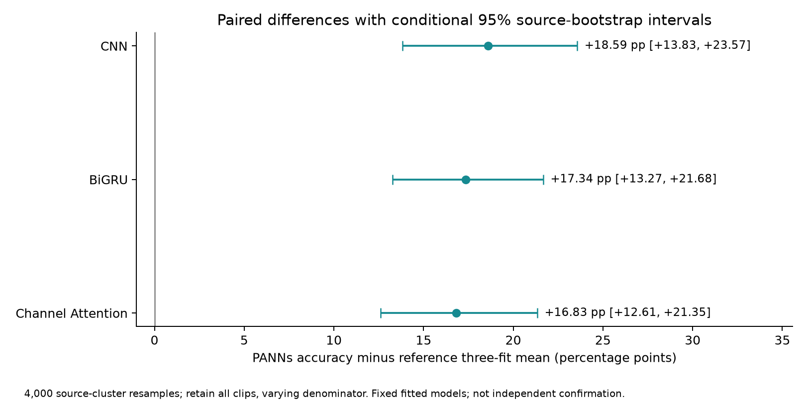
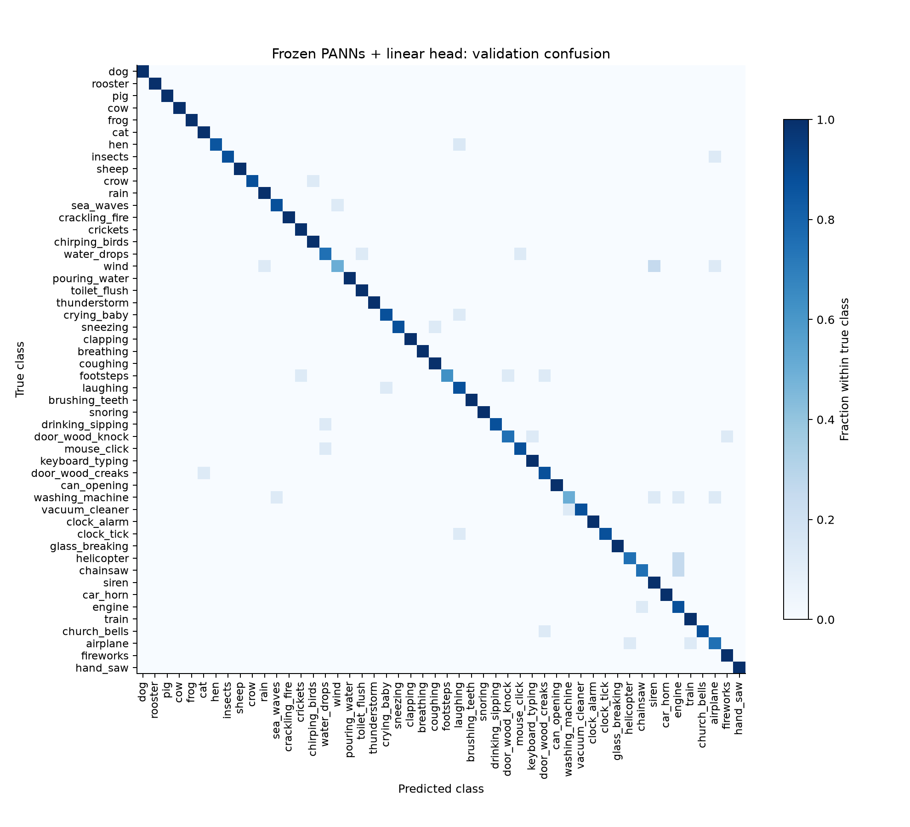

# ESC-50：PANNs 预训练特征＋线性分类器研究结果

2026 年 11 月 5 日。新阶段已在 Colab Tesla T4 实际完成。

## 核心结果

冻结 PANNs 编码器，只训练一次线性分类器，在相同的 398 条验证音频、295 个原始录音来源上得到：

| 指标 | 结果 |
| --- | --- |
| 正确识别 | 363 / 398 条 |
| Accuracy | 91.21% |
| Macro-F1 | 91.10% |
| 相对 Channel Attention 三个固定模型均值 | +16.83 个百分点 |
| 条件 95% 来源分组 Bootstrap 区间 | +12.61 至 +21.35 个百分点 |

已有 CNN、BiGRU、Channel Attention 的三 seed 平均准确率分别为 72.61%、73.87%、74.37%。新方法使用一个固定预训练编码器和一个分类器，并没有制造三个相同 seed 的重复拟合来计算标准差。比较对象是三个旧模型分数的均值，不是它们的集成预测。

## 这个方法做了什么？

可以把流程理解为：音频 → 已训练好的声音特征提取器 → 2,048 个特征数值 → 50 类线性分类器。

PANNs 已从外部 AudioSet 数据中学习过声音表征。本轮把这些权重完全冻结，关闭 dropout、数据增强和训练模式。我们只用现有项目的 1,200 条训练音频，学习如何把这些特征映射到 ESC-50 的 50 个类别。

线性分类器对每个类别计算一个加权分数，选取分数最大的类别。特征标准化的均值和尺度也只从训练集估计，验证集不参与拟合。固定使用 C=1 的 Logistic Regression，没有试多个 C 再挑最高分。

这说明：在本次开发条件下，已有预训练表征能够被简单的分类头有效利用。它不是只靠“更复杂的分类头”取得高分。完整系统仍使用约 8,103 万个加载参数的编码器，因此不能把“小分类头”等同于“轻量模型”。

## 与旧模型的逐样本差异

相对三个 Channel Attention 模型，PANNs 分别修正了 78、77、86 个原错误，同时新产生了 15、11、14 个错误；净增加正确数为 63、66、72。

之前 CNN、BiGRU、Channel Attention、噪声增强 CNN 在全部三个 seed 下共同识别错误的 41 条音频中，新模型识别对了 26 条，仍错 15 条。这是对既有困难样本的描述，不是另一个独立测试集。

仍有 35 条验证音频识别错误。Wind 和 washing_machine 各只有 4/8 正确，footsteps 为 5/8。28 类的现有验证音频全部正确，但每类只有 7 或 8 条，不能据此声称这些类别已经达到普遍的 100% 正确率。

## 如何执行和检查？

采用官方 Cnn14_16k 权重及内部音频前端：16 kHz、512 点窗、160 点 hop、64 Mel bands、50–8,000 Hz。原始 WAV 先重采样，不使用旧项目的特征缓存，也不额外做峰值归一化。

训练和验证特征提取分别用时 23.38 秒、7.00 秒，分类器拟合 4.41 秒，主程序共 38.05 秒。分类器在 137 次迭代后正常收敛。以上不含下载、安装、前序兼容性修复和 PANNs 外部预训练成本。

初次运行在旧权重的 NumPy 对象加载处停止；修复后仍保留 weights-only 加载及严格权重匹配，没有修改模型或超参数。该失败发生在任何特征提取或拟合之前，记录已保存。

导出的标准化参数和线性系数在全部 398 条已保存验证特征上重新计算，预测变化为 0，仍为 363 条正确。这里只检查了交付分类头，没有把它包装成编码器重新提取或独立复现。Fold 5 音频没有解码或参与推理。结果、特征及分类器已下载，Colab T4 已释放。

## 结论的边界与下一步

结果支持把 PANNs＋线性分类器保留为当前干净开发验证集上表现最好的候选。本轮超过了执行前固定的 +3 个百分点实用筛选门槛，按协议停止，不再针对这个验证集追加调参。

必须保留四个限制：所有官方 fold 已在历史研究中曝光；AudioSet 与 ESC-50 的潜在重叠没有完整排除；预训练数据、编码器容量和前端同时变化，不能单独归因；PANNs 本轮没有做噪声实验，不能继承旧噪声增强 CNN 的鲁棒性结论。

Bootstrap 按来源配对重采样 4,000 次，同一个来源的所有片段一起保留，每次使用实际片段数作分母。区间只描述当前固定模型条件下的来源抽样不确定性，不能消除历史模型选择偏差，也不是独立泛化确认。

[完整英文报告](report_en.md) · [英文 PDF（含全部三张新图）](../pdf/ESC50_PANNs_Transfer_Report_EN.pdf) · [模型卡](../../models/panns_linear/MODEL_CARD.md)

