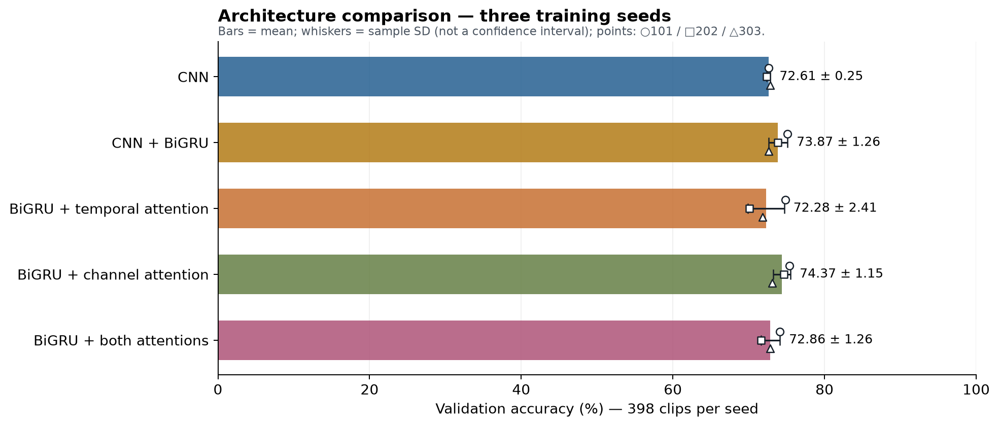
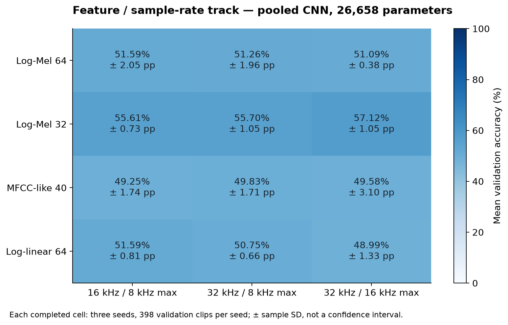
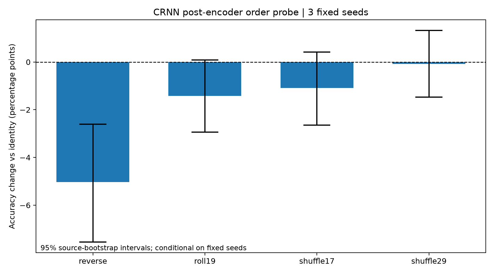
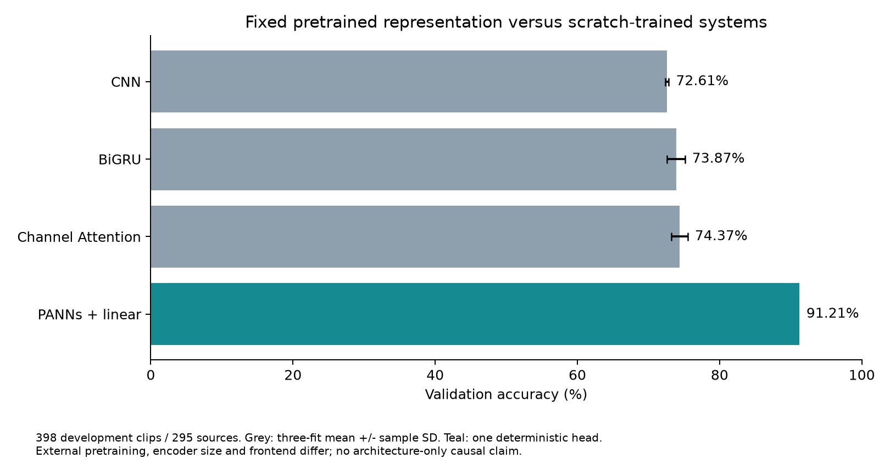
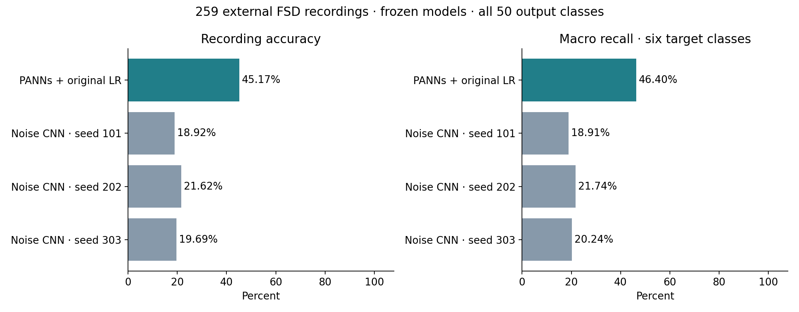
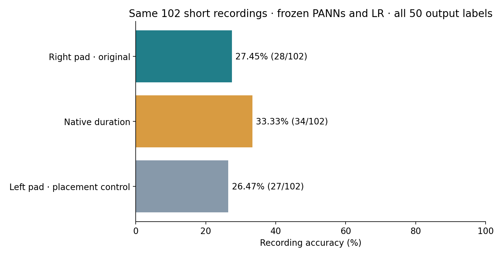
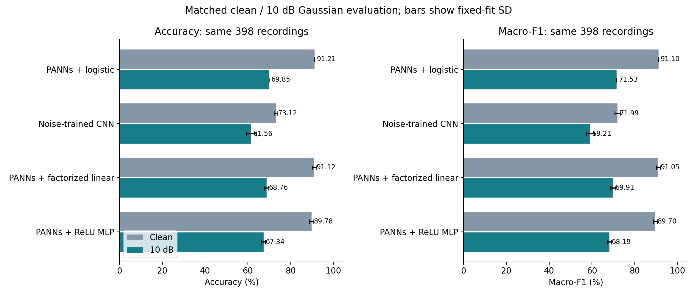
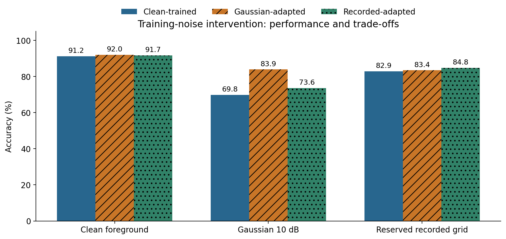

# Environmental Sound Classification: Models, Representations and Noise Transfer

**COMP9444 Course Research Project**

## Abstract

This project studies which modelling and training choices improve environmental sound classification, and how those improvements transfer across recording conditions. The experiments span classical feature baselines, CNN and recurrent architectures, attention, augmentation, feature settings, frozen PANNs representations, matched classifier heads, external recordings and noise-distribution adaptation. On the principal ESC-50 development partition, the CNN achieves 72.61% mean accuracy, CNN–BiGRU 73.87%, and channel attention 74.37%. Frozen PANNs with a linear classifier reaches 91.21%. Gaussian augmentation substantially improves matched-noise accuracy, but transfer to recorded backgrounds is less consistent. A controlled recorded-background comparison improves its reserved panel by 1.36 percentage points over Gaussian training while losing 10.30 points on Gaussian interference. The combined findings favour evaluating improvements against their intended conditions and reporting negative outcomes, system costs and uncertainty alongside accuracy.

## 1. Research questions and context

Environmental sound classification assigns recordings to categories such as animals, weather, alarms and machinery. Variation in event duration, intensity, recording equipment and background interference complicates the task. A small labelled dataset also makes it difficult to separate the effect of a model change from capacity, optimization and model selection.

Three questions organize the completed work:

1. **Representation and architecture:** How do handcrafted summaries, convolutional features, recurrent processing, attention and frontend choices affect classification?
2. **Pretrained transfer:** How does a frozen pretrained audio system compare with scratch models, and what happens when the classifier or input-recording conditions change?
3. **Noise adaptation:** Do gains under one interference distribution transfer to another when representation and classifier fitting are controlled?

The primary neural baseline is an independently implemented, frequency-preserving CNN. Classical models provide simpler references; PANNs supplies a pretrained alternative. The contribution is a comparative empirical study, including experiments that do not improve performance. It is not a novel architecture or a state-of-the-art benchmark claim.

The literature motivates these comparisons. [Piczak (2015)](https://doi.org/10.1145/2733373.2806390) introduced ESC, and his [CNN study](https://doi.org/10.1109/MLSP.2015.7324337) provides early spectrogram-learning context. [Salamon and Bello (2017)](https://arxiv.org/abs/1608.04363) motivate waveform augmentation; their principal experiments use UrbanSound8K. [Zhang et al. (2019)](https://doi.org/10.1109/ACCESS.2019.2939495) motivate temporal/channel attention. [Kong et al. (2020)](https://arxiv.org/abs/1912.10211) motivate supervised AudioSet transfer through PANNs. Our implementations and evaluation recipes differ from these papers; the [related-work review](../docs/related_work.md) explains those relationships.

## 2. Data, methods and interpretation

### 2.1 Principal evaluation

ESC-50 contains 2,000 five-second clips across 50 classes. The principal comparison uses **1,200 training clips from folds 1–3** and **398 development clips from fold 4**, representing **295 original recording sources**. Two fold-four clips are excluded because their metadata source identifiers overlap the designated fold-five partition. Training sources are separated from the development and designated test sources using the available identifiers. Fitted preprocessing statistics use training data only.

All official folds have historical exposure during the project. The headline scores therefore describe development comparisons rather than an untouched final-test estimate. Historical fold-five and fold-rotation results are reported separately in Section 6. Metadata exclusions address known recording-ID overlap; they do not establish the absence of perceptual duplicates or AudioSet pretraining overlap.

Scratch comparisons use seeds 101, 202 and 303, 60 epochs, batch size 32, AdamW, initial learning rate 0.001, weight decay 0.0001, and cosine scheduling. Checkpoints use minimum development cross-entropy. The original pretrained linear reference uses one fixed fit. The matched PANNs head experiment instead uses three seeds and a fixed final epoch, as described below.

### 2.2 Metrics and experimental units

Accuracy is clip-weighted on ESC-50; macro-F1 averages all 50 class F1 values. Scratch values are mean ± sample standard deviation over three fits. Standard deviation is not a confidence interval, and three fits do not create additional independent recordings. Confusion matrices and paired errors supplement overall scores.

Paired bootstrap intervals use 4,000 source-group resamples for the development studies, retaining each selected source's clips and using the sampled clip-count denominator. External studies resample recordings. Intervals condition on the fitted systems and fixed evaluation panels; they do not include every training seed, augmentation draw or future environment. Secondary comparisons are descriptive, without a general multiple-comparison correction.

The original experiment matrix contains **60 neural-fit tasks, two classical-reference tasks and three stress tasks**. The classical tasks include regularization searches over three logistic L2 settings and four SVM C values, so task counts are not counts of optimizer fits. Some CNN/BiGRU records also appear in the earlier capacity-control study and historical figures: they are reused fits, not independent replications. Later inference, six matched-head fits and noise-adaptation studies have separate records. The [results notebook](../notebooks/01_results.ipynb) retains the complete experiment tables and all 40 figures.

## 3. Representation and architecture

### 3.1 Classical references and CNN baseline

A multinomial logistic model on 64 log-Mel temporal means and standard deviations reaches **42.21% accuracy and 38.86% macro-F1**. A linear SVM on 20 DCT-of-log-Mel cepstral means and standard deviations reaches **40.20% and 37.50%**. These are different summary representations, not exact reproductions of historical MFCC baselines. Their results establish useful low-cost references, but do not isolate classifier choice from feature choice.

The main CNN takes mono 16-kHz audio and produces a natural-log Mel-power input of shape **1 × 64 × 313**, with a 512-point FFT and 256-sample hop. Three convolution/normalization/ReLU/pooling stages use 16, 32 and 64 channels. Their output contains 39 time positions with 512 features each. Temporal averaging preserves frequency positions before the 50-class classifier. The network has **49,058 parameters**.

CNN–BiGRU passes the same encoded sequence through a bidirectional GRU with hidden size 64 per direction. Averaged 128-dimensional recurrent outputs feed the classifier, giving **251,810 parameters**. Pooled and tokenwise MLP controls use the same encoder architecture, trained jointly with their heads and have **252,036 parameters**, approximately matching recurrent-model capacity.

| System | Development accuracy | Macro-F1 |
| --- | ---: | ---: |
| CNN baseline | 72.61% ± 0.25 pp | 71.39% ± 0.58 pp |
| CNN–BiGRU | 73.87% ± 1.26 pp | 72.97% ± 1.36 pp |
| CNN + pooled MLP | 72.28% ± 0.63 pp | 71.17% ± 0.57 pp |
| CNN + tokenwise MLP | 69.68% ± 3.90 pp | 67.86% ± 4.97 pp |
| BiGRU + channel attention | 74.37% ± 1.15 pp | 73.48% ± 1.00 pp |
| BiGRU + temporal attention | 72.28% ± 2.41 pp | 71.52% ± 2.41 pp |
| BiGRU + combined attention | 72.86% ± 1.26 pp | 71.69% ± 1.35 pp |

Source: [model comparison table](tables/model_comparison.csv) and [MLP results](results/mlp_controls/comparison.csv).

BiGRU improves the observed mean by **1.26 pp**, but its paired source interval **[−1.81, 4.17]** includes zero. The MLP controls do not reproduce its mean result. This argues against treating parameter count alone as a sufficient explanation, without establishing temporal order as the sole cause. Channel attention adds only 1,096 parameters but just **0.50 pp** over BiGRU, with interval **[−1.22, 2.17]**. The other attention variants perform worse. Architectural complexity does not consistently help this development task.

### 3.2 Augmentation and frontend settings

Gaussian waveform augmentation is applied with probability 0.5 and training SNR uniformly sampled from 10–30 dB. We also evaluate waveform Mixup and a masking-only SpecAugment adaptation. Their clean accuracy/macro-F1 values are **73.12%/71.99%**, **71.61%/70.65%**, and **71.86%/70.75%**, respectively. Masking and Mixup do not improve clean accuracy under these settings; the main noise benefit appears under interference in Section 5.

A separate feature/sampling experiment evaluates **12 configurations × three seeds** using a **26,658-parameter globally pooled CNN**, with 32-ms windows and 16-ms hops across sampling rates. Its scores must not be substituted for the main frequency-preserving baseline.

| Sampling rate / maximum frequency | Log-Mel 32 | Log-Mel 64 | Cepstral 40 | Log-linear 64 |
| --- | ---: | ---: | ---: | ---: |
| 16 kHz / 8 kHz | 55.61% | 51.59% | 49.25% | 51.59% |
| 32 kHz / 8 kHz | 55.70% | 51.26% | 49.83% | 50.75% |
| 32 kHz / 16 kHz | 57.12% | 51.09% | 49.58% | 48.99% |

Values are three-fit mean accuracy from [the grouped results](results/model_comparison/analysis/groups.csv).

Log-Mel 32 outperforms Log-Mel 64 in all three configurations. Higher sampling rate or additional bandwidth is not uniformly beneficial across representations. These findings concern a particular model and training budget; the change from frequency-preserving to globally pooled features prevents a direct ranking against the 72.61% baseline.

### 3.3 Paired errors and temporal interventions

CNN–BiGRU both repairs and introduces errors. Across the three seeds it corrects **32, 33 and 31** CNN errors while losing **22, 27 and 32** previously correct predictions. The net gains are therefore ten, six and minus one clips. The CNN misclassifies 83 clips in every seed; BiGRU does so for 64. Four families—CNN, BiGRU, channel attention and noise CNN—share **41 consistently incorrect clips from 31 sources**. These identify useful listening cases, not established label errors or acoustic causes.

To examine order sensitivity, we reverse, roll or shuffle the encoder's 39 tokens without retraining. Reversal reduces BiGRU accuracy by **5.03 pp [−7.54, −2.60]**. The tested CNN predictions remain unchanged, consistent with temporal mean aggregation. Other BiGRU intervention effects are smaller and uncertain.

This is sensitivity to an artificial post-encoder intervention. It does not reverse the waveform, isolate a natural sound mechanism, or prove why the recurrent model's original mean is higher. CNN features already encode local temporal patterns before pooling.

## 4. Pretrained representations and transfer

### 4.1 Frozen PANNs and classifier controls

We use the official **Cnn14_16k** checkpoint pretrained on AudioSet, with the encoder frozen in evaluation mode. Each recording yields a 2,048-dimensional embedding. A training-only StandardScaler precedes L2 multinomial logistic regression with C=1 and L-BFGS optimization. The head has **102,450 parameters**; the loaded frozen model has approximately **81 million**.

The system reaches **91.21% accuracy and 91.10% macro-F1**, an **18.59 pp** accuracy difference from the CNN. Pretraining, architecture, capacity and frontend change together, so this is a full-system comparison. A small trainable head does not imply a small inference model.

A matched classifier experiment compares **2048→49→50** factorized-linear and ReLU heads, both with **102,901 parameters**. Each uses three seeds, matched initialization and minibatch ordering, and 100 fixed AdamW epochs; only the intermediate activation changes. Final weights are evaluated without development checkpoint selection.

| PANNs classifier | Clean accuracy | Gaussian 10-dB accuracy |
| --- | ---: | ---: |
| Original logistic reference, one fit | 91.21% | 69.85% |
| Factorized linear, three-fit mean | 91.12% | 68.76% |
| ReLU head, three-fit mean | 89.78% | 67.34% |

The controlled ReLU-minus-linear clean difference is **−1.34 pp [−2.52, −0.26]**; at 10 dB it is **−1.42 pp [−3.05, 0.24]**. Added nonlinearity does not help this configuration. The original logistic head uses different optimization and regularization, so its comparison with these heads is not an activation-only ablation.

### 4.2 External recordings

We evaluate fixed PANNs and noise-CNN systems on six mapped categories from **FSDnoisy18k v1.0**: clapping, engine, fireworks, rain, wind and footsteps. Five known ESC-50 recording IDs are excluded, leaving **259 recordings**. All 50 output labels remain active. Consecutive five-second window probabilities are averaged using actual unpadded duration before taking one recording-level prediction.

PANNs achieves **45.17% accuracy**, compared with a **20.08% mean** across the three noise-CNN fits. The paired difference is **25.10 pp [19.82, 30.63]**. The CNN mean is not an ensemble prediction. PANNs' six-class macro recall is 46.40%; its six-class macro-F1 of 58.07% has a different class scope from the principal 50-class metric.

The absolute decline from ESC-50 is substantial. PANNs makes 132 predictions outside the mapped six labels and ten within-six mistakes. Category composition, recording length and aggregation differ, so the score gap does not isolate one source of domain shift. This restricted external panel is not full-50-class validation, and recording-ID exclusion does not resolve reuploads or pretraining overlap.

### 4.3 Input-duration diagnostic

A paired diagnostic investigates 102 eligible recordings shorter than five seconds. The same classifier scores **27.45%** with right-padding, **33.33%** with native duration, and **26.47%** with left-padding. Native minus right-padding is **5.88 pp [−0.98, 12.75]**: the gain remains uncertain. Native duration changes 46 predictions, repairing ten errors and introducing four; left-padding changes 50 predictions.

Three additional short recordings remain in the right/left comparison but cannot use native inference because of the encoder's minimum-length requirements. This diagnostic changes no weights and was designed after the external panel was examined. It establishes input-policy sensitivity without identifying a single padding mechanism or replacing the original 259-recording result.

## 5. Noise robustness and training-distribution transfer

### 5.1 Matched Gaussian interference

The original three-fit development robustness panel evaluates clean input, Gaussian SNRs of 20, 10 and 0 dB, and gain changes of ±6 dB. At 10 dB, noise CNN accuracy is **61.31%** versus **23.37%** for clean CNN: **+37.94 pp [32.08, 43.88]**. The much larger matched-noise benefit than clean gain supports augmentation for that particular objective.

A later shared-noise panel compares PANNs against the same noise-trained CNN fits using a different Gaussian realization. Here the CNN mean is **61.56%** and PANNs reaches **69.85%**, a paired difference of **8.29 pp [1.83, 14.74]**. These panel values remain separate from the original 61.31%. PANNs loses **21.36 pp** from clean input, compared with **11.56 pp** for noise CNN: higher noisy accuracy does not mean better accuracy retention.

### 5.2 Gaussian adaptation of the linear readout

To separate downstream adaptation from encoder retraining, we retain the frozen PANNs representation, clean-training scaler and logistic objective. Each of 1,200 training targets contributes weight 0.50 clean and 0.25 for each of two Gaussian variants at 10–30 dB. Total weight remains 1,200, preserving effective regularization.

The Gaussian-adapted classifier reaches **91.96% clean accuracy** and **83.92% at Gaussian 10 dB**, compared with **91.21%** and **69.85%** for the clean reference. The matched-noise difference is **14.07 pp [10.20, 18.32]**.

An initial recorded panel mixes every development target with three DEMAND recordings, two fixed segments each, at 10 dB. Mean accuracy increases from **89.07% to 90.12%**, but the primary difference **1.05 pp [−0.54, 2.59]** is uncertain. Its 2,388 target/condition pairs reuse 398 foreground clips; they are not independent recordings. Strong matched-Gaussian adaptation does not establish equally strong transfer to these backgrounds.

### 5.3 Gaussian versus recorded-background training

The last completed model study, on **7 November 2026**, changes the training-noise distribution while preserving encoder, scaler, classifier objective and augmentation weight. One new recorded-background head reuses the Gaussian experiment's per-target SNR assignments. Six training recordings and six separate evaluation recordings cover domestic, nature, office, public, street and transport settings. Previously exposed panel recordings are excluded from this comparison.

Evaluation crosses two fixed segments per recording with 0, 10 and 20 dB, producing **14,328 mixtures from 398 foreground clips and 295 sources**. The primary mean equally weights all six recordings, two segments and three SNRs. Macro-F1 is calculated within each condition before averaging.

| PANNs linear classifier | Clean accuracy | Gaussian 10 dB | Recorded-grid accuracy | Mean recorded macro-F1 |
| --- | ---: | ---: | ---: | ---: |
| Clean-trained | 91.21% | 69.85% | 82.88% | 83.11% |
| Gaussian-adapted | 91.96% | 83.92% | 83.43% | 83.78% |
| Recorded-adapted | 91.71% | 73.62% | 84.79% | 85.18% |

Recorded-minus-Gaussian training gives **1.36 pp [0.41, 2.32]** on the reserved recorded grid, but **−10.30 pp [−13.84, −6.95]** on Gaussian 10 dB. The clean difference **−0.25 pp [−1.86, 1.45]** remains uncertain. The initial recorded mean in Section 5.2 uses a different panel and is not interchangeable with this grid.

This is a measured distribution-dependent tradeoff. Spectral, temporal and semantic background content change together; the experiment does not isolate diversity or one acoustic mechanism. The task recovers the designated foreground label even when the background contains another audible event. Foreground-source intervals condition on the fixed recordings, segments, fitted heads and augmentation draw. They do not establish environmental-population uncertainty or a generally superior default classifier.

## 6. Historical results and overall limitations

Historical fold-five results use **400 clips**. The fixed seed-101 CNN and BiGRU score **61.50% and 62.00%**, respectively; their three-fit means are **63.08% and 63.92%**. Historical single-seed fold rotations give mean accuracies of **66.50% and 68.30%**, using three training folds, one validation fold and one evaluation fold. These are descriptive fixed-recipe results following development exposure, not an independent standard four-training-fold benchmark. They are not pooled with the 398-clip development comparison or counted as additional confirmation of reused fits. Original values are retained in [the historical data](figures/historical_baseline/figure_data.json).

Across the full project, four limitations determine interpretation. First, the principal development set is small and repeatedly used, so model selection and multiple comparisons limit confirmatory claims. Second, source metadata and external recording-ID exclusions cannot rule out every duplicate or pretraining overlap. Third, complete-system comparisons change several factors; even matched controls hold only selected dimensions constant. Fourth, repeated noise conditions increase evaluation coverage but not the number of independent foreground recordings or environments.

Model size also changes the practical choice. PANNs offers the strongest observed clean system, whereas the CNN is far smaller. Neither parameter counts nor short offline Colab runs establish deployment latency, memory use or energy cost. The current classifiers have a fixed label space; unknown-event rejection and probability calibration are not validated.

## 7. Conclusion

The completed work supports three conclusions. Scratch architecture changes yield modest and uncertain gains; approximate capacity controls and token interventions help characterize them without proving a natural temporal mechanism. Frozen PANNs provides a large clean-accuracy improvement, while matched MLP heads, external recordings and duration interventions expose limits that aggregate development accuracy misses. Finally, noise adaptation is distribution-dependent: Gaussian training substantially improves matched interference, while recorded-background training trades Gaussian performance for a smaller reserved-panel gain. A useful improvement is therefore defined jointly by its task, evaluation conditions, uncertainty and system cost.

## Results and references

- [Executed integrated notebook](../notebooks/01_results.ipynb), [all result directories](results/), and [figure index](figures/index.json).
- [Model tables](tables/model_comparison.csv), [robustness table](tables/robustness_comparison.csv), [classical/feature experiment records](results/model_comparison/analysis/runs.csv), and [paired errors](results/error_analysis/README.md).
- [Matched classifier study](results/transfer_heads/README.md), [external recordings](results/external_recordings/README.md), [input duration](results/input_duration/README.md), [Gaussian adaptation](results/gaussian_adaptation/README.md), and [recorded-noise study](results/recorded_noise/README.md).
- [Related work](../docs/related_work.md) and [26-reference catalog](../docs/literature_matrix.csv).
