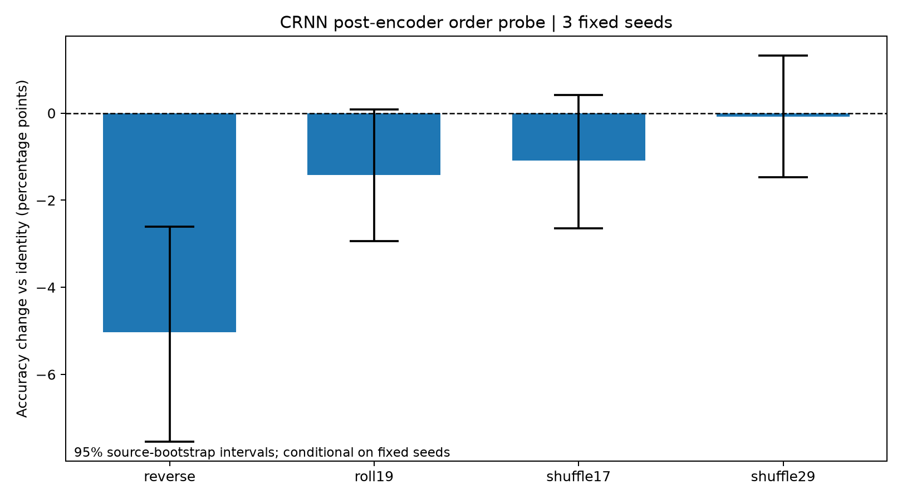

# ESC-50 RQ1: Temporal-Order Probe — 5 November 2026

Reversing the **39 encoded time tokens** reduced CRNN accuracy from **73.87% to 68.84%** across the three fixed training seeds. The mean change is **−5.03 percentage points**, with a 95% conditional source-bootstrap interval of **[−7.54, −2.60] pp**. Random token shuffling had much smaller average effects. This supports sensitivity to the particular ordering of encoded features; it does not establish that CRNN's small advantage over CNN is caused by useful long-range acoustic reasoning.

## What ran

Six existing checkpoints (CNN and CNN + BiGRU, each at seeds 101/202/303) were evaluated on the same **398 development-validation WAVs from 295 sources**. The identity, reversal, 19-token cyclic shift, and two fixed random permutations produced **30 prediction files / 11,940 predictions**. No weights were trained or changed. No test-fold WAVs were evaluated.

The intervention actually reorders the encoder tensor before each head. It does not use the CNN's ignored `time_permutation` argument. Encoder embeddings are preserved; the raw waveform and its local convolutional patterns are not reversed.

## Main results

| Intervention | CRNN mean accuracy | Change from identity | 95% conditional source interval |
| --- | ---: | ---: | ---: |
| Identity | 73.87% | — | — |
| Reverse | 68.84% | −5.03 pp | [−7.54, −2.60] pp |
| Cyclic shift by 19 | 72.45% | −1.42 pp | [−2.94, +0.09] pp |
| Shuffle, permutation seed 17 | 72.78% | −1.09 pp | [−2.64, +0.42] pp |
| Shuffle, permutation seed 29 | 73.79% | −0.08 pp | [−1.47, +1.32] pp |

CNN remained at **72.61%** with **zero prediction changes** in every condition and training seed.

Intervals use 4,000 whole-source resamples with the actual resampled clip denominator and the same source draws across three fixed fits. They condition on these checkpoints and these specific permutations, not future training seeds or all possible permutations. No family-wise correction is applied to these exploratory comparisons.



Reversal was worse than both shuffled orders. Post hoc paired comparisons give reverse-minus-shuffle17 **−3.94 pp [−6.31, −1.75]** and reverse-minus-shuffle29 **−4.94 pp [−7.26, −2.74]**. These follow-up contrasts were motivated by the observed pattern and are exploratory. They do not support a simple rule that increasing disorder always reduces accuracy.

## Which errors changed?

| Training seed | Reverse fixes an original error | Reverse creates a new error | Net correct clips |
| --- | ---: | ---: | ---: |
| 101 | 14 | 38 | −24 |
| 202 | 16 | 36 | −20 |
| 303 | 9 | 25 | −16 |

The largest descriptive class losses under reversal include coughing (−50.0 pp), can opening (−45.8 pp), and sneezing (−37.5 pp). Each class still contains only eight unique clips; repeated seeds are not extra recordings. See [class error changes](class_error_changes.csv), which distinguishes decision events from unique clips and sources.

For the four examples selected in the preceding round, this table counts correct predictions out of the **same three fitted CRNNs**:

| Selected clip class | Identity | Reverse | Shift19 | Shuffle17 | Shuffle29 |
| --- | ---: | ---: | ---: | ---: | ---: |
| Clapping | 3/3 | 2/3 | 2/3 | 3/3 | 3/3 |
| Siren | 3/3 | 3/3 | 3/3 | 3/3 | 3/3 |
| Glass breaking | 3/3 | 1/3 | 3/3 | 3/3 | 3/3 |
| Helicopter | 1/3 | 3/3 | 1/3 | 2/3 | 1/3 |

The selected siren remains correct despite reordered tokens. Glass breaking is sensitive to reversal but remains correct under the two shuffles; helicopter improves under reversal. These observations constrain simplistic temporal explanations. They do not identify the causal acoustic cue. Directional GRU parameters, state-boundary effects, event/quiet-region placement, and encoded local patterns remain competing explanations.

The CNN's three convolution/pooling stages already give each encoded token a nominal receptive field of 22 STFT frames: approximately **368 ms** with the 32 ms window and 16 ms hop. Post-encoder mean pooling removes global token-order dependence; it does not imply that CNN lacks local temporal features.

## Numerical implementation result

Every identity-head calculation matched the model's full forward logits exactly, and all **6 × 398 saved clean predictions** matched. CNN pooling values were identical in the executed float64 comparison, while float32 reordering caused a maximum logit residual of **1.1444 × 10⁻⁵**. All CNN predictions remained unchanged.

The first attempt stopped at its fixed absolute `1e-5` logit guard. That failed attempt is retained in [the numerical note](numerical_note.json), [its protocol](protocol_attempt1.json), and [its log](attempt1_log.txt). The corrected implementation preserves the original float32 outputs, compares pooling in float64, and records prediction margins rather than treating tiny non-associative summation residuals as a model effect.

For a unique top class with logit margin m, an output perturbation bounded by epsilon cannot change the class when **m > 2 epsilon**: each pairwise score gap remains positive. The smallest observed CNN margin was **0.0013919**, comfortably above twice the largest measured residual (**0.00002289**); all per-clip margin checks passed. This is an interpretation of the measured numerical control, not an all-input floating-point or robustness certificate. No file-hash checks or new test files were used in this round.

## Evidence and rerunning

- [Detailed report and exact case predictions](report.md).
- [Prospective intervention protocol](protocol.json), [summary](summary.json), [metrics](metrics.csv).
- [Paired repairs/new errors](paired_errors.csv), [class means](class_results.csv), [class error changes](class_error_changes.csv).
- [Post hoc contrast record](exploratory_contrasts.json).
- [Code drafted in the Chrome discussion](https://chatgpt.com/c/6aeb2796-9768-83ec-a81c-91a61b53a498), then inspected, adapted and executed locally. This is agent-produced research and model feedback, not independent human review.

```sh
# Preview the fixed intervention plan.
python scripts/run_temporal_order_probe.py

# Run using existing matrix checkpoints and original WAVs.
python scripts/run_temporal_order_probe.py --execute --audio-root PATH_TO_WAV_DIRECTORY

# Recalculate paired error decompositions from the saved prediction files.
python scripts/analyze_temporal_order_probe.py
```

This remains exploratory research on an already-exposed development fold. The original 65-task study and the completed three-seed Gaussian-noise findings are preserved. The result narrows the temporal-mechanism question; it does not close it.
