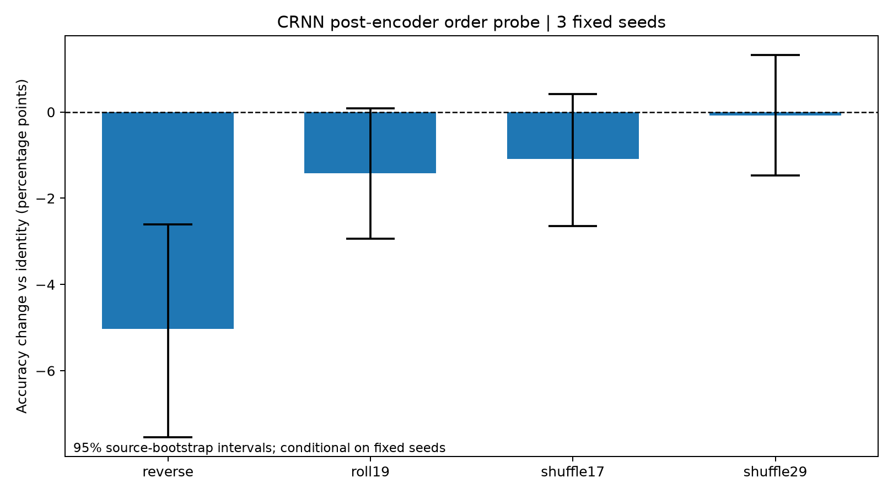

# RQ1 — Post-encoder temporal-order probe

Source-Strict development Fold4: 398 clips, 295 recording sources.
Three fixed training seeds: 101, 202, 303. CPU inference only.

## Fixed-seed mean effects and conditional intervals

| Model | Condition | Delta (pp) | 95% source-bootstrap CI (pp) |
|---|---|---:|---|
| cnn_freq | reverse | +0.000 | [0.000, 0.000] |
| cnn_freq | roll19 | +0.000 | [0.000, 0.000] |
| cnn_freq | shuffle17 | +0.000 | [0.000, 0.000] |
| cnn_freq | shuffle29 | +0.000 | [0.000, 0.000] |
| crnn_freq | reverse | -5.025 | [-7.543, -2.602] |
| crnn_freq | roll19 | -1.424 | [-2.939, 0.085] |
| crnn_freq | shuffle17 | -1.089 | [-2.640, 0.419] |
| crnn_freq | shuffle29 | -0.084 | [-1.470, 1.320] |

## Four previously selected exploratory cases

Each prediction cell lists category names in seed order 101/202/303.

| Filename | Model | Identity | Reverse | Roll19 | Shuffle17 | Shuffle29 |
|---|---|---|---|---|---|---|
| 4-189830-A-22.wav | cnn_freq | door_wood_creaks / door_wood_creaks / door_wood_creaks | door_wood_creaks / door_wood_creaks / door_wood_creaks | door_wood_creaks / door_wood_creaks / door_wood_creaks | door_wood_creaks / door_wood_creaks / door_wood_creaks | door_wood_creaks / door_wood_creaks / door_wood_creaks |
| 4-189830-A-22.wav | crnn_freq | clapping / clapping / clapping | toilet_flush / clapping / clapping | clapping / clapping / door_wood_creaks | clapping / clapping / clapping | clapping / clapping / clapping |
| 4-90014-A-42.wav | cnn_freq | cat / cat / cat | cat / cat / cat | cat / cat / cat | cat / cat / cat | cat / cat / cat |
| 4-90014-A-42.wav | crnn_freq | siren / siren / siren | siren / siren / siren | siren / siren / siren | siren / siren / siren | siren / siren / siren |
| 4-204121-A-39.wav | cnn_freq | can_opening / can_opening / can_opening | can_opening / can_opening / can_opening | can_opening / can_opening / can_opening | can_opening / can_opening / can_opening | can_opening / can_opening / can_opening |
| 4-204121-A-39.wav | crnn_freq | glass_breaking / glass_breaking / glass_breaking | crickets / snoring / glass_breaking | glass_breaking / glass_breaking / glass_breaking | glass_breaking / glass_breaking / glass_breaking | glass_breaking / glass_breaking / glass_breaking |
| 4-193480-A-40.wav | cnn_freq | helicopter / helicopter / helicopter | helicopter / helicopter / helicopter | helicopter / helicopter / helicopter | helicopter / helicopter / helicopter | helicopter / helicopter / helicopter |
| 4-193480-A-40.wav | crnn_freq | wind / helicopter / train | helicopter / helicopter / helicopter | airplane / helicopter / train | helicopter / helicopter / train | airplane / helicopter / train |

## Interpretation boundaries

Permutations modify the order of existing encoder embeddings only.
CNN pooling is compared in float64 (atol=rtol=1e-12); original float32 residuals and prediction margins are retained in metrics.csv. See numerical_note.json for the preserved first-attempt failure.
CRNN changes may reveal sensitivity to post-encoder temporal order,
but do not prove useful temporal recognition or a causal mechanism.
The four cases are exploratory, not representative class-level evidence.
Intervals resample original recording sources and average the same
three fixed seeds; they do not quantify training-seed population uncertainty.
No model robustness, label-error, or causal claim is established.
No retraining, architecture modification, or held-out test inference.
